# USSR · Tier V

[All nations and tiers](../buffs_nerfs.md) · EU v20410 → RU v14600ru · 3 November 2026

<label><strong>Find a tank</strong><input type="search" placeholder="Try is7, obj140 or xm57" aria-label="Find a tank" style="display:block;width:100%;padding:.7rem;border:1px solid #888;border-radius:4px;margin:.5rem 0;color:inherit;background:transparent"></label>

A-20 · Tier V

a20

<a href="https://tanks.gg/v20410/tank/a-20">EU stats</a> · <a href="https://tanks.gg/v14600ru/tank/a-20">RU stats</a>
<figure style="display:inline-block">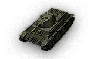<figcaption>A-20</figcaption></figure>
<strong>Penetration (mm)</strong> <b>EU</b>  AP <strong>105</strong> /  APCR <strong>147</strong> /  HE <strong>23</strong> → <b>RU</b>  AP <strong>46</strong> /  APCR <strong>62</strong> /  HE <strong>19</strong>

<strong>Damage (HP)</strong> <b>EU</b>  AP <strong>65</strong> /  APCR <strong>65</strong> /  HE <strong>80</strong> → <b>RU</b>  AP <strong>40</strong> /  APCR <strong>40</strong> /  HE <strong>50</strong>

<em>Firepower</em> 
<strong>DPM (HP/min)</strong> <small>EU</small> 2 052.63  <small>RU</small> <strong>2 454.55</strong> 
<strong>Module damage</strong> <small>EU</small> 61  <small>RU</small> <strong>50</strong> 
<strong>Rate of fire (rounds/min)</strong> <small>EU</small> 31.58  <small>RU</small> <strong>61.36</strong> 
<strong>Reload time (s)</strong> <small>EU</small> 1.90  <small>RU</small> <strong>4.20</strong> 
<strong>Caliber</strong> <small>EU</small> 45  <small>RU</small> <strong>37</strong> 
<strong>Shell velocity (m/s)</strong> <small>EU</small> 870  <small>RU</small> <strong>900</strong> 
<strong>Max range (m)</strong> <small>EU</small> 720  <small>RU</small> <strong>400</strong> 
<strong>Ammo capacity</strong> <small>EU</small> 145  <small>RU</small> <strong>210</strong> 
<strong>Potential damage</strong> <small>EU</small> 9 425  <small>RU</small> <strong>8 400</strong> 
<strong>Clip size</strong> <small>EU</small> — → <small>RU</small> <strong>6</strong> 
<strong>Clip size · burst size</strong> <small>EU</small> — → <small>RU</small> <strong>3</strong> 
<strong>Clip damage · damage</strong> <small>EU</small> — → <small>RU</small> <strong>240</strong> 
<strong>Clip damage · time (s)</strong> <small>EU</small> — → <small>RU</small> <strong>1.67</strong> 
<strong>Clip damage · burst damage · damage</strong> <small>EU</small> — → <small>RU</small> <strong>120</strong> 
<strong>Clip damage · burst damage · time (s)</strong> <small>EU</small> — → <small>RU</small> <strong>0.67</strong> 
<strong>Intra-clip reload</strong> <small>EU</small> — → <small>RU</small> <strong>0.33</strong> 

<em>Gun handling</em> 
<strong>Aim time (s)</strong> <small>EU</small> 1.63  <small>RU</small> <strong>2.21</strong> 
<strong>Dispersion (m/100 m)</strong> <small>EU</small> 0.35  <small>RU</small> <strong>0.43</strong> 
<strong>Dispersion · damaged</strong> <small>EU</small> 0.71  <small>RU</small> <strong>0.86</strong> 
<strong>Elevation (°)</strong> <small>EU</small> 25  <small>RU</small> <strong>27</strong> 

<em>Mobility</em> 
<strong>Forward speed on soft terrain (km/h)</strong> <small>EU</small> 62.17  <small>RU</small> <strong>60.13</strong> 
<strong>Engine power (hp)</strong> <small>EU</small> 550  <small>RU</small> <strong>528.64</strong> 
<strong>Weight (kg)</strong> <small>EU</small> 17 722 → <small>RU</small> <strong>17 610</strong> 
<strong>Power/weight (hp/t)</strong> <small>EU</small> 31.03  <small>RU</small> <strong>30.02</strong> 
<strong>Tank traverse on hard terrain (°/s)</strong> <small>EU</small> 50.28  <small>RU</small> <strong>49.75</strong> 
<strong>Tank traverse on medium terrain (°/s)</strong> <small>EU</small> 45.71  <small>RU</small> <strong>45.23</strong> 
<strong>Tank traverse on soft terrain (°/s)</strong> <small>EU</small> 26.46  <small>RU</small> <strong>26.18</strong> 

<em>Armor &amp; health</em> 
<strong>Health</strong> <small>EU</small> 620  <small>RU</small> <strong>560</strong> 

<em>Miscellaneous</em> 
<strong>Stationary camo · after firing</strong> <small>EU</small> 4.43  <small>RU</small> <strong>3.61</strong> 
<strong>Moving camo · after firing</strong> <small>EU</small> 4.43  <small>RU</small> <strong>3.61</strong> 

KV-1 · Tier V

kv1

<a href="https://tanks.gg/v20410/tank/kv-1">EU stats</a> · <a href="https://tanks.gg/v14600ru/tank/kv-1">RU stats</a>
<figure style="display:inline-block">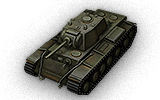<figcaption>KV-1</figcaption></figure>
<strong>Penetration (mm)</strong> <b>EU</b>  HE <strong>61</strong> /  HEAT <strong>140</strong> → <b>RU</b>  AP <strong>120</strong> /  APCR <strong>161</strong> /  HE <strong>43</strong>

<strong>Damage (HP)</strong> <b>EU</b>  HE <strong>450</strong> /  HEAT <strong>370</strong> → <b>RU</b>  AP <strong>160</strong> /  APCR <strong>160</strong> /  HE <strong>280</strong>

<em>Firepower</em> 
<strong>DPM (HP/min)</strong> <small>EU</small> 2 470.26  <small>RU</small> <strong>2 002.56</strong> 
<strong>Module damage</strong> <small>EU</small> 165  <small>RU</small> <strong>115</strong> 
<strong>Rate of fire (rounds/min)</strong> <small>EU</small> 5.49  <small>RU</small> <strong>12.52</strong> 
<strong>Reload time (s)</strong> <small>EU</small> 10.93  <small>RU</small> <strong>4.79</strong> 
<strong>Explosion radius</strong> <small>EU</small> 2.49 → <small>RU</small> <strong>—</strong> 
<strong>Caliber</strong> <small>EU</small> 122  <small>RU</small> <strong>85</strong> 
<strong>Shell velocity (m/s)</strong> <small>EU</small> 515  <small>RU</small> <strong>792</strong> 
<strong>Normalization</strong> <small>EU</small> 0  <small>RU</small> <strong>5</strong> 
<strong>Ricochet angle</strong> <small>EU</small> 90  <small>RU</small> <strong>70</strong> 
<strong>Ammo capacity</strong> <small>EU</small> 60  <small>RU</small> <strong>90</strong> 
<strong>Potential damage</strong> <small>EU</small> 27 000  <small>RU</small> <strong>14 400</strong> 

<em>Gun handling</em> 
<strong>Dispersion (m/100 m)</strong> <small>EU</small> 0.55  <small>RU</small> <strong>0.40</strong> 
<strong>Dispersion · damaged</strong> <small>EU</small> 1.09  <small>RU</small> <strong>0.81</strong> 
<strong>Elevation (°)</strong> <small>EU</small> 25  <small>RU</small> <strong>24</strong> 

<em>Mobility</em> 
<strong>Forward speed on medium terrain (km/h)</strong> <small>EU</small> 30.40  <small>RU</small> <strong>29.25</strong> 
<strong>Forward speed on soft terrain (km/h)</strong> <small>EU</small> 21.28  <small>RU</small> <strong>20.47</strong> 
<strong>Engine power (hp)</strong> <small>EU</small> 550  <small>RU</small> <strong>528.64</strong> 
<strong>Weight (kg)</strong> <small>EU</small> 49 190 → <small>RU</small> <strong>49 140</strong> 
<strong>Power/weight (hp/t)</strong> <small>EU</small> 11.18  <small>RU</small> <strong>10.76</strong> 
<strong>Tank traverse (°/s)</strong> <small>EU</small> 25.03  <small>RU</small> <strong>20.86</strong> 
<strong>Tank traverse on hard terrain (°/s)</strong> <small>EU</small> 24.57  <small>RU</small> <strong>22.36</strong> 
<strong>Tank traverse on medium terrain (°/s)</strong> <small>EU</small> 19.31  <small>RU</small> <strong>17.57</strong> 
<strong>Tank traverse on soft terrain (°/s)</strong> <small>EU</small> 13.51  <small>RU</small> <strong>12.30</strong> 

<em>Miscellaneous</em> 
<strong>Stationary camo · after firing</strong> <small>EU</small> 1.46  <small>RU</small> <strong>1.82</strong> 
<strong>Moving camo · after firing</strong> <small>EU</small> 0.73  <small>RU</small> <strong>0.91</strong> 
<strong>Shell cost</strong> <small>EU</small> 257  <small>RU</small> <strong>109</strong> 

KV-1 shielded · Tier V

kv1shielded

<a href="https://tanks.gg/v20410/tank/kv-1sh">EU stats</a> · <a href="https://tanks.gg/v14600ru/tank/kv-1e">RU stats</a>
<figure style="display:inline-block">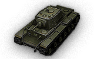<figcaption>KV-1 shielded</figcaption></figure>
<em>Mobility</em> 
<strong>Forward speed on medium terrain (km/h)</strong> <small>EU</small> 25.16  <small>RU</small> <strong>22.87</strong> 
<strong>Forward speed on soft terrain (km/h)</strong> <small>EU</small> 14.26  <small>RU</small> <strong>12.96</strong> 
<strong>Engine power (hp)</strong> <small>EU</small> 550  <small>RU</small> <strong>500</strong> 
<strong>Power/weight (hp/t)</strong> <small>EU</small> 11.24  <small>RU</small> <strong>10.22</strong> 

KV-1SA · Tier V

kv1sa

<a href="https://tanks.gg/v20410/tank/kv-1sa">EU stats</a> · <a href="https://tanks.gg/v14600ru/tank/kv-1s-s-mz">RU stats</a>
<figure style="display:inline-block">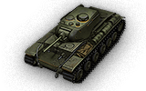<figcaption>KV-1SA</figcaption></figure>
<em>Gun handling</em> 
<strong>Aim time (s)</strong> <small>EU</small> 2.40  <small>RU</small> <strong>2.01</strong> 
<strong>Dispersion (m/100 m)</strong> <small>EU</small> 0.43  <small>RU</small> <strong>0.40</strong> 
<strong>Dispersion · damaged</strong> <small>EU</small> 0.86  <small>RU</small> <strong>0.81</strong> 
<strong>Dispersion · moving</strong> <small>EU</small> 0.24  <small>RU</small> <strong>0.27</strong> 
<strong>Dispersion · tank traverse</strong> <small>EU</small> 0.24  <small>RU</small> <strong>0.27</strong> 
<strong>Dispersion · turret traverse</strong> <small>EU</small> 0.14  <small>RU</small> <strong>0.16</strong> 

<em>Mobility</em> 
<strong>Forward speed on hard terrain (km/h)</strong> <small>EU</small> 40.20  <small>RU</small> <strong>33.50</strong> 
<strong>Forward speed on medium terrain (km/h)</strong> <small>EU</small> 34.84  <small>RU</small> <strong>29.03</strong> 
<strong>Forward speed on soft terrain (km/h)</strong> <small>EU</small> 20.10  <small>RU</small> <strong>16.75</strong> 
<strong>Engine power (hp)</strong> <small>EU</small> 600  <small>RU</small> <strong>500</strong> 
<strong>Power/weight (hp/t)</strong> <small>EU</small> 13.73  <small>RU</small> <strong>11.44</strong> 

<em>Armor &amp; health</em> 
<strong>Health</strong> <small>EU</small> 800  <small>RU</small> <strong>950</strong> 

SU-100I · EU V → RU VI

su100i

<a href="https://tanks.gg/v20410/tank/su-100i">EU stats</a> · <a href="https://tanks.gg/v14600ru/tank/su-100i">RU stats</a>
<figure style="display:inline-block">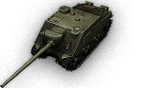<figcaption>EU · SU-100I</figcaption></figure><figure style="display:inline-block">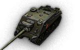<figcaption>RU · СУ-100И</figcaption></figure>
<strong>Penetration (mm)</strong> <b>EU</b>  AP <strong>175</strong> /  APCR <strong>235</strong> /  HE <strong>50</strong> → <b>RU</b>  AP <strong>171</strong> /  APCR <strong>223</strong> /  HE <strong>50</strong>

<em>General</em> 
<strong>Tier</strong> <small>EU</small> 5 → <small>RU</small> <strong>6</strong> 

<em>Firepower</em> 
<strong>DPM (HP/min)</strong> <small>EU</small> 1 580.30  <small>RU</small> <strong>2 143.15</strong> 
<strong>Rate of fire (rounds/min)</strong> <small>EU</small> 6.32  <small>RU</small> <strong>8.57</strong> 
<strong>Reload time (s)</strong> <small>EU</small> 9.49  <small>RU</small> <strong>7</strong> 
<strong>Ammo capacity</strong> <small>EU</small> 30  <small>RU</small> <strong>52</strong> 
<strong>Potential damage</strong> <small>EU</small> 7 500  <small>RU</small> <strong>13 000</strong> 

<em>Gun handling</em> 
<strong>Aim time (s)</strong> <small>EU</small> 2.40  <small>RU</small> <strong>1.73</strong> 
<strong>Dispersion (m/100 m)</strong> <small>EU</small> 0.40  <small>RU</small> <strong>0.41</strong> 
<strong>Dispersion · damaged</strong> <small>EU</small> 0.81  <small>RU</small> <strong>0.82</strong> 
<strong>Dispersion · moving</strong> <small>EU</small> 0.24  <small>RU</small> <strong>0.22</strong> 
<strong>Dispersion · tank traverse</strong> <small>EU</small> 0.24  <small>RU</small> <strong>0.22</strong> 
<strong>Dispersion · turret traverse</strong> <small>EU</small> 0.16  <small>RU</small> <strong>0.08</strong> 
<strong>Dispersion · firing</strong> <small>EU</small> 4  <small>RU</small> <strong>3.20</strong> 
<strong>Depression (°)</strong> <small>EU</small> 6  <small>RU</small> <strong>9</strong> 

<em>Mobility</em> 
<strong>Forward speed (km/h)</strong> <small>EU</small> 45  <small>RU</small> <strong>48</strong> 
<strong>Forward speed on hard terrain (km/h)</strong> <small>EU</small> 45  <small>RU</small> <strong>48</strong> 
<strong>Forward speed on medium terrain (km/h)</strong> <small>EU</small> 42.59  <small>RU</small> <strong>43.45</strong> 
<strong>Forward speed on soft terrain (km/h)</strong> <small>EU</small> 28.39  <small>RU</small> <strong>24.56</strong> 
<strong>Engine power (hp)</strong> <small>EU</small> 470  <small>RU</small> <strong>460</strong> 
<strong>Weight (kg)</strong> <small>EU</small> 30 000 → <small>RU</small> <strong>30 995</strong> 
<strong>Power/weight (hp/t)</strong> <small>EU</small> 15.67  <small>RU</small> <strong>14.84</strong> 
<strong>Terrain resist (med)</strong> <small>EU</small> 1.34  <small>RU</small> <strong>1.25</strong> 
<strong>Terrain resist (soft)</strong> <small>EU</small> 2.01  <small>RU</small> <strong>2.21</strong> 
<strong>Turret traverse (°/s)</strong> <small>EU</small> 31.29  <small>RU</small> <strong>37.55</strong> 
<strong>Tank traverse (°/s)</strong> <small>EU</small> 33.38  <small>RU</small> <strong>36.50</strong> 
<strong>Tank traverse on hard terrain (°/s)</strong> <small>EU</small> 31.71  <small>RU</small> <strong>34.68</strong> 
<strong>Tank traverse on medium terrain (°/s)</strong> <small>EU</small> 24.91  <small>RU</small> <strong>29.34</strong> 
<strong>Tank traverse on soft terrain (°/s)</strong> <small>EU</small> 16.61  <small>RU</small> <strong>16.59</strong> 

<em>Armor &amp; health</em> 
<strong>Hull armor · front (mm)</strong> <small>EU</small> 50.80  <small>RU</small> <strong>75</strong> 
<strong>Hull armor · side (mm)</strong> <small>EU</small> 38.10  <small>RU</small> <strong>50.80</strong> 
<strong>Hull armor · rear (mm)</strong> <small>EU</small> 38.10  <small>RU</small> <strong>50.80</strong> 
<strong>Health</strong> <small>EU</small> 500  <small>RU</small> <strong>620</strong> 
<strong>Health · track</strong> <small>EU</small> 100  <small>RU</small> <strong>120</strong> 
<strong>Health · ammo rack</strong> <small>EU</small> 130  <small>RU</small> <strong>160</strong> 
<strong>Health · fuel tank</strong> <small>EU</small> 150  <small>RU</small> <strong>175</strong> 

<em>Miscellaneous</em> 
<strong>Stationary camo</strong> <small>EU</small> 20.41  <small>RU</small> <strong>20.98</strong> 
<strong>Stationary camo · after firing</strong> <small>EU</small> 7.14  <small>RU</small> <strong>4.61</strong> 
<strong>Moving camo</strong> <small>EU</small> 12.26  <small>RU</small> <strong>12.60</strong> 
<strong>Moving camo · after firing</strong> <small>EU</small> 4.29  <small>RU</small> <strong>2.77</strong> 
<strong>View range (m)</strong> <small>EU</small> 340  <small>RU</small> <strong>350</strong> 
<strong>Radio range (m)</strong> <small>EU</small> 525  <small>RU</small> <strong>550</strong> 
<strong>Shell cost</strong> <small>EU</small> 284  <small>RU</small> <strong>300</strong> 

SU-122A · Tier V

su122a

<a href="https://tanks.gg/v20410/tank/su-122a">EU stats</a> · <a href="https://tanks.gg/v14600ru/tank/su-122a">RU stats</a>
<figure style="display:inline-block">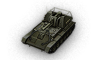<figcaption>SU-122A</figcaption></figure>
<strong>Penetration (mm)</strong> <b>EU</b>  HE <strong>38</strong> /  HE <strong>48</strong> /  AP <strong>160</strong> → <b>RU</b>  HE <strong>38</strong> /  AP <strong>160</strong>

<strong>Damage (HP)</strong> <b>EU</b>  HE <strong>550</strong> /  HE <strong>650</strong> /  AP <strong>380</strong> → <b>RU</b>  HE <strong>700</strong> /  AP <strong>450</strong>

<em>Firepower</em> 
<strong>DPM (HP/min)</strong> <small>EU</small> 1 089.21  <small>RU</small> <strong>1 622.44</strong> 
<strong>Rate of fire (rounds/min)</strong> <small>EU</small> 1.98  <small>RU</small> <strong>2.32</strong> 
<strong>Reload time (s)</strong> <small>EU</small> 30.30  <small>RU</small> <strong>25.89</strong> 
<strong>Explosion radius</strong> <small>EU</small> 6.70  <small>RU</small> <strong>5.50</strong> 
<strong>Stun duration · maximum (s)</strong> <small>EU</small> 11 → <small>RU</small> <strong>—</strong> 
<strong>Stun duration · minimum (s)</strong> <small>EU</small> 6.60 → <small>RU</small> <strong>—</strong> 
<strong>Shell velocity (m/s)</strong> <small>EU</small> 410  <small>RU</small> <strong>455</strong> 
<strong>Max range (m)</strong> <small>EU</small> 1 200.71  <small>RU</small> <strong>1 468.26</strong> 
<strong>Potential damage</strong> <small>EU</small> 9 900  <small>RU</small> <strong>12 600</strong> 

<em>Gun handling</em> 
<strong>Aim time (s)</strong> <small>EU</small> 6.71  <small>RU</small> <strong>5.75</strong> 
<strong>Dispersion (m/100 m)</strong> <small>EU</small> 0.81  <small>RU</small> <strong>0.77</strong> 
<strong>Dispersion · damaged</strong> <small>EU</small> 1.63  <small>RU</small> <strong>1.53</strong> 

<em>Mobility</em> 
<strong>Tank traverse on hard terrain (°/s)</strong> <small>EU</small> 28.88  <small>RU</small> <strong>28.85</strong> 
<strong>Tank traverse on medium terrain (°/s)</strong> <small>EU</small> 24.43  <small>RU</small> <strong>24.41</strong> 
<strong>Tank traverse on soft terrain (°/s)</strong> <small>EU</small> 15.13  <small>RU</small> <strong>15.11</strong> 

<em>Armor &amp; health</em> 
<strong>Health · engine</strong> <small>EU</small> 170  <small>RU</small> <strong>70</strong> 
<strong>Health · ammo rack</strong> <small>EU</small> 150  <small>RU</small> <strong>70</strong> 

<em>Miscellaneous</em> 
<strong>Shell cost</strong> <small>EU</small> 810  <small>RU</small> <strong>970</strong> 

SU-2-122 · Tier V

su2122

<a href="https://tanks.gg/v20410/tank/su-2-122">EU stats</a> · <a href="https://tanks.gg/v14600ru/tank/su-2-122">RU stats</a>
<figure style="display:inline-block">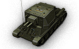<figcaption>SU-2-122</figcaption></figure>
<strong>Penetration (mm)</strong> <b>EU</b>  HE <strong>61</strong> /  HEAT <strong>140</strong> → <b>RU</b>  HE <strong>61</strong> /  HEAT <strong>140</strong> /  AP <strong>105</strong>

<strong>Damage (HP)</strong> <b>EU</b>  HE <strong>450</strong> /  HEAT <strong>370</strong> → <b>RU</b>  HE <strong>450</strong> /  HEAT <strong>370</strong> /  AP <strong>370</strong>

<em>Firepower</em> 
<strong>Ammo capacity</strong> <small>EU</small> 40  <small>RU</small> <strong>54</strong> 
<strong>Potential damage</strong> <small>EU</small> 18 000  <small>RU</small> <strong>24 300</strong> 

<em>Gun handling</em> 
<strong>Aim time (s)</strong> <small>EU</small> 2.88  <small>RU</small> <strong>2.49</strong> 
<strong>Dispersion (m/100 m)</strong> <small>EU</small> 0.46  <small>RU</small> <strong>0.42</strong> 
<strong>Dispersion · damaged</strong> <small>EU</small> 0.92  <small>RU</small> <strong>0.84</strong> 

<em>Armor &amp; health</em> 
<strong>Health</strong> <small>EU</small> 480  <small>RU</small> <strong>600</strong> 

Alternate mode

<a href="https://tanks.gg/v20410/tank/su-2-122-siege">EU stats</a> · <a href="https://tanks.gg/v14600ru/tank/su-2-122-siege">RU stats</a>
<em>Firepower</em> 
<strong>Ammo capacity</strong> <small>EU</small> 40  <small>RU</small> <strong>54</strong> 
<strong>Potential damage</strong> <small>EU</small> 18 000  <small>RU</small> <strong>24 300</strong> 

<em>Gun handling</em> 
<strong>Aim time (s)</strong> <small>EU</small> 2.88  <small>RU</small> <strong>2.49</strong> 
<strong>Dispersion (m/100 m)</strong> <small>EU</small> 0.46  <small>RU</small> <strong>0.42</strong> 
<strong>Dispersion · damaged</strong> <small>EU</small> 0.92  <small>RU</small> <strong>0.84</strong> 

<em>Armor &amp; health</em> 
<strong>Health</strong> <small>EU</small> 480  <small>RU</small> <strong>600</strong> 

SU-85 · Tier V

su85

<a href="https://tanks.gg/v20410/tank/su-85">EU stats</a> · <a href="https://tanks.gg/v14600ru/tank/su-85">RU stats</a>
<figure style="display:inline-block">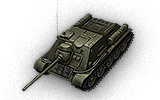<figcaption>SU-85</figcaption></figure>
<em>Firepower</em> 
<strong>DPM (HP/min)</strong> <small>EU</small> 2 048.07  <small>RU</small> <strong>1 877.40</strong> 
<strong>Rate of fire (rounds/min)</strong> <small>EU</small> 11.38  <small>RU</small> <strong>10.43</strong> 
<strong>Reload time (s)</strong> <small>EU</small> 5.27  <small>RU</small> <strong>5.75</strong> 

<em>Gun handling</em> 
<strong>Dispersion · moving</strong> <small>EU</small> 0.23  <small>RU</small> <strong>0.25</strong> 
<strong>Dispersion · tank traverse</strong> <small>EU</small> 0.23  <small>RU</small> <strong>0.25</strong> 

<em>Mobility</em> 
<strong>Forward speed on medium terrain (km/h)</strong> <small>EU</small> 49.76  <small>RU</small> <strong>48.72</strong> 
<strong>Forward speed on soft terrain (km/h)</strong> <small>EU</small> 33.17  <small>RU</small> <strong>32.48</strong> 
<strong>Engine power (hp)</strong> <small>EU</small> 540  <small>RU</small> <strong>528.64</strong> 
<strong>Power/weight (hp/t)</strong> <small>EU</small> 18.31  <small>RU</small> <strong>17.92</strong> 
<strong>Tank traverse (°/s)</strong> <small>EU</small> 39.63  <small>RU</small> <strong>36.50</strong> 
<strong>Tank traverse on hard terrain (°/s)</strong> <small>EU</small> 38.64  <small>RU</small> <strong>35.54</strong> 
<strong>Tank traverse on medium terrain (°/s)</strong> <small>EU</small> 30.36  <small>RU</small> <strong>27.92</strong> 
<strong>Tank traverse on soft terrain (°/s)</strong> <small>EU</small> 20.24  <small>RU</small> <strong>18.61</strong> 

<em>Armor &amp; health</em> 
<strong>Health</strong> <small>EU</small> 500  <small>RU</small> <strong>460</strong> 
<strong>Health · engine</strong> <small>EU</small> 170  <small>RU</small> <strong>145</strong> 
<strong>Health · track</strong> <small>EU</small> 115  <small>RU</small> <strong>100</strong> 
<strong>Track repair time (s)</strong> <small>EU</small> 11.80  <small>RU</small> <strong>12.03</strong> 

T-115 · Tier V

t115

<a href="https://tanks.gg/v20410/tank/t-115">EU stats</a> · <a href="https://tanks.gg/v14600ru/tank/t-115">RU stats</a>
<figure style="display:inline-block">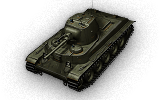<figcaption>EU · T-115</figcaption></figure><figure style="display:inline-block">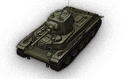<figcaption>RU · Т-115</figcaption></figure>
<strong>Penetration (mm)</strong> <b>EU</b>  AP <strong>125</strong> /  APCR <strong>156</strong> /  HE <strong>39</strong> → <b>RU</b>  AP <strong>108</strong> /  APCR <strong>124</strong> /  HE <strong>39</strong>

<strong>Damage (HP)</strong> <b>EU</b>  AP <strong>110</strong> /  APCR <strong>110</strong> /  HE <strong>156</strong> → <b>RU</b>  AP <strong>115</strong> /  APCR <strong>115</strong> /  HE <strong>165</strong>

<em>Firepower</em> 
<strong>DPM (HP/min)</strong> <small>EU</small> 2 151.19  <small>RU</small> <strong>1 439.34</strong> 
<strong>Rate of fire (rounds/min)</strong> <small>EU</small> 19.56  <small>RU</small> <strong>12.52</strong> 
<strong>Reload time (s)</strong> <small>EU</small> 3.07  <small>RU</small> <strong>4.79</strong> 
<strong>Shell velocity (m/s)</strong> <small>EU</small> 780  <small>RU</small> <strong>662</strong> 
<strong>Potential damage</strong> <small>EU</small> 8 360  <small>RU</small> <strong>8 740</strong> 

<em>Gun handling</em> 
<strong>Aim time (s)</strong> <small>EU</small> 1.92  <small>RU</small> <strong>2.21</strong> 
<strong>Dispersion (m/100 m)</strong> <small>EU</small> 0.36  <small>RU</small> <strong>0.42</strong> 
<strong>Dispersion · damaged</strong> <small>EU</small> 0.73  <small>RU</small> <strong>0.84</strong> 
<strong>Dispersion · moving</strong> <small>EU</small> 0.22  <small>RU</small> <strong>0.20</strong> 
<strong>Dispersion · tank traverse</strong> <small>EU</small> 0.22  <small>RU</small> <strong>0.20</strong> 
<strong>Elevation (°)</strong> <small>EU</small> 17  <small>RU</small> <strong>45</strong> 
<strong>Depression (°)</strong> <small>EU</small> 8  <small>RU</small> <strong>5</strong> 

<em>Mobility</em> 
<strong>Forward speed (km/h)</strong> <small>EU</small> 48  <small>RU</small> <strong>50</strong> 
<strong>Forward speed on hard terrain (km/h)</strong> <small>EU</small> 48  <small>RU</small> <strong>50</strong> 
<strong>Forward speed on medium terrain (km/h)</strong> <small>EU</small> 48  <small>RU</small> <strong>50</strong> 
<strong>Forward speed on soft terrain (km/h)</strong> <small>EU</small> 31.72  <small>RU</small> <strong>35.85</strong> 
<strong>Reverse speed (km/h)</strong> <small>EU</small> 17  <small>RU</small> <strong>20</strong> 
<strong>Engine power (hp)</strong> <small>EU</small> 550  <small>RU</small> <strong>715</strong> 
<strong>Power/weight (hp/t)</strong> <small>EU</small> 16.67  <small>RU</small> <strong>21.67</strong> 
<strong>Terrain resist (hard)</strong> <small>EU</small> 0.96  <small>RU</small> <strong>1.05</strong> 
<strong>Terrain resist (med)</strong> <small>EU</small> 1.15  <small>RU</small> <strong>1.25</strong> 
<strong>Terrain resist (soft)</strong> <small>EU</small> 1.92  <small>RU</small> <strong>2.21</strong> 
<strong>Tank traverse (°/s)</strong> <small>EU</small> 37.55  <small>RU</small> <strong>50.06</strong> 
<strong>Tank traverse on hard terrain (°/s)</strong> <small>EU</small> 37.55  <small>RU</small> <strong>50.06</strong> 
<strong>Tank traverse on medium terrain (°/s)</strong> <small>EU</small> 31.29  <small>RU</small> <strong>42.36</strong> 
<strong>Tank traverse on soft terrain (°/s)</strong> <small>EU</small> 18.77  <small>RU</small> <strong>23.94</strong> 

<em>Armor &amp; health</em> 
<strong>Hull armor · front (mm)</strong> <small>EU</small> 90  <small>RU</small> <strong>50</strong> 
<strong>Hull armor · side (mm)</strong> <small>EU</small> 45  <small>RU</small> <strong>40</strong> 
<strong>Hull armor · rear (mm)</strong> <small>EU</small> 30  <small>RU</small> <strong>40</strong> 
<strong>Turret armor · front (mm)</strong> <small>EU</small> 100  <small>RU</small> <strong>50</strong> 
<strong>Turret armor · side (mm)</strong> <small>EU</small> 60  <small>RU</small> <strong>40</strong> 
<strong>Turret armor · rear (mm)</strong> <small>EU</small> 30  <small>RU</small> <strong>40</strong> 
<strong>Health</strong> <small>EU</small> 720  <small>RU</small> <strong>560</strong> 
<strong>Health · engine</strong> <small>EU</small> 170  <small>RU</small> <strong>85</strong> 
<strong>Health · track</strong> <small>EU</small> 115  <small>RU</small> <strong>110</strong> 
<strong>Health · ammo rack</strong> <small>EU</small> 150  <small>RU</small> <strong>180</strong> 
<strong>Track repair time (s)</strong> <small>EU</small> 11.80  <small>RU</small> <strong>12.03</strong> 

<em>Miscellaneous</em> 
<strong>Stationary camo</strong> <small>EU</small> 12.54  <small>RU</small> <strong>12.48</strong> 
<strong>Stationary camo · after firing</strong> <small>EU</small> 3.26  <small>RU</small> <strong>3.12</strong> 
<strong>Moving camo</strong> <small>EU</small> 9.40  <small>RU</small> <strong>9.35</strong> 
<strong>Moving camo · after firing</strong> <small>EU</small> 2.45  <small>RU</small> <strong>2.34</strong> 
<strong>View range (m)</strong> <small>EU</small> 340  <small>RU</small> <strong>330</strong> 
<strong>Radio range (m)</strong> <small>EU</small> 396.34  <small>RU</small> <strong>458.92</strong> 
<strong>Shell cost</strong> <small>EU</small> 89  <small>RU</small> <strong>80</strong> 

T-34 · Tier V

t34

<a href="https://tanks.gg/v20410/tank/t-34">EU stats</a> · <a href="https://tanks.gg/v14600ru/tank/t-34">RU stats</a>
<figure style="display:inline-block">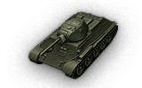<figcaption>T-34</figcaption></figure>
<strong>Penetration (mm)</strong> <b>EU</b>  AP <strong>112</strong> /  APCR <strong>189</strong> /  HE <strong>29</strong> → <b>RU</b>  AP <strong>125</strong> /  APCR <strong>156</strong> /  HE <strong>39</strong>

<strong>Damage (HP)</strong> <b>EU</b>  AP <strong>85</strong> /  APCR <strong>85</strong> /  HE <strong>95</strong> → <b>RU</b>  AP <strong>115</strong> /  APCR <strong>110</strong> /  HE <strong>165</strong>

<em>Firepower</em> 
<strong>DPM (HP/min)</strong> <small>EU</small> 2 312.74  <small>RU</small> <strong>1 262.58</strong> 
<strong>Module damage</strong> <small>EU</small> 76  <small>RU</small> <strong>105</strong> 
<strong>Rate of fire (rounds/min)</strong> <small>EU</small> 27.21  <small>RU</small> <strong>10.98</strong> 
<strong>Reload time (s)</strong> <small>EU</small> 2.21  <small>RU</small> <strong>5.47</strong> 
<strong>Caliber</strong> <small>EU</small> 57  <small>RU</small> <strong>76</strong> 
<strong>Shell velocity (m/s)</strong> <small>EU</small> 990  <small>RU</small> <strong>816</strong> 
<strong>Ammo capacity</strong> <small>EU</small> 115  <small>RU</small> <strong>85</strong> 

<em>Gun handling</em> 
<strong>Aim time (s)</strong> <small>EU</small> 2.30  <small>RU</small> <strong>2.90</strong> 
<strong>Dispersion (m/100 m)</strong> <small>EU</small> 0.34  <small>RU</small> <strong>0.41</strong> 
<strong>Dispersion · damaged</strong> <small>EU</small> 0.68  <small>RU</small> <strong>0.82</strong> 
<strong>Elevation (°)</strong> <small>EU</small> 20  <small>RU</small> <strong>26</strong> 

<em>Mobility</em> 
<strong>Forward speed on medium terrain (km/h)</strong> <small>EU</small> 56  <small>RU</small> <strong>52.66</strong> 
<strong>Forward speed on soft terrain (km/h)</strong> <small>EU</small> 31.67  <small>RU</small> <strong>29.76</strong> 
<strong>Engine power (hp)</strong> <small>EU</small> 550  <small>RU</small> <strong>528.64</strong> 
<strong>Weight (kg)</strong> <small>EU</small> 28 740 → <small>RU</small> <strong>29 390</strong> 
<strong>Power/weight (hp/t)</strong> <small>EU</small> 19.14  <small>RU</small> <strong>17.99</strong> 
<strong>Tank traverse (°/s)</strong> <small>EU</small> 46.93  <small>RU</small> <strong>41.72</strong> 
<strong>Tank traverse on hard terrain (°/s)</strong> <small>EU</small> 49.15  <small>RU</small> <strong>41.31</strong> 
<strong>Tank traverse on medium terrain (°/s)</strong> <small>EU</small> 41.59  <small>RU</small> <strong>34.96</strong> 
<strong>Tank traverse on soft terrain (°/s)</strong> <small>EU</small> 23.51  <small>RU</small> <strong>19.76</strong> 

<em>Armor &amp; health</em> 
<strong>Health</strong> <small>EU</small> 650  <small>RU</small> <strong>590</strong> 

<em>Miscellaneous</em> 
<strong>Stationary camo · after firing</strong> <small>EU</small> 3.84  <small>RU</small> <strong>3.57</strong> 
<strong>Moving camo · after firing</strong> <small>EU</small> 2.88  <small>RU</small> <strong>2.68</strong> 
<strong>Shell cost</strong> <small>EU</small> 56  <small>RU</small> <strong>80</strong> 

T-34 shielded · Tier V

t34shielded

<a href="https://tanks.gg/v20410/tank/t-34s">EU stats</a> · <a href="https://tanks.gg/v14600ru/tank/t-34e">RU stats</a>
<figure style="display:inline-block">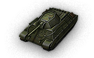<figcaption>T-34 shielded</figcaption></figure>
<em>Gun handling</em> 
<strong>Aim time (s)</strong> <small>EU</small> 2.10  <small>RU</small> <strong>2.30</strong> 
<strong>Dispersion (m/100 m)</strong> <small>EU</small> 0.41  <small>RU</small> <strong>0.43</strong> 
<strong>Dispersion · damaged</strong> <small>EU</small> 0.82  <small>RU</small> <strong>0.86</strong> 
<strong>Dispersion · turret traverse</strong> <small>EU</small> 0.12  <small>RU</small> <strong>0.14</strong> 

<em>Mobility</em> 
<strong>Forward speed on hard terrain (km/h)</strong> <small>EU</small> 56  <small>RU</small> <strong>54.23</strong> 
<strong>Forward speed on medium terrain (km/h)</strong> <small>EU</small> 50.48  <small>RU</small> <strong>45.89</strong> 
<strong>Forward speed on soft terrain (km/h)</strong> <small>EU</small> 28.53  <small>RU</small> <strong>25.94</strong> 
<strong>Engine power (hp)</strong> <small>EU</small> 550  <small>RU</small> <strong>500</strong> 
<strong>Power/weight (hp/t)</strong> <small>EU</small> 17.24  <small>RU</small> <strong>15.67</strong> 

