# USSR · Tier VI

[All nations and tiers](../buffs_nerfs.md) · EU v20410 → RU v14600ru · 3 November 2026

<label><strong>Find a tank</strong><input type="search" placeholder="Try is7, obj140 or xm57" aria-label="Find a tank" style="display:block;width:100%;padding:.7rem;border:1px solid #888;border-radius:4px;margin:.5rem 0;color:inherit;background:transparent"></label>

A-43 · Tier VI

a43

<a href="https://tanks.gg/v20410/tank/a-43">EU stats</a> · <a href="https://tanks.gg/v14600ru/tank/a-43">RU stats</a>
<figure style="display:inline-block">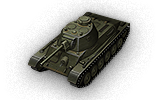<figcaption>A-43</figcaption></figure>
<strong>Penetration (mm)</strong> <b>EU</b>  AP <strong>145</strong> /  APCR <strong>189</strong> /  HE <strong>29</strong> → <b>RU</b>  AP <strong>125</strong> /  APCR <strong>156</strong> /  HE <strong>39</strong>

<strong>Damage (HP)</strong> <b>EU</b>  AP <strong>85</strong> /  APCR <strong>85</strong> /  HE <strong>95</strong> → <b>RU</b>  AP <strong>115</strong> /  APCR <strong>110</strong> /  HE <strong>165</strong>

<em>Firepower</em> 
<strong>DPM (HP/min)</strong> <small>EU</small> 2 312.74  <small>RU</small> <strong>2 180.82</strong> 
<strong>Module damage</strong> <small>EU</small> 76  <small>RU</small> <strong>105</strong> 
<strong>Rate of fire (rounds/min)</strong> <small>EU</small> 27.21  <small>RU</small> <strong>18.96</strong> 
<strong>Reload time (s)</strong> <small>EU</small> 2.21  <small>RU</small> <strong>3.16</strong> 
<strong>Caliber</strong> <small>EU</small> 57  <small>RU</small> <strong>76</strong> 
<strong>Shell velocity (m/s)</strong> <small>EU</small> 990  <small>RU</small> <strong>816</strong> 
<strong>Ammo capacity</strong> <small>EU</small> 150  <small>RU</small> <strong>120</strong> 
<strong>Potential damage</strong> <small>EU</small> 12 750  <small>RU</small> <strong>13 800</strong> 

<em>Gun handling</em> 
<strong>Dispersion (m/100 m)</strong> <small>EU</small> 0.33  <small>RU</small> <strong>0.39</strong> 
<strong>Dispersion · damaged</strong> <small>EU</small> 0.65  <small>RU</small> <strong>0.79</strong> 
<strong>Dispersion · firing</strong> <small>EU</small> 3  <small>RU</small> <strong>3.50</strong> 

<em>Mobility</em> 
<strong>Forward speed on soft terrain (km/h)</strong> <small>EU</small> 52.86  <small>RU</small> <strong>51.17</strong> 
<strong>Weight (kg)</strong> <small>EU</small> 27 105 → <small>RU</small> <strong>27 755</strong> 
<strong>Power/weight (hp/t)</strong> <small>EU</small> 23.61  <small>RU</small> <strong>22.86</strong> 
<strong>Tank traverse (°/s)</strong> <small>EU</small> 57.36  <small>RU</small> <strong>45.89</strong> 
<strong>Tank traverse on hard terrain (°/s)</strong> <small>EU</small> 63.05  <small>RU</small> <strong>53.57</strong> 
<strong>Tank traverse on medium terrain (°/s)</strong> <small>EU</small> 56.05  <small>RU</small> <strong>47.62</strong> 
<strong>Tank traverse on soft terrain (°/s)</strong> <small>EU</small> 29.67  <small>RU</small> <strong>25.21</strong> 

<em>Armor &amp; health</em> 
<strong>Health</strong> <small>EU</small> 900  <small>RU</small> <strong>820</strong> 
<strong>Health · engine</strong> <small>EU</small> 205  <small>RU</small> <strong>120</strong> 

<em>Miscellaneous</em> 
<strong>Stationary camo · after firing</strong> <small>EU</small> 3.23  <small>RU</small> <strong>3</strong> 
<strong>Moving camo · after firing</strong> <small>EU</small> 2.43  <small>RU</small> <strong>2.25</strong> 
<strong>Shell cost</strong> <small>EU</small> 56  <small>RU</small> <strong>80</strong> 

KV-1S · Tier VI

kv1s

<a href="https://tanks.gg/v20410/tank/kv-1s">EU stats</a> · <a href="https://tanks.gg/v14600ru/tank/kv-1s">RU stats</a>
<figure style="display:inline-block">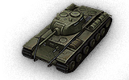<figcaption>KV-1S</figcaption></figure>
<strong>Penetration (mm)</strong> <b>EU</b>  HE <strong>61</strong> /  HEAT <strong>150</strong> → <b>RU</b>  AP <strong>150</strong> /  APCR <strong>196</strong> /  HE <strong>43</strong>

<strong>Damage (HP)</strong> <b>EU</b>  HE <strong>450</strong> /  HEAT <strong>370</strong> → <b>RU</b>  AP <strong>160</strong> /  APCR <strong>160</strong> /  HE <strong>280</strong>

<em>Firepower</em> 
<strong>DPM (HP/min)</strong> <small>EU</small> 2 560.09  <small>RU</small> <strong>2 176.70</strong> 
<strong>Module damage</strong> <small>EU</small> 165  <small>RU</small> <strong>115</strong> 
<strong>Rate of fire (rounds/min)</strong> <small>EU</small> 5.69  <small>RU</small> <strong>13.60</strong> 
<strong>Reload time (s)</strong> <small>EU</small> 10.55  <small>RU</small> <strong>4.41</strong> 
<strong>Explosion radius</strong> <small>EU</small> 2.49 → <small>RU</small> <strong>—</strong> 
<strong>Caliber</strong> <small>EU</small> 122  <small>RU</small> <strong>85</strong> 
<strong>Shell velocity (m/s)</strong> <small>EU</small> 515  <small>RU</small> <strong>800</strong> 
<strong>Normalization</strong> <small>EU</small> 0  <small>RU</small> <strong>5</strong> 
<strong>Ricochet angle</strong> <small>EU</small> 90  <small>RU</small> <strong>70</strong> 
<strong>Ammo capacity</strong> <small>EU</small> 85  <small>RU</small> <strong>70</strong> 
<strong>Potential damage</strong> <small>EU</small> 38 250  <small>RU</small> <strong>11 200</strong> 

<em>Gun handling</em> 
<strong>Aim time (s)</strong> <small>EU</small> 2.78  <small>RU</small> <strong>2.01</strong> 
<strong>Dispersion (m/100 m)</strong> <small>EU</small> 0.46  <small>RU</small> <strong>0.36</strong> 
<strong>Dispersion · damaged</strong> <small>EU</small> 0.92  <small>RU</small> <strong>0.73</strong> 
<strong>Dispersion · turret traverse</strong> <small>EU</small> 0.14  <small>RU</small> <strong>0.11</strong> 
<strong>Elevation (°)</strong> <small>EU</small> 20  <small>RU</small> <strong>15</strong> 

<em>Mobility</em> 
<strong>Forward speed on medium terrain (km/h)</strong> <small>EU</small> 43  <small>RU</small> <strong>42.17</strong> 
<strong>Forward speed on soft terrain (km/h)</strong> <small>EU</small> 24.74  <small>RU</small> <strong>23.83</strong> 
<strong>Engine power (hp)</strong> <small>EU</small> 660  <small>RU</small> <strong>634.37</strong> 
<strong>Weight (kg)</strong> <small>EU</small> 44 145 → <small>RU</small> <strong>44 045</strong> 
<strong>Power/weight (hp/t)</strong> <small>EU</small> 14.95  <small>RU</small> <strong>14.40</strong> 
<strong>Tank traverse on hard terrain (°/s)</strong> <small>EU</small> 44.03  <small>RU</small> <strong>46.52</strong> 
<strong>Tank traverse on medium terrain (°/s)</strong> <small>EU</small> 40.65  <small>RU</small> <strong>42.94</strong> 
<strong>Tank traverse on soft terrain (°/s)</strong> <small>EU</small> 22.97  <small>RU</small> <strong>24.27</strong> 

<em>Armor &amp; health</em> 
<strong>Health</strong> <small>EU</small> 1 150  <small>RU</small> <strong>1 100</strong> 

<em>Miscellaneous</em> 
<strong>Stationary camo · after firing</strong> <small>EU</small> 1.57  <small>RU</small> <strong>1.97</strong> 
<strong>Moving camo · after firing</strong> <small>EU</small> 0.79  <small>RU</small> <strong>0.98</strong> 
<strong>Shell cost</strong> <small>EU</small> 257  <small>RU</small> <strong>109</strong> 

KV-2 · Tier VI

kv2

<a href="https://tanks.gg/v20410/tank/kv-2">EU stats</a> · <a href="https://tanks.gg/v14600ru/tank/kv-2">RU stats</a>
<figure style="display:inline-block"><figcaption>KV-2</figcaption></figure>
<strong>Penetration (mm)</strong> <b>EU</b>  AP <strong>110</strong> /  AP <strong>136</strong> /  HE <strong>86</strong> → <b>RU</b>  AP <strong>167</strong> /  APCR <strong>219</strong> /  HE <strong>54</strong>

<strong>Damage (HP)</strong> <b>EU</b>  AP <strong>700</strong> /  AP <strong>700</strong> /  HE <strong>910</strong> → <b>RU</b>  AP <strong>300</strong> /  APCR <strong>300</strong> /  HE <strong>360</strong>

<em>Firepower</em> 
<strong>DPM (HP/min)</strong> <small>EU</small> 1 825.25  <small>RU</small> <strong>1 935.46</strong> 
<strong>Module damage</strong> <small>EU</small> 203  <small>RU</small> <strong>150</strong> 
<strong>Rate of fire (rounds/min)</strong> <small>EU</small> 2.61  <small>RU</small> <strong>6.45</strong> 
<strong>Reload time (s)</strong> <small>EU</small> 23.01  <small>RU</small> <strong>9.30</strong> 
<strong>Caliber</strong> <small>EU</small> 152  <small>RU</small> <strong>107</strong> 
<strong>Shell velocity (m/s)</strong> <small>EU</small> 525  <small>RU</small> <strong>830</strong> 
<strong>Ammo capacity</strong> <small>EU</small> 36  <small>RU</small> <strong>50</strong> 
<strong>Potential damage</strong> <small>EU</small> 25 200  <small>RU</small> <strong>15 000</strong> 

<em>Gun handling</em> 
<strong>Aim time (s)</strong> <small>EU</small> 3.64  <small>RU</small> <strong>3.26</strong> 
<strong>Dispersion (m/100 m)</strong> <small>EU</small> 0.58  <small>RU</small> <strong>0.43</strong> 
<strong>Dispersion · damaged</strong> <small>EU</small> 1.15  <small>RU</small> <strong>0.86</strong> 
<strong>Dispersion · firing</strong> <small>EU</small> 5  <small>RU</small> <strong>4</strong> 
<strong>Elevation (°)</strong> <small>EU</small> 12  <small>RU</small> <strong>18</strong> 

<em>Mobility</em> 
<strong>Forward speed on hard terrain (km/h)</strong> <small>EU</small> 32.83  <small>RU</small> <strong>32.77</strong> 
<strong>Forward speed on medium terrain (km/h)</strong> <small>EU</small> 28.72  <small>RU</small> <strong>28.67</strong> 
<strong>Forward speed on soft terrain (km/h)</strong> <small>EU</small> 16.41  <small>RU</small> <strong>16.38</strong> 
<strong>Weight (kg)</strong> <small>EU</small> 53 000 → <small>RU</small> <strong>53 100</strong> 
<strong>Power/weight (hp/t)</strong> <small>EU</small> 12.08  <small>RU</small> <strong>12.05</strong> 
<strong>Tank traverse (°/s)</strong> <small>EU</small> 25.03  <small>RU</small> <strong>20.86</strong> 
<strong>Tank traverse on hard terrain (°/s)</strong> <small>EU</small> 27.15  <small>RU</small> <strong>24.33</strong> 
<strong>Tank traverse on medium terrain (°/s)</strong> <small>EU</small> 23.76  <small>RU</small> <strong>21.29</strong> 
<strong>Tank traverse on soft terrain (°/s)</strong> <small>EU</small> 13.58  <small>RU</small> <strong>12.17</strong> 

<em>Armor &amp; health</em> 
<strong>Health · engine</strong> <small>EU</small> 205  <small>RU</small> <strong>120</strong> 

<em>Miscellaneous</em> 
<strong>Stationary camo · after firing</strong> <small>EU</small> 0.61  <small>RU</small> <strong>0.89</strong> 
<strong>Moving camo · after firing</strong> <small>EU</small> 0.30  <small>RU</small> <strong>0.45</strong> 
<strong>Shell cost</strong> <small>EU</small> 725  <small>RU</small> <strong>270</strong> 

KV-2 (R) · Tier VI

kv2r

<a href="https://tanks.gg/v20410/tank/kv-2-r">EU stats</a> · <a href="https://tanks.gg/v14600ru/tank/kv-2-r">RU stats</a>
<figure style="display:inline-block">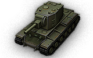<figcaption>KV-2 (R)</figcaption></figure>
<em>Mobility</em> 
<strong>Tank traverse (°/s)</strong> <small>EU</small> 25.03  <small>RU</small> <strong>20.86</strong> 
<strong>Tank traverse on hard terrain (°/s)</strong> <small>EU</small> 25.03  <small>RU</small> <strong>20.86</strong> 
<strong>Tank traverse on medium terrain (°/s)</strong> <small>EU</small> 21.90  <small>RU</small> <strong>18.25</strong> 
<strong>Tank traverse on soft terrain (°/s)</strong> <small>EU</small> 12.52  <small>RU</small> <strong>10.43</strong> 

<em>Armor &amp; health</em> 
<strong>Health · engine</strong> <small>EU</small> 205  <small>RU</small> <strong>120</strong> 

Loza&#x27;s M4-A2 Sherman · Tier VI

lozasm4a2sherman

<a href="https://tanks.gg/v20410/tank/lozas-m4-a2">EU stats</a> · <a href="https://tanks.gg/v14600ru/tank/m4-a2-lozy">RU stats</a>
<figure style="display:inline-block">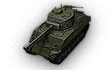<figcaption>Loza&#x27;s M4-A2 Sherman</figcaption></figure>
<strong>Penetration (mm)</strong> <b>EU</b>  AP <strong>143</strong> /  APCR <strong>185</strong> /  HE <strong>38</strong> → <b>RU</b>  AP <strong>128</strong> /  APCR <strong>177</strong> /  HE <strong>38</strong>

<em>Gun handling</em> 
<strong>Aim time (s)</strong> <small>EU</small> 1.92  <small>RU</small> <strong>2.21</strong> 
<strong>Dispersion · firing</strong> <small>EU</small> 3  <small>RU</small> <strong>3.50</strong> 

<em>Mobility</em> 
<strong>Forward speed on medium terrain (km/h)</strong> <small>EU</small> 51.40  <small>RU</small> <strong>48.38</strong> 
<strong>Forward speed on soft terrain (km/h)</strong> <small>EU</small> 37.20  <small>RU</small> <strong>32.25</strong> 
<strong>Engine power (hp)</strong> <small>EU</small> 500  <small>RU</small> <strong>433.49</strong> 
<strong>Power/weight (hp/t)</strong> <small>EU</small> 14.66  <small>RU</small> <strong>12.71</strong> 

MT-25 · Tier VI

mt25

<a href="https://tanks.gg/v20410/tank/mt-25">EU stats</a> · <a href="https://tanks.gg/v14600ru/tank/mt-25">RU stats</a>
<figure style="display:inline-block">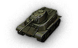<figcaption>MT-25</figcaption></figure>
<strong>Damage (HP)</strong> <b>EU</b>  AP <strong>115</strong> /  APCR <strong>115</strong> /  HE <strong>165</strong> → <b>RU</b>  AP <strong>115</strong> /  APCR <strong>110</strong> /  HE <strong>165</strong>

<em>Mobility</em> 
<strong>Forward speed (km/h)</strong> <small>EU</small> 67  <small>RU</small> <strong>62</strong> 
<strong>Forward speed on hard terrain (km/h)</strong> <small>EU</small> 67  <small>RU</small> <strong>62</strong> 
<strong>Forward speed on medium terrain (km/h)</strong> <small>EU</small> 67  <small>RU</small> <strong>62</strong> 
<strong>Forward speed on soft terrain (km/h)</strong> <small>EU</small> 67  <small>RU</small> <strong>62</strong> 
<strong>Engine power (hp)</strong> <small>EU</small> 800  <small>RU</small> <strong>740</strong> 
<strong>Power/weight (hp/t)</strong> <small>EU</small> 30.63  <small>RU</small> <strong>28.33</strong> 
<strong>Tank traverse on hard terrain (°/s)</strong> <small>EU</small> 52.07  <small>RU</small> <strong>59.24</strong> 
<strong>Tank traverse on medium terrain (°/s)</strong> <small>EU</small> 44.63  <small>RU</small> <strong>50.78</strong> 
<strong>Tank traverse on soft terrain (°/s)</strong> <small>EU</small> 20.83  <small>RU</small> <strong>23.70</strong> 

<em>Armor &amp; health</em> 
<strong>Health</strong> <small>EU</small> 800  <small>RU</small> <strong>660</strong> 

<em>Miscellaneous</em> 
<strong>View range (m)</strong> <small>EU</small> 370  <small>RU</small> <strong>360</strong> 

SU-100 · Tier VI

su100

<a href="https://tanks.gg/v20410/tank/su-100">EU stats</a> · <a href="https://tanks.gg/v14600ru/tank/su-100">RU stats</a>
<figure style="display:inline-block">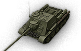<figcaption>SU-100</figcaption></figure>
<em>Mobility</em> 
<strong>Forward speed on medium terrain (km/h)</strong> <small>EU</small> 49.92  <small>RU</small> <strong>45.74</strong> 
<strong>Forward speed on soft terrain (km/h)</strong> <small>EU</small> 33.28  <small>RU</small> <strong>30.49</strong> 
<strong>Engine power (hp)</strong> <small>EU</small> 600  <small>RU</small> <strong>549.79</strong> 
<strong>Power/weight (hp/t)</strong> <small>EU</small> 18.36  <small>RU</small> <strong>16.83</strong> 
<strong>Tank traverse (°/s)</strong> <small>EU</small> 39.63  <small>RU</small> <strong>37.55</strong> 
<strong>Tank traverse on hard terrain (°/s)</strong> <small>EU</small> 40.64  <small>RU</small> <strong>35.83</strong> 
<strong>Tank traverse on medium terrain (°/s)</strong> <small>EU</small> 31.93  <small>RU</small> <strong>28.15</strong> 
<strong>Tank traverse on soft terrain (°/s)</strong> <small>EU</small> 21.29  <small>RU</small> <strong>18.77</strong> 

<em>Armor &amp; health</em> 
<strong>Health · engine</strong> <small>EU</small> 205  <small>RU</small> <strong>190</strong> 
<strong>Health · track</strong> <small>EU</small> 145  <small>RU</small> <strong>120</strong> 
<strong>Track repair time (s)</strong> <small>EU</small> 11.62  <small>RU</small> <strong>12.03</strong> 

<em>Miscellaneous</em> 
<strong>View range (m)</strong> <small>EU</small> 320  <small>RU</small> <strong>350</strong> 

SU-8 · Tier VI

su8

<a href="https://tanks.gg/v20410/tank/su-8">EU stats</a> · <a href="https://tanks.gg/v14600ru/tank/su-8">RU stats</a>
<figure style="display:inline-block">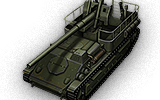<figcaption>SU-8</figcaption></figure>
<strong>Penetration (mm)</strong> <b>EU</b>  HE <strong>38</strong> /  HE <strong>48</strong> /  AP <strong>182</strong> → <b>RU</b>  HE <strong>38</strong> /  AP <strong>182</strong>

<strong>Damage (HP)</strong> <b>EU</b>  HE <strong>550</strong> /  HE <strong>650</strong> /  AP <strong>380</strong> → <b>RU</b>  HE <strong>700</strong> /  AP <strong>450</strong>

<em>Firepower</em> 
<strong>DPM (HP/min)</strong> <small>EU</small> 1 543.45  <small>RU</small> <strong>1 904.61</strong> 
<strong>Rate of fire (rounds/min)</strong> <small>EU</small> 2.81  <small>RU</small> <strong>2.72</strong> 
<strong>Reload time (s)</strong> <small>EU</small> 21.38  <small>RU</small> <strong>22.05</strong> 
<strong>Explosion radius</strong> <small>EU</small> 6.70  <small>RU</small> <strong>5.50</strong> 
<strong>Stun duration · maximum (s)</strong> <small>EU</small> 11 → <small>RU</small> <strong>—</strong> 
<strong>Stun duration · minimum (s)</strong> <small>EU</small> 6.60 → <small>RU</small> <strong>—</strong> 
<strong>Max range (m)</strong> <small>EU</small> 1 343.50  <small>RU</small> <strong>1 467.37</strong> 
<strong>Potential damage</strong> <small>EU</small> 14 300  <small>RU</small> <strong>18 200</strong> 

<em>Mobility</em> 
<strong>Tank traverse on hard terrain (°/s)</strong> <small>EU</small> 24.52  <small>RU</small> <strong>24.51</strong> 
<strong>Tank traverse on medium terrain (°/s)</strong> <small>EU</small> 21.02  <small>RU</small> <strong>21.01</strong> 

<em>Armor &amp; health</em> 
<strong>Health · engine</strong> <small>EU</small> 205  <small>RU</small> <strong>90</strong> 
<strong>Health · ammo rack</strong> <small>EU</small> 170  <small>RU</small> <strong>80</strong> 

<em>Miscellaneous</em> 
<strong>Shell cost</strong> <small>EU</small> 810  <small>RU</small> <strong>970</strong> 

T-150 · Tier VI

t150

<a href="https://tanks.gg/v20410/tank/t-150">EU stats</a> · <a href="https://tanks.gg/v14600ru/tank/t-150">RU stats</a>
<figure style="display:inline-block">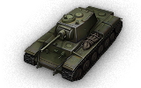<figcaption>T-150</figcaption></figure>
<em>Gun handling</em> 
<strong>Aim time (s)</strong> <small>EU</small> 3.07  <small>RU</small> <strong>3.26</strong> 
<strong>Dispersion (m/100 m)</strong> <small>EU</small> 0.38  <small>RU</small> <strong>0.43</strong> 
<strong>Dispersion · damaged</strong> <small>EU</small> 0.77  <small>RU</small> <strong>0.86</strong> 
<strong>Dispersion · turret traverse</strong> <small>EU</small> 0.14  <small>RU</small> <strong>0.20</strong> 

<em>Mobility</em> 
<strong>Forward speed on medium terrain (km/h)</strong> <small>EU</small> 35  <small>RU</small> <strong>34.58</strong> 
<strong>Forward speed on soft terrain (km/h)</strong> <small>EU</small> 22.20  <small>RU</small> <strong>21.61</strong> 
<strong>Engine power (hp)</strong> <small>EU</small> 760  <small>RU</small> <strong>740.10</strong> 
<strong>Power/weight (hp/t)</strong> <small>EU</small> 14  <small>RU</small> <strong>13.63</strong> 
<strong>Tank traverse (°/s)</strong> <small>EU</small> 29.20  <small>RU</small> <strong>18.77</strong> 
<strong>Tank traverse on hard terrain (°/s)</strong> <small>EU</small> 29.95  <small>RU</small> <strong>24.30</strong> 
<strong>Tank traverse on medium terrain (°/s)</strong> <small>EU</small> 25.95  <small>RU</small> <strong>21.06</strong> 
<strong>Tank traverse on soft terrain (°/s)</strong> <small>EU</small> 16.22  <small>RU</small> <strong>13.16</strong> 

<em>Armor &amp; health</em> 
<strong>Health</strong> <small>EU</small> 1 050  <small>RU</small> <strong>990</strong> 

T-34-85 · Tier VI

t3485

<a href="https://tanks.gg/v20410/tank/t-34-85">EU stats</a> · <a href="https://tanks.gg/v14600ru/tank/t-34-85">RU stats</a>
<figure style="display:inline-block">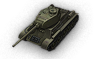<figcaption>T-34-85</figcaption></figure>
<em>Mobility</em> 
<strong>Forward speed on soft terrain (km/h)</strong> <small>EU</small> 35.01  <small>RU</small> <strong>34.17</strong> 
<strong>Engine power (hp)</strong> <small>EU</small> 650  <small>RU</small> <strong>634.37</strong> 
<strong>Power/weight (hp/t)</strong> <small>EU</small> 19.32  <small>RU</small> <strong>18.85</strong> 
<strong>Tank traverse (°/s)</strong> <small>EU</small> 49.02  <small>RU</small> <strong>39.63</strong> 
<strong>Tank traverse on hard terrain (°/s)</strong> <small>EU</small> 52.24  <small>RU</small> <strong>45.75</strong> 
<strong>Tank traverse on medium terrain (°/s)</strong> <small>EU</small> 44.20  <small>RU</small> <strong>38.71</strong> 
<strong>Tank traverse on soft terrain (°/s)</strong> <small>EU</small> 27.36  <small>RU</small> <strong>23.97</strong> 

<em>Armor &amp; health</em> 
<strong>Health</strong> <small>EU</small> 950  <small>RU</small> <strong>810</strong> 
<strong>Health · engine</strong> <small>EU</small> 190  <small>RU</small> <strong>260</strong> 

<em>Miscellaneous</em> 
<strong>Fire chance (%)</strong> <small>EU</small> 15  <small>RU</small> <strong>12</strong> 

T-34-85 Rudy · Tier VI

t3485rudy

<a href="https://tanks.gg/v20410/tank/rudy-ussr">EU stats</a> · <a href="https://tanks.gg/v14600ru/tank/rudy-ussr">RU stats</a>
<figure style="display:inline-block">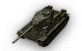<figcaption>T-34-85 Rudy</figcaption></figure>
<em>Mobility</em> 
<strong>Forward speed on soft terrain (km/h)</strong> <small>EU</small> 36.46  <small>RU</small> <strong>34.41</strong> 
<strong>Engine power (hp)</strong> <small>EU</small> 560  <small>RU</small> <strong>528.64</strong> 
<strong>Power/weight (hp/t)</strong> <small>EU</small> 17.24  <small>RU</small> <strong>16.28</strong> 

T-34-85M · Tier VI

t3485m

<a href="https://tanks.gg/v20410/tank/t-34-85m">EU stats</a> · <a href="https://tanks.gg/v14600ru/tank/t-34-85m">RU stats</a>
<figure style="display:inline-block">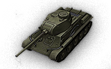<figcaption>T-34-85M</figcaption></figure>
<em>Mobility</em> 
<strong>Forward speed on hard terrain (km/h)</strong> <small>EU</small> 53  <small>RU</small> <strong>52.02</strong> 
<strong>Forward speed on medium terrain (km/h)</strong> <small>EU</small> 51.33  <small>RU</small> <strong>50.25</strong> 
<strong>Forward speed on soft terrain (km/h)</strong> <small>EU</small> 30.20  <small>RU</small> <strong>29.56</strong> 
<strong>Engine power (hp)</strong> <small>EU</small> 540  <small>RU</small> <strong>528.64</strong> 
<strong>Power/weight (hp/t)</strong> <small>EU</small> 16.75  <small>RU</small> <strong>16.40</strong> 

