# USSR · Tier VII

[All nations and tiers](../buffs_nerfs.md) · EU v20410 → RU v14600ru · 3 November 2026

<label><strong>Find a tank</strong><input type="search" placeholder="Try is7, obj140 or xm57" aria-label="Find a tank" style="display:block;width:100%;padding:.7rem;border:1px solid #888;border-radius:4px;margin:.5rem 0;color:inherit;background:transparent"></label>

A-44 · Tier VII

a44

<a href="https://tanks.gg/v20410/tank/a-44">EU stats</a> · <a href="https://tanks.gg/v14600ru/tank/a-44">RU stats</a>
<figure style="display:inline-block">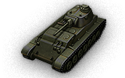<figcaption>A-44</figcaption></figure>
<em>Gun handling</em> 
<strong>Aim time (s)</strong> <small>EU</small> 2.30  <small>RU</small> <strong>2.78</strong> 
<strong>Dispersion (m/100 m)</strong> <small>EU</small> 0.38  <small>RU</small> <strong>0.41</strong> 
<strong>Dispersion · damaged</strong> <small>EU</small> 0.77  <small>RU</small> <strong>0.82</strong> 
<strong>Elevation (°)</strong> <small>EU</small> 20  <small>RU</small> <strong>15</strong> 
<strong>Depression (°)</strong> <small>EU</small> 4  <small>RU</small> <strong>3</strong> 

<em>Mobility</em> 
<strong>Forward speed on soft terrain (km/h)</strong> <small>EU</small> 39.44  <small>RU</small> <strong>39.09</strong> 
<strong>Power/weight (hp/t)</strong> <small>EU</small> 16.58  <small>RU</small> <strong>16.43</strong> 
<strong>Turret traverse (°/s)</strong> <small>EU</small> 41.72  <small>RU</small> <strong>39.63</strong> 
<strong>Tank traverse (°/s)</strong> <small>EU</small> 57.36  <small>RU</small> <strong>45.89</strong> 
<strong>Tank traverse on hard terrain (°/s)</strong> <small>EU</small> 59.07  <small>RU</small> <strong>51.95</strong> 
<strong>Tank traverse on medium terrain (°/s)</strong> <small>EU</small> 51.68  <small>RU</small> <strong>45.46</strong> 
<strong>Tank traverse on soft terrain (°/s)</strong> <small>EU</small> 25.84  <small>RU</small> <strong>22.73</strong> 

<em>Armor &amp; health</em> 
<strong>Health</strong> <small>EU</small> 1 200  <small>RU</small> <strong>1 100</strong> 
<strong>Health · engine</strong> <small>EU</small> 240  <small>RU</small> <strong>120</strong> 

IS · Tier VII

is

<a href="https://tanks.gg/v20410/tank/is">EU stats</a> · <a href="https://tanks.gg/v14600ru/tank/is">RU stats</a>
<figure style="display:inline-block">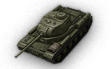<figcaption>IS</figcaption></figure>
<em>Mobility</em> 
<strong>Forward speed on soft terrain (km/h)</strong> <small>EU</small> 26.85  <small>RU</small> <strong>26.49</strong> 
<strong>Engine power (hp)</strong> <small>EU</small> 750  <small>RU</small> <strong>740.10</strong> 
<strong>Power/weight (hp/t)</strong> <small>EU</small> 16.22  <small>RU</small> <strong>16.01</strong> 
<strong>Tank traverse (°/s)</strong> <small>EU</small> 43.81  <small>RU</small> <strong>36.50</strong> 
<strong>Tank traverse on hard terrain (°/s)</strong> <small>EU</small> 45.57  <small>RU</small> <strong>41.35</strong> 
<strong>Tank traverse on medium terrain (°/s)</strong> <small>EU</small> 35.81  <small>RU</small> <strong>32.49</strong> 
<strong>Tank traverse on soft terrain (°/s)</strong> <small>EU</small> 21.80  <small>RU</small> <strong>19.77</strong> 

<em>Armor &amp; health</em> 
<strong>Health</strong> <small>EU</small> 1 350  <small>RU</small> <strong>1 230</strong> 

IS-2 · Tier VII

is2

<a href="https://tanks.gg/v20410/tank/is-2-ru">EU stats</a> · <a href="https://tanks.gg/v14600ru/tank/is-2-ru">RU stats</a>
<figure style="display:inline-block">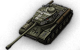<figcaption>IS-2</figcaption></figure>
<em>Armor &amp; health</em> 
<strong>Health</strong> <small>EU</small> 1 320  <small>RU</small> <strong>1 280</strong> 

IS-2 shielded · Tier VII

is2shielded

<a href="https://tanks.gg/v20410/tank/is-2s">EU stats</a> · <a href="https://tanks.gg/v14600ru/tank/is-2e">RU stats</a>
<figure style="display:inline-block">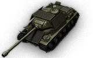<figcaption>EU · IS-2 shielded</figcaption></figure><figure style="display:inline-block"><figcaption>RU · ИС-2 экранированный</figcaption></figure>
<em>Armor &amp; health</em> 
<strong>Health</strong> <small>EU</small> 1 270  <small>RU</small> <strong>1 230</strong> 

IS-2M · Tier VII

is2m

<a href="https://tanks.gg/v20410/tank/is-2m">EU stats</a> · <a href="https://tanks.gg/v14600ru/tank/is-2m">RU stats</a>
<figure style="display:inline-block">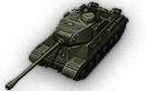<figcaption>IS-2M</figcaption></figure>
<em>Mobility</em> 
<strong>Forward speed on soft terrain (km/h)</strong> <small>EU</small> 23.19  <small>RU</small> <strong>22.63</strong> 
<strong>Engine power (hp)</strong> <small>EU</small> 650  <small>RU</small> <strong>634.37</strong> 
<strong>Power/weight (hp/t)</strong> <small>EU</small> 13.40  <small>RU</small> <strong>13.08</strong> 

KV-122 · Tier VII

kv122

<a href="https://tanks.gg/v20410/tank/kv-122">EU stats</a> · <a href="https://tanks.gg/v14600ru/tank/kv-122">RU stats</a>
<figure style="display:inline-block">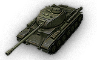<figcaption>KV-122</figcaption></figure>
<em>Firepower</em> 
<strong>DPM (HP/min)</strong> <small>EU</small> 1 835.05  <small>RU</small> <strong>1 906.73</strong> 
<strong>Rate of fire (rounds/min)</strong> <small>EU</small> 4.71  <small>RU</small> <strong>4.89</strong> 
<strong>Reload time (s)</strong> <small>EU</small> 12.75  <small>RU</small> <strong>12.27</strong> 

<em>Gun handling</em> 
<strong>Aim time (s)</strong> <small>EU</small> 3.07  <small>RU</small> <strong>2.78</strong> 
<strong>Dispersion (m/100 m)</strong> <small>EU</small> 0.44  <small>RU</small> <strong>0.40</strong> 
<strong>Dispersion · damaged</strong> <small>EU</small> 0.88  <small>RU</small> <strong>0.81</strong> 

<em>Armor &amp; health</em> 
<strong>Health</strong> <small>EU</small> 1 200  <small>RU</small> <strong>1 400</strong> 

KV-3 · Tier VII

kv3

<a href="https://tanks.gg/v20410/tank/kv-3">EU stats</a> · <a href="https://tanks.gg/v14600ru/tank/kv-3">RU stats</a>
<figure style="display:inline-block">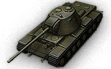<figcaption>KV-3</figcaption></figure>
<em>Mobility</em> 
<strong>Forward speed on medium terrain (km/h)</strong> <small>EU</small> 32  <small>RU</small> <strong>31.61</strong> 
<strong>Forward speed on soft terrain (km/h)</strong> <small>EU</small> 19.90  <small>RU</small> <strong>19.24</strong> 
<strong>Reverse speed (km/h)</strong> <small>EU</small> 11  <small>RU</small> <strong>10</strong> 
<strong>Engine power (hp)</strong> <small>EU</small> 820  <small>RU</small> <strong>792.96</strong> 
<strong>Power/weight (hp/t)</strong> <small>EU</small> 12.02  <small>RU</small> <strong>11.63</strong> 
<strong>Tank traverse (°/s)</strong> <small>EU</small> 26.08  <small>RU</small> <strong>18.77</strong> 
<strong>Tank traverse on hard terrain (°/s)</strong> <small>EU</small> 27.47  <small>RU</small> <strong>22.33</strong> 
<strong>Tank traverse on medium terrain (°/s)</strong> <small>EU</small> 21.58  <small>RU</small> <strong>17.54</strong> 
<strong>Tank traverse on soft terrain (°/s)</strong> <small>EU</small> 13.14  <small>RU</small> <strong>10.68</strong> 

<em>Armor &amp; health</em> 
<strong>Health</strong> <small>EU</small> 1 450  <small>RU</small> <strong>1 400</strong> 

LTG · Tier VII

ltg

<a href="https://tanks.gg/v20410/tank/ltg">EU stats</a> · <a href="https://tanks.gg/v14600ru/tank/ltg">RU stats</a>
<figure style="display:inline-block">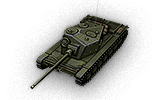<figcaption>LTG</figcaption></figure>
<em>Mobility</em> 
<strong>Forward speed (km/h)</strong> <small>EU</small> 70  <small>RU</small> <strong>63</strong> 
<strong>Forward speed on hard terrain (km/h)</strong> <small>EU</small> 70  <small>RU</small> <strong>63</strong> 
<strong>Forward speed on medium terrain (km/h)</strong> <small>EU</small> 70  <small>RU</small> <strong>63</strong> 
<strong>Forward speed on soft terrain (km/h)</strong> <small>EU</small> 56.46  <small>RU</small> <strong>48.93</strong> 
<strong>Reverse speed (km/h)</strong> <small>EU</small> 23  <small>RU</small> <strong>20</strong> 
<strong>Engine power (hp)</strong> <small>EU</small> 750  <small>RU</small> <strong>650</strong> 
<strong>Power/weight (hp/t)</strong> <small>EU</small> 29.67  <small>RU</small> <strong>25.71</strong> 
<strong>Tank traverse (°/s)</strong> <small>EU</small> 58.41  <small>RU</small> <strong>50.06</strong> 
<strong>Tank traverse on hard terrain (°/s)</strong> <small>EU</small> 61.84  <small>RU</small> <strong>60.72</strong> 
<strong>Tank traverse on medium terrain (°/s)</strong> <small>EU</small> 55.65  <small>RU</small> <strong>54.65</strong> 
<strong>Tank traverse on soft terrain (°/s)</strong> <small>EU</small> 34.78  <small>RU</small> <strong>34.15</strong> 

<em>Armor &amp; health</em> 
<strong>Health</strong> <small>EU</small> 1 000  <small>RU</small> <strong>880</strong> 

S-51 · Tier VII

s51

<a href="https://tanks.gg/v20410/tank/s-51">EU stats</a> · <a href="https://tanks.gg/v14600ru/tank/s-51">RU stats</a>
<figure style="display:inline-block">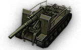<figcaption>S-51</figcaption></figure>
<strong>Penetration (mm)</strong> <b>EU</b>  HE <strong>52</strong> /  HE <strong>65</strong> /  AP <strong>258</strong> → <b>RU</b>  HE <strong>51</strong> /  AP <strong>258</strong>

<strong>Damage (HP)</strong> <b>EU</b>  HE <strong>900</strong> /  HE <strong>1200</strong> /  AP <strong>600</strong> → <b>RU</b>  HE <strong>1200</strong> /  AP <strong>650</strong>

<em>Firepower</em> 
<strong>DPM (HP/min)</strong> <small>EU</small> 1 076.90  <small>RU</small> <strong>1 501.92</strong> 
<strong>Rate of fire (rounds/min)</strong> <small>EU</small> 1.20  <small>RU</small> <strong>1.25</strong> 
<strong>Reload time (s)</strong> <small>EU</small> 50.14  <small>RU</small> <strong>47.94</strong> 
<strong>Explosion radius</strong> <small>EU</small> 10.40  <small>RU</small> <strong>8</strong> 
<strong>Stun duration · maximum (s)</strong> <small>EU</small> 28 → <small>RU</small> <strong>—</strong> 
<strong>Stun duration · minimum (s)</strong> <small>EU</small> 12.60 → <small>RU</small> <strong>—</strong> 
<strong>Shell velocity (m/s)</strong> <small>EU</small> 425  <small>RU</small> <strong>480</strong> 
<strong>Max range (m)</strong> <small>EU</small> 1 263.11  <small>RU</small> <strong>1 467.52</strong> 
<strong>Potential damage</strong> <small>EU</small> 10 800  <small>RU</small> <strong>14 400</strong> 

<em>Gun handling</em> 
<strong>Aim time (s)</strong> <small>EU</small> 6.04  <small>RU</small> <strong>5.75</strong> 
<strong>Dispersion (m/100 m)</strong> <small>EU</small> 0.80  <small>RU</small> <strong>0.76</strong> 
<strong>Dispersion · damaged</strong> <small>EU</small> 1.59  <small>RU</small> <strong>1.51</strong> 

<em>Mobility</em> 
<strong>Tank traverse on hard terrain (°/s)</strong> <small>EU</small> 24.03  <small>RU</small> <strong>24.02</strong> 
<strong>Tank traverse on medium terrain (°/s)</strong> <small>EU</small> 20.83  <small>RU</small> <strong>20.82</strong> 
<strong>Tank traverse on soft terrain (°/s)</strong> <small>EU</small> 12.50  <small>RU</small> <strong>12.49</strong> 

<em>Armor &amp; health</em> 
<strong>Health · ammo rack</strong> <small>EU</small> 190  <small>RU</small> <strong>90</strong> 

<em>Miscellaneous</em> 
<strong>Shell cost</strong> <small>EU</small> 1 910  <small>RU</small> <strong>2 270</strong> 

SU-100M1 · Tier VII

su100m1

<a href="https://tanks.gg/v20410/tank/su-100m1">EU stats</a> · <a href="https://tanks.gg/v14600ru/tank/su-100m1">RU stats</a>
<figure style="display:inline-block">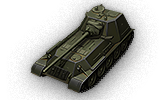<figcaption>SU-100M1</figcaption></figure>
<em>Mobility</em> 
<strong>Tank traverse on hard terrain (°/s)</strong> <small>EU</small> 25.68  <small>RU</small> <strong>25.67</strong> 
<strong>Tank traverse on medium terrain (°/s)</strong> <small>EU</small> 20.18  <small>RU</small> <strong>20.17</strong> 
<strong>Tank traverse on soft terrain (°/s)</strong> <small>EU</small> 13.45  <small>RU</small> <strong>13.44</strong> 

<em>Armor &amp; health</em> 
<strong>Health</strong> <small>EU</small> 900  <small>RU</small> <strong>850</strong> 

SU-14-1 · Tier VII

su141

<a href="https://tanks.gg/v20410/tank/su-14-1">EU stats</a> · <a href="https://tanks.gg/v14600ru/tank/su-14-1">RU stats</a>
<figure style="display:inline-block">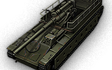<figcaption>SU-14-1</figcaption></figure>
<strong>Penetration (mm)</strong> <b>EU</b>  HE <strong>52</strong> /  HE <strong>65</strong> /  AP <strong>258</strong> → <b>RU</b>  HE <strong>51</strong> /  AP <strong>258</strong>

<strong>Damage (HP)</strong> <b>EU</b>  HE <strong>900</strong> /  HE <strong>1200</strong> /  AP <strong>600</strong> → <b>RU</b>  HE <strong>1200</strong> /  AP <strong>650</strong>

<em>Firepower</em> 
<strong>DPM (HP/min)</strong> <small>EU</small> 1 058.68  <small>RU</small> <strong>1 472.47</strong> 
<strong>Rate of fire (rounds/min)</strong> <small>EU</small> 1.18  <small>RU</small> <strong>1.23</strong> 
<strong>Reload time (s)</strong> <small>EU</small> 51.01  <small>RU</small> <strong>48.90</strong> 
<strong>Explosion radius</strong> <small>EU</small> 10.40  <small>RU</small> <strong>8</strong> 
<strong>Stun duration · maximum (s)</strong> <small>EU</small> 28 → <small>RU</small> <strong>—</strong> 
<strong>Stun duration · minimum (s)</strong> <small>EU</small> 12.60 → <small>RU</small> <strong>—</strong> 
<strong>Shell velocity (m/s)</strong> <small>EU</small> 425  <small>RU</small> <strong>480</strong> 
<strong>Max range (m)</strong> <small>EU</small> 1 263.11  <small>RU</small> <strong>1 467.52</strong> 
<strong>Potential damage</strong> <small>EU</small> 14 400  <small>RU</small> <strong>19 200</strong> 

<em>Gun handling</em> 
<strong>Aim time (s)</strong> <small>EU</small> 6.33  <small>RU</small> <strong>5.94</strong> 
<strong>Dispersion (m/100 m)</strong> <small>EU</small> 0.79  <small>RU</small> <strong>0.76</strong> 
<strong>Dispersion · damaged</strong> <small>EU</small> 1.57  <small>RU</small> <strong>1.51</strong> 

<em>Miscellaneous</em> 
<strong>Shell cost</strong> <small>EU</small> 1 910  <small>RU</small> <strong>2 270</strong> 

SU-152 · Tier VII

su152

<a href="https://tanks.gg/v20410/tank/su-152">EU stats</a> · <a href="https://tanks.gg/v14600ru/tank/su-152">RU stats</a>
<figure style="display:inline-block">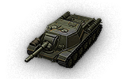<figcaption>SU-152</figcaption></figure>
<strong>Penetration (mm)</strong> <b>EU</b>  HEAT <strong>190</strong> /  HEAT <strong>240</strong> /  HE <strong>86</strong> → <b>RU</b>  AP <strong>175</strong> /  APCR <strong>217</strong> /  HE <strong>64</strong>

<strong>Damage (HP)</strong> <b>EU</b>  HEAT <strong>700</strong> /  HEAT <strong>700</strong> /  HE <strong>910</strong> → <b>RU</b>  AP <strong>390</strong> /  APCR <strong>390</strong> /  HE <strong>530</strong>

<em>Firepower</em> 
<strong>DPM (HP/min)</strong> <small>EU</small> 2 474.92  <small>RU</small> <strong>3 298.14</strong> 
<strong>Module damage</strong> <small>EU</small> 203  <small>RU</small> <strong>165</strong> 
<strong>Rate of fire (rounds/min)</strong> <small>EU</small> 3.54  <small>RU</small> <strong>8.46</strong> 
<strong>Reload time (s)</strong> <small>EU</small> 16.97  <small>RU</small> <strong>7.09</strong> 
<strong>Caliber</strong> <small>EU</small> 152  <small>RU</small> <strong>122</strong> 
<strong>Shell velocity (m/s)</strong> <small>EU</small> 750  <small>RU</small> <strong>800</strong> 
<strong>Normalization</strong> <small>EU</small> 0  <small>RU</small> <strong>5</strong> 
<strong>Ricochet angle</strong> <small>EU</small> 85  <small>RU</small> <strong>70</strong> 
<strong>Spaced armor pen loss</strong> <small>EU</small> 0.50  <small>RU</small> <strong>0</strong> 
<strong>Ammo capacity</strong> <small>EU</small> 26  <small>RU</small> <strong>32</strong> 
<strong>Potential damage</strong> <small>EU</small> 18 200  <small>RU</small> <strong>12 480</strong> 

<em>Gun handling</em> 
<strong>Aim time (s)</strong> <small>EU</small> 3.07  <small>RU</small> <strong>2.78</strong> 
<strong>Dispersion (m/100 m)</strong> <small>EU</small> 0.46  <small>RU</small> <strong>0.39</strong> 
<strong>Dispersion · damaged</strong> <small>EU</small> 0.92  <small>RU</small> <strong>0.79</strong> 

<em>Mobility</em> 
<strong>Forward speed on medium terrain (km/h)</strong> <small>EU</small> 39.83  <small>RU</small> <strong>37.63</strong> 
<strong>Forward speed on soft terrain (km/h)</strong> <small>EU</small> 24.24  <small>RU</small> <strong>22.91</strong> 
<strong>Reverse speed (km/h)</strong> <small>EU</small> 12  <small>RU</small> <strong>11</strong> 
<strong>Engine power (hp)</strong> <small>EU</small> 670  <small>RU</small> <strong>634.37</strong> 
<strong>Weight (kg)</strong> <small>EU</small> 45 735 → <small>RU</small> <strong>45 825</strong> 
<strong>Power/weight (hp/t)</strong> <small>EU</small> 14.65  <small>RU</small> <strong>13.84</strong> 
<strong>Tank traverse (°/s)</strong> <small>EU</small> 33.38  <small>RU</small> <strong>23.99</strong> 
<strong>Tank traverse on hard terrain (°/s)</strong> <small>EU</small> 34.34  <small>RU</small> <strong>27.29</strong> 
<strong>Tank traverse on medium terrain (°/s)</strong> <small>EU</small> 26.98  <small>RU</small> <strong>21.44</strong> 
<strong>Tank traverse on soft terrain (°/s)</strong> <small>EU</small> 16.42  <small>RU</small> <strong>13.05</strong> 

<em>Armor &amp; health</em> 
<strong>Health</strong> <small>EU</small> 900  <small>RU</small> <strong>870</strong> 
<strong>Health · engine</strong> <small>EU</small> 240  <small>RU</small> <strong>190</strong> 
<strong>Track repair time (s)</strong> <small>EU</small> 11.70  <small>RU</small> <strong>12.03</strong> 

<em>Miscellaneous</em> 
<strong>Stationary camo · after firing</strong> <small>EU</small> 2.36  <small>RU</small> <strong>3.13</strong> 
<strong>Moving camo · after firing</strong> <small>EU</small> 1.41  <small>RU</small> <strong>1.87</strong> 
<strong>Shell cost</strong> <small>EU</small> 1 034  <small>RU</small> <strong>1 025</strong> 

T-34M-54 · Tier VII

t34m54

<a href="https://tanks.gg/v20410/tank/t-34m-54">EU stats</a> · <a href="https://tanks.gg/v14600ru/tank/t-34m-54">RU stats</a>
<figure style="display:inline-block">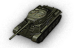<figcaption>T-34M-54</figcaption></figure>
<em>Gun handling</em> 
<strong>Aim time (s)</strong> <small>EU</small> 2.88  <small>RU</small> <strong>2.11</strong> 
<strong>Dispersion (m/100 m)</strong> <small>EU</small> 0.39  <small>RU</small> <strong>0.35</strong> 
<strong>Dispersion · damaged</strong> <small>EU</small> 0.79  <small>RU</small> <strong>0.71</strong> 

T-43 · Tier VII

t43

<a href="https://tanks.gg/v20410/tank/t-43">EU stats</a> · <a href="https://tanks.gg/v14600ru/tank/t-43">RU stats</a>
<figure style="display:inline-block">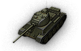<figcaption>T-43</figcaption></figure>
<strong>Penetration (mm)</strong> <b>EU</b>  AP <strong>164</strong> /  APCR <strong>212</strong> /  HE <strong>44</strong> → <b>RU</b>  AP <strong>144</strong> /  APCR <strong>194</strong> /  HE <strong>44</strong>

<strong>Damage (HP)</strong> <b>EU</b>  AP <strong>220</strong> /  APCR <strong>220</strong> /  HE <strong>300</strong> → <b>RU</b>  AP <strong>180</strong> /  APCR <strong>180</strong> /  HE <strong>300</strong>

<em>Firepower</em> 
<strong>Rate of fire (rounds/min)</strong> <small>EU</small> 9.48  <small>RU</small> <strong>11.59</strong> 
<strong>Reload time (s)</strong> <small>EU</small> 6.33  <small>RU</small> <strong>5.18</strong> 
<strong>Potential damage</strong> <small>EU</small> 10 560  <small>RU</small> <strong>8 640</strong> 

<em>Gun handling</em> 
<strong>Aim time (s)</strong> <small>EU</small> 2.11  <small>RU</small> <strong>2.21</strong> 
<strong>Dispersion · damaged</strong> <small>EU</small> 0.69  <small>RU</small> <strong>0.71</strong> 
<strong>Dispersion · moving</strong> <small>EU</small> 0.14  <small>RU</small> <strong>0.16</strong> 
<strong>Dispersion · tank traverse</strong> <small>EU</small> 0.14  <small>RU</small> <strong>0.16</strong> 

<em>Mobility</em> 
<strong>Forward speed (km/h)</strong> <small>EU</small> 55  <small>RU</small> <strong>51</strong> 
<strong>Forward speed on hard terrain (km/h)</strong> <small>EU</small> 55  <small>RU</small> <strong>51</strong> 
<strong>Forward speed on medium terrain (km/h)</strong> <small>EU</small> 55  <small>RU</small> <strong>51</strong> 
<strong>Forward speed on soft terrain (km/h)</strong> <small>EU</small> 40.95  <small>RU</small> <strong>34.64</strong> 
<strong>Engine power (hp)</strong> <small>EU</small> 750  <small>RU</small> <strong>634.37</strong> 
<strong>Power/weight (hp/t)</strong> <small>EU</small> 21.52  <small>RU</small> <strong>18.20</strong> 
<strong>Tank traverse (°/s)</strong> <small>EU</small> 52.15  <small>RU</small> <strong>39.63</strong> 
<strong>Tank traverse on hard terrain (°/s)</strong> <small>EU</small> 54.71  <small>RU</small> <strong>43.47</strong> 
<strong>Tank traverse on medium terrain (°/s)</strong> <small>EU</small> 45.59  <small>RU</small> <strong>36.23</strong> 
<strong>Tank traverse on soft terrain (°/s)</strong> <small>EU</small> 27.36  <small>RU</small> <strong>21.74</strong> 

<em>Armor &amp; health</em> 
<strong>Health</strong> <small>EU</small> 1 200  <small>RU</small> <strong>1 100</strong> 

