# USSR · Tier VIII

[All nations and tiers](../buffs_nerfs.md) · EU v20410 → RU v14600ru · 3 November 2026

<label><strong>Find a tank</strong><input type="search" placeholder="Try is7, obj140 or xm57" aria-label="Find a tank" style="display:block;width:100%;padding:.7rem;border:1px solid #888;border-radius:4px;margin:.5rem 0;color:inherit;background:transparent"></label>

IS-2-II · Tier VIII

is2ii

<a href="https://tanks.gg/v20410/tank/is-2-ii">EU stats</a> · <a href="https://tanks.gg/v14600ru/tank/is-2-ii">RU stats</a>
<figure style="display:inline-block">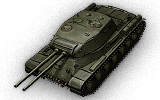<figcaption>IS-2-II</figcaption></figure>
<em>Firepower</em> 
<strong>DPM (HP/min)</strong> <small>EU</small> 2 346.75  <small>RU</small> <strong>2 208.71</strong> 
<strong>Rate of fire (rounds/min)</strong> <small>EU</small> 7.82  <small>RU</small> <strong>7.36</strong> 
<strong>Reload time (s)</strong> <small>EU</small> 7.67  <small>RU</small> <strong>8.15</strong> 

<em>Gun handling</em> 
<strong>Aim time (s)</strong> <small>EU</small> 2.21  <small>RU</small> <strong>2.40</strong> 
<strong>Dispersion (m/100 m)</strong> <small>EU</small> 0.36  <small>RU</small> <strong>0.35</strong> 
<strong>Dispersion · damaged</strong> <small>EU</small> 0.73  <small>RU</small> <strong>0.69</strong> 
<strong>Depression (°)</strong> <small>EU</small> 7  <small>RU</small> <strong>8</strong> 

<em>Mobility</em> 
<strong>Forward speed (km/h)</strong> <small>EU</small> 38  <small>RU</small> <strong>36</strong> 
<strong>Forward speed on hard terrain (km/h)</strong> <small>EU</small> 38  <small>RU</small> <strong>36</strong> 
<strong>Forward speed on medium terrain (km/h)</strong> <small>EU</small> 38  <small>RU</small> <strong>36</strong> 
<strong>Tank traverse (°/s)</strong> <small>EU</small> 35.46  <small>RU</small> <strong>31.29</strong> 
<strong>Tank traverse on hard terrain (°/s)</strong> <small>EU</small> 38.34  <small>RU</small> <strong>34.82</strong> 
<strong>Tank traverse on medium terrain (°/s)</strong> <small>EU</small> 27.38  <small>RU</small> <strong>24.87</strong> 
<strong>Tank traverse on soft terrain (°/s)</strong> <small>EU</small> 18.26  <small>RU</small> <strong>16.58</strong> 

<em>Armor &amp; health</em> 
<strong>Hull armor · front (mm)</strong> <small>EU</small> 110  <small>RU</small> <strong>135</strong> 
<strong>Health</strong> <small>EU</small> 1 650  <small>RU</small> <strong>1 600</strong> 

<em>Miscellaneous</em> 
<strong>View range (m)</strong> <small>EU</small> 350  <small>RU</small> <strong>370</strong> 

Alternate mode

<a href="https://tanks.gg/v20410/tank/is-2-ii-siege">EU stats</a> · <a href="https://tanks.gg/v14600ru/tank/is-2-ii-siege">RU stats</a>
<em>Firepower</em> 
<strong>DPM (HP/min)</strong> <small>EU</small> 2 346.75  <small>RU</small> <strong>2 208.71</strong> 
<strong>Rate of fire (rounds/min)</strong> <small>EU</small> 7.82  <small>RU</small> <strong>7.36</strong> 
<strong>Reload time (s)</strong> <small>EU</small> 7.67  <small>RU</small> <strong>8.15</strong> 

<em>Gun handling</em> 
<strong>Aim time (s)</strong> <small>EU</small> 2.21  <small>RU</small> <strong>2.40</strong> 
<strong>Dispersion (m/100 m)</strong> <small>EU</small> 0.36  <small>RU</small> <strong>0.35</strong> 
<strong>Dispersion · damaged</strong> <small>EU</small> 0.73  <small>RU</small> <strong>0.69</strong> 
<strong>Depression (°)</strong> <small>EU</small> 7  <small>RU</small> <strong>8</strong> 

<em>Mobility</em> 
<strong>Forward speed (km/h)</strong> <small>EU</small> 38  <small>RU</small> <strong>36</strong> 
<strong>Forward speed on hard terrain (km/h)</strong> <small>EU</small> 38  <small>RU</small> <strong>36</strong> 
<strong>Forward speed on medium terrain (km/h)</strong> <small>EU</small> 38  <small>RU</small> <strong>36</strong> 
<strong>Tank traverse (°/s)</strong> <small>EU</small> 35.46  <small>RU</small> <strong>31.29</strong> 
<strong>Tank traverse on hard terrain (°/s)</strong> <small>EU</small> 38.34  <small>RU</small> <strong>34.82</strong> 
<strong>Tank traverse on medium terrain (°/s)</strong> <small>EU</small> 27.38  <small>RU</small> <strong>24.87</strong> 
<strong>Tank traverse on soft terrain (°/s)</strong> <small>EU</small> 18.26  <small>RU</small> <strong>16.58</strong> 

<em>Armor &amp; health</em> 
<strong>Hull armor · front (mm)</strong> <small>EU</small> 110  <small>RU</small> <strong>135</strong> 
<strong>Health</strong> <small>EU</small> 1 650  <small>RU</small> <strong>1 600</strong> 

<em>Miscellaneous</em> 
<strong>View range (m)</strong> <small>EU</small> 350  <small>RU</small> <strong>370</strong> 

IS-3 · Tier VIII

is3

<a href="https://tanks.gg/v20410/tank/is-3">EU stats</a> · <a href="https://tanks.gg/v14600ru/tank/is-3">RU stats</a>
<figure style="display:inline-block">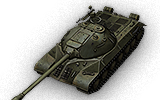<figcaption>IS-3</figcaption></figure>
<em>Firepower</em> 
<strong>DPM (HP/min)</strong> <small>EU</small> 1 835.05  <small>RU</small> <strong>1 984.24</strong> 
<strong>Rate of fire (rounds/min)</strong> <small>EU</small> 4.71  <small>RU</small> <strong>5.09</strong> 
<strong>Reload time (s)</strong> <small>EU</small> 12.75  <small>RU</small> <strong>11.79</strong> 

<em>Mobility</em> 
<strong>Forward speed (km/h)</strong> <small>EU</small> 45  <small>RU</small> <strong>38</strong> 
<strong>Forward speed on hard terrain (km/h)</strong> <small>EU</small> 45  <small>RU</small> <strong>38</strong> 
<strong>Forward speed on medium terrain (km/h)</strong> <small>EU</small> 44.30  <small>RU</small> <strong>38</strong> 
<strong>Forward speed on soft terrain (km/h)</strong> <small>EU</small> 29.53  <small>RU</small> <strong>27.32</strong> 
<strong>Engine power (hp)</strong> <small>EU</small> 800  <small>RU</small> <strong>740.10</strong> 
<strong>Power/weight (hp/t)</strong> <small>EU</small> 16.29  <small>RU</small> <strong>15.07</strong> 
<strong>Tank traverse (°/s)</strong> <small>EU</small> 37.55  <small>RU</small> <strong>31.29</strong> 
<strong>Tank traverse on hard terrain (°/s)</strong> <small>EU</small> 39.68  <small>RU</small> <strong>33.40</strong> 
<strong>Tank traverse on medium terrain (°/s)</strong> <small>EU</small> 28.35  <small>RU</small> <strong>23.86</strong> 
<strong>Tank traverse on soft terrain (°/s)</strong> <small>EU</small> 18.90  <small>RU</small> <strong>15.91</strong> 

<em>Armor &amp; health</em> 
<strong>Hull armor · front (mm)</strong> <small>EU</small> 110  <small>RU</small> <strong>120</strong> 
<strong>Health</strong> <small>EU</small> 1 650  <small>RU</small> <strong>1 500</strong> 

<em>Miscellaneous</em> 
<strong>View range (m)</strong> <small>EU</small> 370  <small>RU</small> <strong>350</strong> 

IS-3A · Tier VIII

is3a

<a href="https://tanks.gg/v20410/tank/is-3a">EU stats</a> · <a href="https://tanks.gg/v14600ru/tank/is-3-s-mz">RU stats</a>
<figure style="display:inline-block">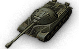<figcaption>IS-3A</figcaption></figure>
<em>Firepower</em> 
<strong>DPM (HP/min)</strong> <small>EU</small> 2 033.85  <small>RU</small> <strong>1 991.93</strong> 
<strong>Rate of fire (rounds/min)</strong> <small>EU</small> 5.21  <small>RU</small> <strong>5.11</strong> 
<strong>Reload time (s)</strong> <small>EU</small> 11.51  <small>RU</small> <strong>11.75</strong> 

IS-3A Peregrine · Tier VIII

is3aperegrine

<a href="https://tanks.gg/v20410/tank/peregrine">EU stats</a> · <a href="https://tanks.gg/v14600ru/tank/sapsan">RU stats</a>
<figure style="display:inline-block">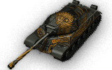<figcaption>IS-3A Peregrine</figcaption></figure>
<em>Firepower</em> 
<strong>DPM (HP/min)</strong> <small>EU</small> 2 033.85  <small>RU</small> <strong>1 991.93</strong> 
<strong>Rate of fire (rounds/min)</strong> <small>EU</small> 5.21  <small>RU</small> <strong>5.11</strong> 
<strong>Reload time (s)</strong> <small>EU</small> 11.51  <small>RU</small> <strong>11.75</strong> 

IS-5 (Object 730) · Tier VIII

is5object730

<a href="https://tanks.gg/v20410/tank/is-5">EU stats</a> · <a href="https://tanks.gg/v14600ru/tank/is-5">RU stats</a>
<figure style="display:inline-block">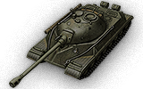<figcaption>IS-5 (Object 730)</figcaption></figure>
<em>Gun handling</em> 
<strong>Aim time (s)</strong> <small>EU</small> 2.59  <small>RU</small> <strong>3.07</strong> 
<strong>Dispersion (m/100 m)</strong> <small>EU</small> 0.40  <small>RU</small> <strong>0.44</strong> 
<strong>Dispersion · damaged</strong> <small>EU</small> 0.81  <small>RU</small> <strong>0.88</strong> 
<strong>Dispersion · moving</strong> <small>EU</small> 0.17  <small>RU</small> <strong>0.20</strong> 
<strong>Dispersion · tank traverse</strong> <small>EU</small> 0.17  <small>RU</small> <strong>0.20</strong> 
<strong>Dispersion · turret traverse</strong> <small>EU</small> 0.08  <small>RU</small> <strong>0.10</strong> 

<em>Armor &amp; health</em> 
<strong>Health</strong> <small>EU</small> 1 550  <small>RU</small> <strong>1 700</strong> 

IS-M · Tier VIII

ism

<a href="https://tanks.gg/v20410/tank/is-m">EU stats</a> · <a href="https://tanks.gg/v14600ru/tank/is-m">RU stats</a>
<figure style="display:inline-block">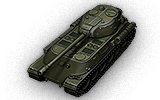<figcaption>IS-M</figcaption></figure>
<strong>Penetration (mm)</strong> <b>EU</b>  AP <strong>221</strong> /  APCR <strong>258</strong> /  HE <strong>68</strong> → <b>RU</b>  AP <strong>221</strong> /  APCR <strong>254</strong> /  HE <strong>68</strong>

<em>Gun handling</em> 
<strong>Aim time (s)</strong> <small>EU</small> 2.68  <small>RU</small> <strong>2.88</strong> 

<em>Mobility</em> 
<strong>Tank traverse on hard terrain (°/s)</strong> <small>EU</small> 27.08  <small>RU</small> <strong>28.32</strong> 
<strong>Tank traverse on medium terrain (°/s)</strong> <small>EU</small> 17.52  <small>RU</small> <strong>18.32</strong> 
<strong>Tank traverse on soft terrain (°/s)</strong> <small>EU</small> 11.91  <small>RU</small> <strong>12.46</strong> 

<em>Armor &amp; health</em> 
<strong>Hull armor · front (mm)</strong> <small>EU</small> 130  <small>RU</small> <strong>145</strong> 
<strong>Health</strong> <small>EU</small> 1 650  <small>RU</small> <strong>1 600</strong> 

<em>Miscellaneous</em> 
<strong>Moving camo</strong> <small>EU</small> 3.24  <small>RU</small> <strong>3.19</strong> 
<strong>Moving camo · after firing</strong> <small>EU</small> 0.58  <small>RU</small> <strong>0.57</strong> 

ISU-122-2 · Tier VIII

isu1222

<a href="https://tanks.gg/v20410/tank/isu-122-2">EU stats</a> · <a href="https://tanks.gg/v14600ru/tank/isu-122-2">RU stats</a>
<figure style="display:inline-block">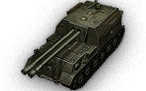<figcaption>EU · ISU-122-2</figcaption></figure><figure style="display:inline-block">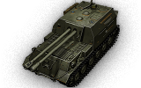<figcaption>RU · ИСУ-122-2</figcaption></figure>
<em>Gun handling</em> 
<strong>Aim time (s)</strong> <small>EU</small> 1.92  <small>RU</small> <strong>2.21</strong> 
<strong>Dispersion · damaged</strong> <small>EU</small> 0.71  <small>RU</small> <strong>0.69</strong> 
<strong>Dispersion · moving</strong> <small>EU</small> 0.15  <small>RU</small> <strong>0.22</strong> 
<strong>Dispersion · tank traverse</strong> <small>EU</small> 0.15  <small>RU</small> <strong>0.22</strong> 
<strong>Dispersion · turret traverse</strong> <small>EU</small> 0.10  <small>RU</small> <strong>0.12</strong> 

<em>Mobility</em> 
<strong>Forward speed (km/h)</strong> <small>EU</small> 40  <small>RU</small> <strong>52</strong> 
<strong>Forward speed on hard terrain (km/h)</strong> <small>EU</small> 40  <small>RU</small> <strong>52</strong> 
<strong>Forward speed on medium terrain (km/h)</strong> <small>EU</small> 40  <small>RU</small> <strong>52</strong> 
<strong>Forward speed on soft terrain (km/h)</strong> <small>EU</small> 30.05  <small>RU</small> <strong>32.05</strong> 
<strong>Reverse speed (km/h)</strong> <small>EU</small> 20  <small>RU</small> <strong>15</strong> 
<strong>Engine power (hp)</strong> <small>EU</small> 750  <small>RU</small> <strong>800</strong> 
<strong>Power/weight (hp/t)</strong> <small>EU</small> 15  <small>RU</small> <strong>16</strong> 

<em>Armor &amp; health</em> 
<strong>Hull armor · front (mm)</strong> <small>EU</small> 190  <small>RU</small> <strong>20</strong> 
<strong>Hull armor · side (mm)</strong> <small>EU</small> 65  <small>RU</small> <strong>15</strong> 
<strong>Hull armor · rear (mm)</strong> <small>EU</small> 40  <small>RU</small> <strong>10</strong> 

Alternate mode

<a href="https://tanks.gg/v20410/tank/isu-122-2-siege">EU stats</a> · <a href="https://tanks.gg/v14600ru/tank/isu-122-2-siege">RU stats</a>
<em>Gun handling</em> 
<strong>Aim time (s)</strong> <small>EU</small> 1.92  <small>RU</small> <strong>2.21</strong> 
<strong>Dispersion · damaged</strong> <small>EU</small> 0.71  <small>RU</small> <strong>0.69</strong> 
<strong>Dispersion · moving</strong> <small>EU</small> 0.15  <small>RU</small> <strong>0.22</strong> 
<strong>Dispersion · tank traverse</strong> <small>EU</small> 0.15  <small>RU</small> <strong>0.22</strong> 
<strong>Dispersion · turret traverse</strong> <small>EU</small> 0.10  <small>RU</small> <strong>0.12</strong> 

<em>Mobility</em> 
<strong>Forward speed (km/h)</strong> <small>EU</small> 40  <small>RU</small> <strong>52</strong> 
<strong>Forward speed on hard terrain (km/h)</strong> <small>EU</small> 40  <small>RU</small> <strong>52</strong> 
<strong>Forward speed on medium terrain (km/h)</strong> <small>EU</small> 40  <small>RU</small> <strong>52</strong> 
<strong>Forward speed on soft terrain (km/h)</strong> <small>EU</small> 30.05  <small>RU</small> <strong>32.05</strong> 
<strong>Reverse speed (km/h)</strong> <small>EU</small> 20  <small>RU</small> <strong>15</strong> 
<strong>Engine power (hp)</strong> <small>EU</small> 750  <small>RU</small> <strong>800</strong> 
<strong>Power/weight (hp/t)</strong> <small>EU</small> 15  <small>RU</small> <strong>16</strong> 

<em>Armor &amp; health</em> 
<strong>Hull armor · front (mm)</strong> <small>EU</small> 190  <small>RU</small> <strong>20</strong> 
<strong>Hull armor · side (mm)</strong> <small>EU</small> 65  <small>RU</small> <strong>15</strong> 
<strong>Hull armor · rear (mm)</strong> <small>EU</small> 40  <small>RU</small> <strong>10</strong> 

ISU-152 · Tier VIII

isu152

<a href="https://tanks.gg/v20410/tank/isu-152">EU stats</a> · <a href="https://tanks.gg/v14600ru/tank/isu-152">RU stats</a>
<figure style="display:inline-block">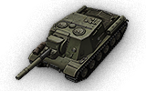<figcaption>ISU-152</figcaption></figure>
<em>Gun handling</em> 
<strong>Aim time (s)</strong> <small>EU</small> 2.97  <small>RU</small> <strong>3.26</strong> 
<strong>Dispersion (m/100 m)</strong> <small>EU</small> 0.36  <small>RU</small> <strong>0.39</strong> 
<strong>Dispersion · damaged</strong> <small>EU</small> 0.73  <small>RU</small> <strong>0.79</strong> 

<em>Mobility</em> 
<strong>Forward speed on medium terrain (km/h)</strong> <small>EU</small> 43  <small>RU</small> <strong>40.91</strong> 
<strong>Forward speed on soft terrain (km/h)</strong> <small>EU</small> 26.24  <small>RU</small> <strong>24.90</strong> 
<strong>Reverse speed (km/h)</strong> <small>EU</small> 13  <small>RU</small> <strong>12</strong> 
<strong>Engine power (hp)</strong> <small>EU</small> 780  <small>RU</small> <strong>740.10</strong> 
<strong>Power/weight (hp/t)</strong> <small>EU</small> 15.86  <small>RU</small> <strong>15.05</strong> 
<strong>Tank traverse (°/s)</strong> <small>EU</small> 31.29  <small>RU</small> <strong>21.90</strong> 
<strong>Tank traverse on hard terrain (°/s)</strong> <small>EU</small> 29.53  <small>RU</small> <strong>22.57</strong> 
<strong>Tank traverse on medium terrain (°/s)</strong> <small>EU</small> 23.20  <small>RU</small> <strong>17.73</strong> 
<strong>Tank traverse on soft terrain (°/s)</strong> <small>EU</small> 14.12  <small>RU</small> <strong>10.79</strong> 

<em>Armor &amp; health</em> 
<strong>Health</strong> <small>EU</small> 1 250  <small>RU</small> <strong>1 200</strong> 
<strong>Health · engine</strong> <small>EU</small> 275  <small>RU</small> <strong>370</strong> 
<strong>Health · track</strong> <small>EU</small> 220  <small>RU</small> <strong>200</strong> 
<strong>Track repair time (s)</strong> <small>EU</small> 11.70  <small>RU</small> <strong>12.03</strong> 

ISU-152K · Tier VIII

isu152k

<a href="https://tanks.gg/v20410/tank/isu-152k">EU stats</a> · <a href="https://tanks.gg/v14600ru/tank/isu-152k">RU stats</a>
<figure style="display:inline-block">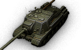<figcaption>EU · ISU-152K</figcaption></figure><figure style="display:inline-block"><figcaption>RU · ИСУ-152К</figcaption></figure>
<em>Gun handling</em> 
<strong>Aim time (s)</strong> <small>EU</small> 3.26  <small>RU</small> <strong>3.36</strong> 
<strong>Dispersion (m/100 m)</strong> <small>EU</small> 0.40  <small>RU</small> <strong>0.41</strong> 
<strong>Dispersion · damaged</strong> <small>EU</small> 0.81  <small>RU</small> <strong>0.82</strong> 

KV-4 · Tier VIII

kv4

<a href="https://tanks.gg/v20410/tank/kv-4">EU stats</a> · <a href="https://tanks.gg/v14600ru/tank/kv-4">RU stats</a>
<figure style="display:inline-block">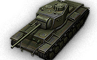<figcaption>KV-4</figcaption></figure>
<strong>Penetration (mm)</strong> <b>EU</b>  APCR <strong>217</strong> /  HEAT <strong>270</strong> /  HE <strong>61</strong> → <b>RU</b>  AP <strong>227</strong> /  APCR <strong>289</strong> /  HE <strong>62</strong>

<strong>Damage (HP)</strong> <b>EU</b>  APCR <strong>390</strong> /  HEAT <strong>390</strong> /  HE <strong>530</strong> → <b>RU</b>  AP <strong>320</strong> /  APCR <strong>320</strong> /  HE <strong>420</strong>

<em>Firepower</em> 
<strong>DPM (HP/min)</strong> <small>EU</small> 2 033.85  <small>RU</small> <strong>2 225.07</strong> 
<strong>Module damage</strong> <small>EU</small> 165  <small>RU</small> <strong>150</strong> 
<strong>Rate of fire (rounds/min)</strong> <small>EU</small> 5.21  <small>RU</small> <strong>6.95</strong> 
<strong>Reload time (s)</strong> <small>EU</small> 11.51  <small>RU</small> <strong>8.63</strong> 
<strong>Caliber</strong> <small>EU</small> 122  <small>RU</small> <strong>107</strong> 
<strong>Shell velocity (m/s)</strong> <small>EU</small> 975  <small>RU</small> <strong>1 043</strong> 
<strong>Normalization</strong> <small>EU</small> 2  <small>RU</small> <strong>5</strong> 
<strong>Potential damage</strong> <small>EU</small> 19 500  <small>RU</small> <strong>16 000</strong> 

<em>Gun handling</em> 
<strong>Aim time (s)</strong> <small>EU</small> 2.88  <small>RU</small> <strong>2.21</strong> 
<strong>Dispersion (m/100 m)</strong> <small>EU</small> 0.40  <small>RU</small> <strong>0.35</strong> 
<strong>Dispersion · damaged</strong> <small>EU</small> 0.81  <small>RU</small> <strong>0.69</strong> 
<strong>Dispersion · moving</strong> <small>EU</small> 0.22  <small>RU</small> <strong>0.23</strong> 
<strong>Dispersion · tank traverse</strong> <small>EU</small> 0.22  <small>RU</small> <strong>0.23</strong> 
<strong>Dispersion · turret traverse</strong> <small>EU</small> 0.14  <small>RU</small> <strong>0.10</strong> 
<strong>Depression (°)</strong> <small>EU</small> 8  <small>RU</small> <strong>6</strong> 

<em>Mobility</em> 
<strong>Forward speed (km/h)</strong> <small>EU</small> 32  <small>RU</small> <strong>30</strong> 
<strong>Forward speed on hard terrain (km/h)</strong> <small>EU</small> 32  <small>RU</small> <strong>30</strong> 
<strong>Forward speed on medium terrain (km/h)</strong> <small>EU</small> 31.70  <small>RU</small> <strong>30</strong> 
<strong>Forward speed on soft terrain (km/h)</strong> <small>EU</small> 19.02  <small>RU</small> <strong>18.10</strong> 
<strong>Engine power (hp)</strong> <small>EU</small> 1 330  <small>RU</small> <strong>1 268.74</strong> 
<strong>Weight (kg)</strong> <small>EU</small> 106 445 → <small>RU</small> <strong>106 695</strong> 
<strong>Power/weight (hp/t)</strong> <small>EU</small> 12.49  <small>RU</small> <strong>11.89</strong> 
<strong>Tank traverse (°/s)</strong> <small>EU</small> 26.08  <small>RU</small> <strong>18.77</strong> 
<strong>Tank traverse on hard terrain (°/s)</strong> <small>EU</small> 26.01  <small>RU</small> <strong>20.57</strong> 
<strong>Tank traverse on medium terrain (°/s)</strong> <small>EU</small> 22.54  <small>RU</small> <strong>17.83</strong> 
<strong>Tank traverse on soft terrain (°/s)</strong> <small>EU</small> 13.53  <small>RU</small> <strong>10.70</strong> 

<em>Armor &amp; health</em> 
<strong>Hull armor · front (mm)</strong> <small>EU</small> 180  <small>RU</small> <strong>220</strong> 
<strong>Turret armor · front (mm)</strong> <small>EU</small> 220  <small>RU</small> <strong>240</strong> 
<strong>Health</strong> <small>EU</small> 1 800  <small>RU</small> <strong>1 700</strong> 

<em>Miscellaneous</em> 
<strong>Stationary camo · after firing</strong> <small>EU</small> 0.34  <small>RU</small> <strong>0.37</strong> 
<strong>Moving camo · after firing</strong> <small>EU</small> 0.17  <small>RU</small> <strong>0.19</strong> 
<strong>Shell cost</strong> <small>EU</small> 1 060  <small>RU</small> <strong>1 010</strong> 

KV-4 Kreslavskiy · Tier VIII

kv4kreslavskiy

<a href="https://tanks.gg/v20410/tank/kv-4-kresl">EU stats</a> · <a href="https://tanks.gg/v14600ru/tank/kv-4-kresl">RU stats</a>
<figure style="display:inline-block">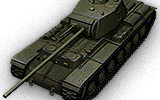<figcaption>KV-4 Kreslavskiy</figcaption></figure>
<em>Firepower</em> 
<strong>DPM (HP/min)</strong> <small>EU</small> 1 772.18  <small>RU</small> <strong>1 944.23</strong> 
<strong>Rate of fire (rounds/min)</strong> <small>EU</small> 5.54  <small>RU</small> <strong>6.08</strong> 
<strong>Reload time (s)</strong> <small>EU</small> 10.83  <small>RU</small> <strong>9.88</strong> 

<em>Gun handling</em> 
<strong>Aim time (s)</strong> <small>EU</small> 2.78  <small>RU</small> <strong>2.49</strong> 

KV-4 KTTS · Tier VIII

kv4ktts

<a href="https://tanks.gg/v20410/tank/kv-4-ktts">EU stats</a> · <a href="https://tanks.gg/v14600ru/tank/kv-4-ktts">RU stats</a>
<figure style="display:inline-block">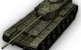<figcaption>KV-4 KTTS</figcaption></figure>
<strong>Penetration (mm)</strong> <b>EU</b>  AP <strong>227</strong> /  APCR <strong>289</strong> /  HE <strong>62</strong> → <b>RU</b>  AP <strong>237</strong> /  APCR <strong>289</strong> /  HE <strong>62</strong>

<em>Firepower</em> 
<strong>DPM (HP/min)</strong> <small>EU</small> 2 682  <small>RU</small> <strong>2 851.75</strong> 
<strong>Rate of fire (rounds/min)</strong> <small>EU</small> 7.45  <small>RU</small> <strong>7.92</strong> 
<strong>Reload time (s)</strong> <small>EU</small> 8.05  <small>RU</small> <strong>7.57</strong> 

<em>Gun handling</em> 
<strong>Aim time (s)</strong> <small>EU</small> 2.40  <small>RU</small> <strong>2.11</strong> 
<strong>Dispersion · moving</strong> <small>EU</small> 0.22  <small>RU</small> <strong>0.17</strong> 
<strong>Dispersion · tank traverse</strong> <small>EU</small> 0.22  <small>RU</small> <strong>0.17</strong> 
<strong>Dispersion · turret traverse</strong> <small>EU</small> 0.12  <small>RU</small> <strong>0.10</strong> 

<em>Armor &amp; health</em> 
<strong>Hull armor · front (mm)</strong> <small>EU</small> 200  <small>RU</small> <strong>250</strong> 
<strong>Turret armor · front (mm)</strong> <small>EU</small> 250  <small>RU</small> <strong>280</strong> 
<strong>Turret armor · side (mm)</strong> <small>EU</small> 125  <small>RU</small> <strong>150</strong> 
<strong>Turret armor · rear (mm)</strong> <small>EU</small> 125  <small>RU</small> <strong>150</strong> 

<em>Miscellaneous</em> 
<strong>View range (m)</strong> <small>EU</small> 350  <small>RU</small> <strong>370</strong> 

KV-4 Turchaninov · Tier VIII

kv4turchaninov

<a href="https://tanks.gg/v20410/tank/kv-4-turch">EU stats</a> · <a href="https://tanks.gg/v14600ru/tank/kv-4t">RU stats</a>
<figure style="display:inline-block">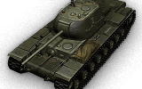<figcaption>KV-4 Turchaninov</figcaption></figure>
<strong>Penetration (mm)</strong> <b>EU</b>  AP <strong>225</strong> /  APCR <strong>255</strong> /  HE <strong>53</strong> → <b>RU</b>  AP <strong>227</strong> /  APCR <strong>262</strong> /  HE <strong>62</strong>

<strong>Damage (HP)</strong> <b>EU</b>  AP <strong>300</strong> /  APCR <strong>300</strong> /  HE <strong>400</strong> → <b>RU</b>  AP <strong>320</strong> /  APCR <strong>320</strong> /  HE <strong>420</strong>

<em>Firepower</em> 
<strong>DPM (HP/min)</strong> <small>EU</small> 2 208.71  <small>RU</small> <strong>2 355.95</strong> 
<strong>Ammo capacity</strong> <small>EU</small> 70  <small>RU</small> <strong>105</strong> 
<strong>Potential damage</strong> <small>EU</small> 21 000  <small>RU</small> <strong>33 600</strong> 
<strong>Clip size</strong> <small>EU</small> — → <small>RU</small> <strong>3</strong> 
<strong>Clip damage · damage</strong> <small>EU</small> — → <small>RU</small> <strong>960</strong> 
<strong>Clip damage · time (s)</strong> <small>EU</small> — → <small>RU</small> <strong>6</strong> 
<strong>Intra-clip reload</strong> <small>EU</small> — → <small>RU</small> <strong>3</strong> 

<em>Gun handling</em> 
<strong>Aim time (s)</strong> <small>EU</small> 2.21  <small>RU</small> <strong>2.49</strong> 
<strong>Dispersion (m/100 m)</strong> <small>EU</small> 0.40  <small>RU</small> <strong>0.36</strong> 
<strong>Dispersion · damaged</strong> <small>EU</small> 0.81  <small>RU</small> <strong>0.73</strong> 
<strong>Dispersion · moving</strong> <small>EU</small> 0.20  <small>RU</small> <strong>0.18</strong> 
<strong>Dispersion · tank traverse</strong> <small>EU</small> 0.20  <small>RU</small> <strong>0.18</strong> 
<strong>Dispersion · turret traverse</strong> <small>EU</small> 0.10  <small>RU</small> <strong>0.14</strong> 
<strong>Dispersion · firing</strong> <small>EU</small> 4  <small>RU</small> <strong>3</strong> 

<em>Mobility</em> 
<strong>Forward speed (km/h)</strong> <small>EU</small> 30  <small>RU</small> <strong>26</strong> 
<strong>Forward speed on hard terrain (km/h)</strong> <small>EU</small> 30  <small>RU</small> <strong>26</strong> 
<strong>Forward speed on medium terrain (km/h)</strong> <small>EU</small> 30  <small>RU</small> <strong>26</strong> 
<strong>Forward speed on soft terrain (km/h)</strong> <small>EU</small> 19.28  <small>RU</small> <strong>18.04</strong> 
<strong>Engine power (hp)</strong> <small>EU</small> 1 140  <small>RU</small> <strong>1 200</strong> 
<strong>Weight (kg)</strong> <small>EU</small> 90 000 → <small>RU</small> <strong>101 250</strong> 
<strong>Power/weight (hp/t)</strong> <small>EU</small> 12.67  <small>RU</small> <strong>11.85</strong> 
<strong>Turret traverse (°/s)</strong> <small>EU</small> 22.95  <small>RU</small> <strong>25.03</strong> 
<strong>Tank traverse (°/s)</strong> <small>EU</small> 22.95  <small>RU</small> <strong>18.77</strong> 
<strong>Tank traverse on hard terrain (°/s)</strong> <small>EU</small> 22.95  <small>RU</small> <strong>18.77</strong> 
<strong>Tank traverse on medium terrain (°/s)</strong> <small>EU</small> 19.89  <small>RU</small> <strong>16.27</strong> 
<strong>Tank traverse on soft terrain (°/s)</strong> <small>EU</small> 11.93  <small>RU</small> <strong>9.76</strong> 

<em>Armor &amp; health</em> 
<strong>Hull armor · rear (mm)</strong> <small>EU</small> 140  <small>RU</small> <strong>90</strong> 
<strong>Turret armor · front (mm)</strong> <small>EU</small> 220  <small>RU</small> <strong>210</strong> 
<strong>Turret armor · rear (mm)</strong> <small>EU</small> 100  <small>RU</small> <strong>130</strong> 
<strong>Health · engine</strong> <small>EU</small> 275  <small>RU</small> <strong>360</strong> 
<strong>Health · ammo rack</strong> <small>EU</small> 210  <small>RU</small> <strong>200</strong> 
<strong>Track repair time (s)</strong> <small>EU</small> 11.70  <small>RU</small> <strong>12.03</strong> 

<em>Miscellaneous</em> 
<strong>Stationary camo · after firing</strong> <small>EU</small> 0.97  <small>RU</small> <strong>0.44</strong> 
<strong>Moving camo · after firing</strong> <small>EU</small> 0.48  <small>RU</small> <strong>0.22</strong> 
<strong>Radio range (m)</strong> <small>EU</small> 594.51  <small>RU</small> <strong>761.39</strong> 
<strong>Shell cost</strong> <small>EU</small> 572  <small>RU</small> <strong>1 010</strong> 

LT-432 · Tier VIII

lt432

<a href="https://tanks.gg/v20410/tank/lt-432">EU stats</a> · <a href="https://tanks.gg/v14600ru/tank/lt-432">RU stats</a>
<figure style="display:inline-block">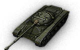<figcaption>LT-432</figcaption></figure>
<em>Firepower</em> 
<strong>DPM (HP/min)</strong> <small>EU</small> 2 166.23  <small>RU</small> <strong>2 121.58</strong> 
<strong>Rate of fire (rounds/min)</strong> <small>EU</small> 12.03  <small>RU</small> <strong>11.79</strong> 
<strong>Reload time (s)</strong> <small>EU</small> 4.99  <small>RU</small> <strong>5.09</strong> 

LTS-85 · Tier VIII

lts85

<a href="https://tanks.gg/v20410/tank/lts-85">EU stats</a> · <a href="https://tanks.gg/v14600ru/tank/lts-85">RU stats</a>
<figure style="display:inline-block">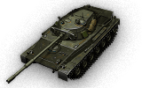<figcaption>LTS-85</figcaption></figure>
<strong>Penetration (mm)</strong> <b>EU</b>  AP <strong>190</strong> /  HEAT <strong>250</strong> /  HE <strong>50</strong> → <b>RU</b>  AP <strong>221</strong> /  HEAT <strong>280</strong> /  HE <strong>50</strong>

<em>Firepower</em> 
<strong>DPM (HP/min)</strong> <small>EU</small> 1 500  <small>RU</small> <strong>2 278.48</strong> 
<strong>Rate of fire (rounds/min)</strong> <small>EU</small> 5  <small>RU</small> <strong>7.59</strong> 
<strong>Reload time (s)</strong> <small>EU</small> 12  <small>RU</small> <strong>7.90</strong> 

<em>Gun handling</em> 
<strong>Aim time (s)</strong> <small>EU</small> 2.21  <small>RU</small> <strong>1.82</strong> 
<strong>Dispersion (m/100 m)</strong> <small>EU</small> 0.42  <small>RU</small> <strong>0.31</strong> 
<strong>Dispersion · damaged</strong> <small>EU</small> 0.84  <small>RU</small> <strong>0.61</strong> 

<em>Mobility</em> 
<strong>Forward speed (km/h)</strong> <small>EU</small> 65  <small>RU</small> <strong>60</strong> 
<strong>Forward speed on hard terrain (km/h)</strong> <small>EU</small> 65  <small>RU</small> <strong>60</strong> 
<strong>Forward speed on medium terrain (km/h)</strong> <small>EU</small> 65  <small>RU</small> <strong>60</strong> 
<strong>Forward speed on soft terrain (km/h)</strong> <small>EU</small> 65  <small>RU</small> <strong>60</strong> 
<strong>Reverse speed (km/h)</strong> <small>EU</small> 23  <small>RU</small> <strong>20</strong> 

<em>Armor &amp; health</em> 
<strong>Health</strong> <small>EU</small> 1 150  <small>RU</small> <strong>1 300</strong> 

<em>Miscellaneous</em> 
<strong>Moving camo</strong> <small>EU</small> 15.62  <small>RU</small> <strong>11.68</strong> 
<strong>Moving camo · after firing</strong> <small>EU</small> 3.09  <small>RU</small> <strong>2.31</strong> 

LTTB · Tier VIII

lttb

<a href="https://tanks.gg/v20410/tank/lttb">EU stats</a> · <a href="https://tanks.gg/v14600ru/tank/lttb">RU stats</a>
<figure style="display:inline-block">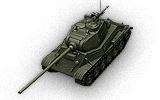<figcaption>LTTB</figcaption></figure>
<strong>Penetration (mm)</strong> <b>EU</b>  AP <strong>185</strong> /  APCR <strong>216</strong> /  HE <strong>44</strong> → <b>RU</b>  AP <strong>170</strong> /  APCR <strong>216</strong> /  HE <strong>44</strong>

<em>Firepower</em> 
<strong>DPM (HP/min)</strong> <small>EU</small> 2 208.71  <small>RU</small> <strong>2 086</strong> 
<strong>Rate of fire (rounds/min)</strong> <small>EU</small> 12.27  <small>RU</small> <strong>11.59</strong> 
<strong>Reload time (s)</strong> <small>EU</small> 4.89  <small>RU</small> <strong>5.18</strong> 

<em>Gun handling</em> 
<strong>Aim time (s)</strong> <small>EU</small> 1.92  <small>RU</small> <strong>2.01</strong> 
<strong>Dispersion (m/100 m)</strong> <small>EU</small> 0.34  <small>RU</small> <strong>0.35</strong> 
<strong>Dispersion · damaged</strong> <small>EU</small> 0.67  <small>RU</small> <strong>0.69</strong> 
<strong>Dispersion · moving</strong> <small>EU</small> 0.10  <small>RU</small> <strong>0.12</strong> 
<strong>Dispersion · tank traverse</strong> <small>EU</small> 0.10  <small>RU</small> <strong>0.12</strong> 
<strong>Dispersion · firing</strong> <small>EU</small> 3  <small>RU</small> <strong>4</strong> 

<em>Mobility</em> 
<strong>Forward speed (km/h)</strong> <small>EU</small> 73  <small>RU</small> <strong>68</strong> 
<strong>Forward speed on hard terrain (km/h)</strong> <small>EU</small> 73  <small>RU</small> <strong>68</strong> 
<strong>Forward speed on medium terrain (km/h)</strong> <small>EU</small> 73  <small>RU</small> <strong>68</strong> 
<strong>Forward speed on soft terrain (km/h)</strong> <small>EU</small> 73  <small>RU</small> <strong>68</strong> 
<strong>Reverse speed (km/h)</strong> <small>EU</small> 25  <small>RU</small> <strong>20</strong> 
<strong>Engine power (hp)</strong> <small>EU</small> 900  <small>RU</small> <strong>770</strong> 
<strong>Weight (kg)</strong> <small>EU</small> 22 530 → <small>RU</small> <strong>22 680</strong> 
<strong>Power/weight (hp/t)</strong> <small>EU</small> 39.95  <small>RU</small> <strong>33.95</strong> 
<strong>Terrain resist (hard)</strong> <small>EU</small> 0.86  <small>RU</small> <strong>0.90</strong> 
<strong>Terrain resist (med)</strong> <small>EU</small> 0.96  <small>RU</small> <strong>1</strong> 
<strong>Terrain resist (soft)</strong> <small>EU</small> 1.53  <small>RU</small> <strong>1.60</strong> 
<strong>Tank traverse (°/s)</strong> <small>EU</small> 66.75  <small>RU</small> <strong>50.06</strong> 
<strong>Tank traverse on hard terrain (°/s)</strong> <small>EU</small> 69.89  <small>RU</small> <strong>63.17</strong> 
<strong>Tank traverse on medium terrain (°/s)</strong> <small>EU</small> 62.90  <small>RU</small> <strong>56.86</strong> 
<strong>Tank traverse on soft terrain (°/s)</strong> <small>EU</small> 39.32  <small>RU</small> <strong>35.53</strong> 

<em>Armor &amp; health</em> 
<strong>Track armor</strong> <small>EU</small> 20  <small>RU</small> <strong>15</strong> 
<strong>Health</strong> <small>EU</small> 1 300  <small>RU</small> <strong>1 050</strong> 

<em>Miscellaneous</em> 
<strong>Stationary camo</strong> <small>EU</small> 16.13  <small>RU</small> <strong>15.39</strong> 
<strong>Stationary camo · after firing</strong> <small>EU</small> 3.84  <small>RU</small> <strong>3.66</strong> 
<strong>Moving camo</strong> <small>EU</small> 16.13  <small>RU</small> <strong>15.39</strong> 
<strong>Moving camo · after firing</strong> <small>EU</small> 3.84  <small>RU</small> <strong>3.66</strong> 
<strong>View range (m)</strong> <small>EU</small> 400  <small>RU</small> <strong>380</strong> 

Object 168 German · Tier VIII

object168german

<a href="https://tanks.gg/v20410/tank/obj-168g">EU stats</a> · <a href="https://tanks.gg/v14600ru/tank/obyekt-168n">RU stats</a>
<figure style="display:inline-block">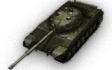<figcaption>EU · Object 168 German</figcaption></figure><figure style="display:inline-block">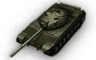<figcaption>RU · Объект 168Н</figcaption></figure>
<strong>Penetration (mm)</strong> <b>EU</b>  AP <strong>227</strong> /  APCR <strong>285</strong> /  HE <strong>62</strong> → <b>RU</b>  AP <strong>227</strong> /  APCR <strong>289</strong> /  HE <strong>62</strong>

<strong>Damage (HP)</strong> <b>EU</b>  AP <strong>340</strong> /  APCR <strong>340</strong> /  HE <strong>450</strong> → <b>RU</b>  AP <strong>320</strong> /  APCR <strong>320</strong> /  HE <strong>420</strong>

<em>Firepower</em> 
<strong>DPM (HP/min)</strong> <small>EU</small> 2 193.53  <small>RU</small> <strong>2 225.07</strong> 
<strong>Rate of fire (rounds/min)</strong> <small>EU</small> 6.45  <small>RU</small> <strong>6.95</strong> 
<strong>Reload time (s)</strong> <small>EU</small> 9.30  <small>RU</small> <strong>8.63</strong> 
<strong>Potential damage</strong> <small>EU</small> 17 000  <small>RU</small> <strong>16 000</strong> 

<em>Gun handling</em> 
<strong>Aim time (s)</strong> <small>EU</small> 2.01  <small>RU</small> <strong>2.11</strong> 
<strong>Dispersion · moving</strong> <small>EU</small> 0.17  <small>RU</small> <strong>0.20</strong> 
<strong>Dispersion · tank traverse</strong> <small>EU</small> 0.17  <small>RU</small> <strong>0.20</strong> 
<strong>Dispersion · firing</strong> <small>EU</small> 3  <small>RU</small> <strong>4</strong> 
<strong>Elevation (°)</strong> <small>EU</small> 23  <small>RU</small> <strong>23.08</strong> 
<strong>Depression (°)</strong> <small>EU</small> 5  <small>RU</small> <strong>7.50</strong> 

<em>Mobility</em> 
<strong>Forward speed on medium terrain (km/h)</strong> <small>EU</small> 54.37  <small>RU</small> <strong>60</strong> 
<strong>Forward speed on soft terrain (km/h)</strong> <small>EU</small> 34.60  <small>RU</small> <strong>40.07</strong> 
<strong>Reverse speed (km/h)</strong> <small>EU</small> 18  <small>RU</small> <strong>20</strong> 
<strong>Weight (kg)</strong> <small>EU</small> 40 000 → <small>RU</small> <strong>39 995</strong> 
<strong>Terrain resist (med)</strong> <small>EU</small> 1.34  <small>RU</small> <strong>1.15</strong> 
<strong>Terrain resist (soft)</strong> <small>EU</small> 2.11  <small>RU</small> <strong>1.82</strong> 
<strong>Turret traverse (°/s)</strong> <small>EU</small> 37.55  <small>RU</small> <strong>41.72</strong> 
<strong>Tank traverse (°/s)</strong> <small>EU</small> 52.15  <small>RU</small> <strong>39.63</strong> 
<strong>Tank traverse on hard terrain (°/s)</strong> <small>EU</small> 49.54  <small>RU</small> <strong>39.63</strong> 
<strong>Tank traverse on medium terrain (°/s)</strong> <small>EU</small> 38.93  <small>RU</small> <strong>36.33</strong> 
<strong>Tank traverse on soft terrain (°/s)</strong> <small>EU</small> 24.77  <small>RU</small> <strong>22.95</strong> 

<em>Armor &amp; health</em> 
<strong>Hull armor · side (mm)</strong> <small>EU</small> 50  <small>RU</small> <strong>66</strong> 
<strong>Hull armor · rear (mm)</strong> <small>EU</small> 40  <small>RU</small> <strong>30</strong> 
<strong>Turret armor · front (mm)</strong> <small>EU</small> 150  <small>RU</small> <strong>160</strong> 
<strong>Turret armor · side (mm)</strong> <small>EU</small> 80  <small>RU</small> <strong>110</strong> 
<strong>Turret armor · rear (mm)</strong> <small>EU</small> 45  <small>RU</small> <strong>60</strong> 
<strong>Health · engine</strong> <small>EU</small> 370  <small>RU</small> <strong>260</strong> 
<strong>Health · track</strong> <small>EU</small> 240  <small>RU</small> <strong>200</strong> 
<strong>Health · ammo rack</strong> <small>EU</small> 252  <small>RU</small> <strong>180</strong> 
<strong>Track repair time (s)</strong> <small>EU</small> 8.02  <small>RU</small> <strong>10.03</strong> 

<em>Miscellaneous</em> 
<strong>Stationary camo</strong> <small>EU</small> 16.30  <small>RU</small> <strong>14.82</strong> 
<strong>Stationary camo · after firing</strong> <small>EU</small> 3.23  <small>RU</small> <strong>2.93</strong> 
<strong>Moving camo</strong> <small>EU</small> 12.20  <small>RU</small> <strong>11.12</strong> 
<strong>Moving camo · after firing</strong> <small>EU</small> 2.42  <small>RU</small> <strong>2.20</strong> 
<strong>View range (m)</strong> <small>EU</small> 390  <small>RU</small> <strong>380</strong> 
<strong>Fire chance (%)</strong> <small>EU</small> 12  <small>RU</small> <strong>15</strong> 
<strong>Shell cost</strong> <small>EU</small> 250  <small>RU</small> <strong>1 010</strong> 

Object 259A · Tier VIII

object259a

<a href="https://tanks.gg/v20410/tank/obj-259a">EU stats</a> · <a href="https://tanks.gg/v14600ru/tank/ob-259a">RU stats</a>
<figure style="display:inline-block">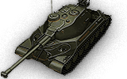<figcaption>Object 259A</figcaption></figure>
<em>Gun handling</em> 
<strong>Dispersion (m/100 m)</strong> <small>EU</small> 0.36  <small>RU</small> <strong>0.40</strong> 
<strong>Dispersion · damaged</strong> <small>EU</small> 0.73  <small>RU</small> <strong>0.81</strong> 
<strong>Dispersion · moving</strong> <small>EU</small> 0.19  <small>RU</small> <strong>0.24</strong> 
<strong>Dispersion · tank traverse</strong> <small>EU</small> 0.19  <small>RU</small> <strong>0.24</strong> 

<em>Mobility</em> 
<strong>Forward speed (km/h)</strong> <small>EU</small> 60  <small>RU</small> <strong>55</strong> 
<strong>Forward speed on hard terrain (km/h)</strong> <small>EU</small> 43.91  <small>RU</small> <strong>41.47</strong> 
<strong>Forward speed on medium terrain (km/h)</strong> <small>EU</small> 33.58  <small>RU</small> <strong>31.72</strong> 
<strong>Forward speed on soft terrain (km/h)</strong> <small>EU</small> 22.84  <small>RU</small> <strong>21.57</strong> 
<strong>Engine power (hp)</strong> <small>EU</small> 900  <small>RU</small> <strong>850</strong> 
<strong>Power/weight (hp/t)</strong> <small>EU</small> 15  <small>RU</small> <strong>14.17</strong> 

Object 416 · Tier VIII

object416

<a href="https://tanks.gg/v20410/tank/obj-416">EU stats</a> · <a href="https://tanks.gg/v14600ru/tank/ob-416">RU stats</a>
<figure style="display:inline-block">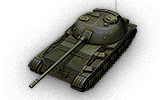<figcaption>Object 416</figcaption></figure>
<strong>Penetration (mm)</strong> <b>EU</b>  AP <strong>216</strong> /  HEAT <strong>330</strong> /  HE <strong>50</strong> → <b>RU</b>  AP <strong>221</strong> /  HEAT <strong>330</strong> /  HE <strong>50</strong>

<em>Firepower</em> 
<strong>Ammo capacity</strong> <small>EU</small> 35  <small>RU</small> <strong>40</strong> 
<strong>Potential damage</strong> <small>EU</small> 11 200  <small>RU</small> <strong>12 800</strong> 

<em>Gun handling</em> 
<strong>Aim time (s)</strong> <small>EU</small> 1.92  <small>RU</small> <strong>2.01</strong> 
<strong>Dispersion (m/100 m)</strong> <small>EU</small> 0.34  <small>RU</small> <strong>0.33</strong> 
<strong>Dispersion · damaged</strong> <small>EU</small> 0.67  <small>RU</small> <strong>0.65</strong> 
<strong>Depression (°)</strong> <small>EU</small> 4  <small>RU</small> <strong>6</strong> 

<em>Mobility</em> 
<strong>Forward speed (km/h)</strong> <small>EU</small> 55  <small>RU</small> <strong>50</strong> 
<strong>Forward speed on hard terrain (km/h)</strong> <small>EU</small> 55  <small>RU</small> <strong>50</strong> 
<strong>Forward speed on medium terrain (km/h)</strong> <small>EU</small> 55  <small>RU</small> <strong>50</strong> 
<strong>Forward speed on soft terrain (km/h)</strong> <small>EU</small> 43.61  <small>RU</small> <strong>41.92</strong> 
<strong>Engine power (hp)</strong> <small>EU</small> 440  <small>RU</small> <strong>423</strong> 
<strong>Power/weight (hp/t)</strong> <small>EU</small> 18.33  <small>RU</small> <strong>17.63</strong> 
<strong>Tank traverse on hard terrain (°/s)</strong> <small>EU</small> 52.08  <small>RU</small> <strong>52.23</strong> 
<strong>Tank traverse on medium terrain (°/s)</strong> <small>EU</small> 45.57  <small>RU</small> <strong>45.70</strong> 
<strong>Tank traverse on soft terrain (°/s)</strong> <small>EU</small> 22.78  <small>RU</small> <strong>22.85</strong> 

<em>Armor &amp; health</em> 
<strong>Health</strong> <small>EU</small> 1 450  <small>RU</small> <strong>1 400</strong> 

<em>Miscellaneous</em> 
<strong>Moving camo</strong> <small>EU</small> 18.13  <small>RU</small> <strong>14.55</strong> 
<strong>Moving camo · after firing</strong> <small>EU</small> 3.59  <small>RU</small> <strong>2.88</strong> 

Object 701 · Tier VIII

object701

<a href="https://tanks.gg/v20410/tank/obj-701">EU stats</a> · <a href="https://tanks.gg/v14600ru/tank/ob-701">RU stats</a>
<figure style="display:inline-block">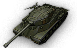<figcaption>EU · Object 701</figcaption></figure><figure style="display:inline-block">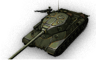<figcaption>RU · Объект 701</figcaption></figure>
<strong>Penetration (mm)</strong> <b>EU</b>  AP <strong>203</strong> /  HEAT <strong>270</strong> /  HE <strong>68</strong> → <b>RU</b>  AP <strong>215</strong> /  APCR <strong>264</strong> /  HE <strong>50</strong>

<strong>Damage (HP)</strong> <b>EU</b>  AP <strong>390</strong> /  HEAT <strong>390</strong> /  HE <strong>530</strong> → <b>RU</b>  AP <strong>250</strong> /  APCR <strong>250</strong> /  HE <strong>330</strong>

<em>Firepower</em> 
<strong>DPM (HP/min)</strong> <small>EU</small> 1 574.59  <small>RU</small> <strong>2 172.92</strong> 
<strong>Module damage</strong> <small>EU</small> 165  <small>RU</small> <strong>135</strong> 
<strong>Rate of fire (rounds/min)</strong> <small>EU</small> 4.04  <small>RU</small> <strong>8.69</strong> 
<strong>Reload time (s)</strong> <small>EU</small> 14.86  <small>RU</small> <strong>6.90</strong> 
<strong>Caliber</strong> <small>EU</small> 122  <small>RU</small> <strong>100</strong> 
<strong>Shell velocity (m/s)</strong> <small>EU</small> 790  <small>RU</small> <strong>900</strong> 
<strong>Ammo capacity</strong> <small>EU</small> 30  <small>RU</small> <strong>52</strong> 
<strong>Potential damage</strong> <small>EU</small> 11 700  <small>RU</small> <strong>13 000</strong> 

<em>Gun handling</em> 
<strong>Aim time (s)</strong> <small>EU</small> 2.78  <small>RU</small> <strong>2.21</strong> 
<strong>Dispersion (m/100 m)</strong> <small>EU</small> 0.43  <small>RU</small> <strong>0.34</strong> 
<strong>Dispersion · damaged</strong> <small>EU</small> 0.86  <small>RU</small> <strong>0.67</strong> 
<strong>Dispersion · moving</strong> <small>EU</small> 0.25  <small>RU</small> <strong>0.18</strong> 
<strong>Dispersion · tank traverse</strong> <small>EU</small> 0.25  <small>RU</small> <strong>0.18</strong> 
<strong>Dispersion · turret traverse</strong> <small>EU</small> 0.15  <small>RU</small> <strong>0.10</strong> 
<strong>Depression (°)</strong> <small>EU</small> 5  <small>RU</small> <strong>6</strong> 

<em>Mobility</em> 
<strong>Forward speed (km/h)</strong> <small>EU</small> 30  <small>RU</small> <strong>32</strong> 
<strong>Forward speed on hard terrain (km/h)</strong> <small>EU</small> 30  <small>RU</small> <strong>32</strong> 
<strong>Forward speed on medium terrain (km/h)</strong> <small>EU</small> 30  <small>RU</small> <strong>32</strong> 
<strong>Forward speed on soft terrain (km/h)</strong> <small>EU</small> 25.95  <small>RU</small> <strong>19.52</strong> 
<strong>Reverse speed (km/h)</strong> <small>EU</small> 12  <small>RU</small> <strong>13</strong> 
<strong>Weight (kg)</strong> <small>EU</small> 55 000 → <small>RU</small> <strong>58 500</strong> 
<strong>Power/weight (hp/t)</strong> <small>EU</small> 13.64  <small>RU</small> <strong>12.82</strong> 
<strong>Terrain resist (hard)</strong> <small>EU</small> 0.96  <small>RU</small> <strong>1.25</strong> 
<strong>Terrain resist (med)</strong> <small>EU</small> 1.05  <small>RU</small> <strong>1.44</strong> 
<strong>Terrain resist (soft)</strong> <small>EU</small> 1.92  <small>RU</small> <strong>2.40</strong> 
<strong>Turret traverse (°/s)</strong> <small>EU</small> 20.86  <small>RU</small> <strong>33.38</strong> 
<strong>Tank traverse (°/s)</strong> <small>EU</small> 20.86  <small>RU</small> <strong>27.12</strong> 
<strong>Tank traverse on hard terrain (°/s)</strong> <small>EU</small> 20.86  <small>RU</small> <strong>27.12</strong> 
<strong>Tank traverse on medium terrain (°/s)</strong> <small>EU</small> 18.96  <small>RU</small> <strong>23.50</strong> 
<strong>Tank traverse on soft terrain (°/s)</strong> <small>EU</small> 10.43  <small>RU</small> <strong>14.10</strong> 

<em>Armor &amp; health</em> 
<strong>Hull armor · front (mm)</strong> <small>EU</small> 120  <small>RU</small> <strong>140</strong> 
<strong>Health</strong> <small>EU</small> 1 650  <small>RU</small> <strong>1 500</strong> 

<em>Miscellaneous</em> 
<strong>Stationary camo</strong> <small>EU</small> 5.99  <small>RU</small> <strong>6.33</strong> 
<strong>Stationary camo · after firing</strong> <small>EU</small> 1.14  <small>RU</small> <strong>1.32</strong> 
<strong>Moving camo</strong> <small>EU</small> 2.96  <small>RU</small> <strong>3.19</strong> 
<strong>Moving camo · after firing</strong> <small>EU</small> 0.56  <small>RU</small> <strong>0.67</strong> 
<strong>View range (m)</strong> <small>EU</small> 340  <small>RU</small> <strong>350</strong> 
<strong>Radio range (m)</strong> <small>EU</small> 730  <small>RU</small> <strong>625</strong> 
<strong>Shell cost</strong> <small>EU</small> 1 065  <small>RU</small> <strong>600</strong> 

SU-101 · Tier VIII

su101

<a href="https://tanks.gg/v20410/tank/su-101">EU stats</a> · <a href="https://tanks.gg/v14600ru/tank/su-101">RU stats</a>
<figure style="display:inline-block">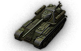<figcaption>SU-101</figcaption></figure>
<em>Gun handling</em> 
<strong>Gun traverse · left (°)</strong> <small>EU</small> -10  <small>RU</small> <strong>-12</strong> 

<em>Mobility</em> 
<strong>Tank traverse on hard terrain (°/s)</strong> <small>EU</small> 26.61  <small>RU</small> <strong>26.62</strong> 
<strong>Tank traverse on medium terrain (°/s)</strong> <small>EU</small> 22.17  <small>RU</small> <strong>22.19</strong> 
<strong>Tank traverse on soft terrain (°/s)</strong> <small>EU</small> 13.30  <small>RU</small> <strong>13.31</strong> 

<em>Armor &amp; health</em> 
<strong>Hull armor · front (mm)</strong> <small>EU</small> 150  <small>RU</small> <strong>160</strong> 
<strong>Health</strong> <small>EU</small> 1 300  <small>RU</small> <strong>1 400</strong> 

<em>Miscellaneous</em> 
<strong>View range (m)</strong> <small>EU</small> 360  <small>RU</small> <strong>350</strong> 

SU-14-2 · Tier VIII

su142

<a href="https://tanks.gg/v20410/tank/su-14-2">EU stats</a> · <a href="https://tanks.gg/v14600ru/tank/su-14-2">RU stats</a>
<figure style="display:inline-block">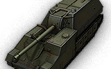<figcaption>SU-14-2</figcaption></figure>
<strong>Penetration (mm)</strong> <b>EU</b>  HE <strong>52</strong> /  HE <strong>65</strong> /  AP <strong>258</strong> → <b>RU</b>  HE <strong>51</strong> /  AP <strong>258</strong>

<strong>Damage (HP)</strong> <b>EU</b>  HE <strong>900</strong> /  HE <strong>1200</strong> /  AP <strong>600</strong> → <b>RU</b>  HE <strong>1200</strong> /  AP <strong>650</strong>

<em>Firepower</em> 
<strong>DPM (HP/min)</strong> <small>EU</small> 1 280.05  <small>RU</small> <strong>1 831.61</strong> 
<strong>Rate of fire (rounds/min)</strong> <small>EU</small> 1.42  <small>RU</small> <strong>1.53</strong> 
<strong>Reload time (s)</strong> <small>EU</small> 42.19  <small>RU</small> <strong>39.31</strong> 
<strong>Explosion radius</strong> <small>EU</small> 10.40  <small>RU</small> <strong>8</strong> 
<strong>Stun duration · maximum (s)</strong> <small>EU</small> 28 → <small>RU</small> <strong>—</strong> 
<strong>Stun duration · minimum (s)</strong> <small>EU</small> 12.60 → <small>RU</small> <strong>—</strong> 
<strong>Shell velocity (m/s)</strong> <small>EU</small> 425  <small>RU</small> <strong>480</strong> 
<strong>Max range (m)</strong> <small>EU</small> 1 263.11  <small>RU</small> <strong>1 467.52</strong> 
<strong>Potential damage</strong> <small>EU</small> 14 400  <small>RU</small> <strong>19 200</strong> 

<em>Gun handling</em> 
<strong>Aim time (s)</strong> <small>EU</small> 5.37  <small>RU</small> <strong>5.08</strong> 

<em>Mobility</em> 
<strong>Tank traverse on hard terrain (°/s)</strong> <small>EU</small> 22.38  <small>RU</small> <strong>22.37</strong> 

<em>Armor &amp; health</em> 
<strong>Health · engine</strong> <small>EU</small> 275  <small>RU</small> <strong>90</strong> 
<strong>Health · track</strong> <small>EU</small> 220  <small>RU</small> <strong>140</strong> 
<strong>Health · ammo rack</strong> <small>EU</small> 210  <small>RU</small> <strong>100</strong> 
<strong>Track repair time (s)</strong> <small>EU</small> 11.70  <small>RU</small> <strong>12.81</strong> 

<em>Miscellaneous</em> 
<strong>Moving camo</strong> <small>EU</small> 1.77  <small>RU</small> <strong>1.71</strong> 
<strong>Shell cost</strong> <small>EU</small> 1 910  <small>RU</small> <strong>2 270</strong> 

T-44 · Tier VIII

t44

<a href="https://tanks.gg/v20410/tank/t-44">EU stats</a> · <a href="https://tanks.gg/v14600ru/tank/t-44">RU stats</a>
<figure style="display:inline-block">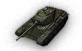<figcaption>T-44</figcaption></figure>
<strong>Penetration (mm)</strong> <b>EU</b>  AP <strong>175</strong> /  APCR <strong>217</strong> /  HE <strong>61</strong> → <b>RU</b>  AP <strong>196</strong> /  APCR <strong>225</strong> /  HE <strong>61</strong>

<em>Firepower</em> 
<strong>DPM (HP/min)</strong> <small>EU</small> 1 877.40  <small>RU</small> <strong>1 821.36</strong> 
<strong>Rate of fire (rounds/min)</strong> <small>EU</small> 4.81  <small>RU</small> <strong>4.67</strong> 
<strong>Reload time (s)</strong> <small>EU</small> 12.46  <small>RU</small> <strong>12.85</strong> 

<em>Gun handling</em> 
<strong>Dispersion (m/100 m)</strong> <small>EU</small> 0.38  <small>RU</small> <strong>0.40</strong> 
<strong>Dispersion · damaged</strong> <small>EU</small> 0.77  <small>RU</small> <strong>0.81</strong> 
<strong>Dispersion · moving</strong> <small>EU</small> 0.12  <small>RU</small> <strong>0.14</strong> 
<strong>Dispersion · tank traverse</strong> <small>EU</small> 0.12  <small>RU</small> <strong>0.14</strong> 

<em>Mobility</em> 
<strong>Forward speed (km/h)</strong> <small>EU</small> 56  <small>RU</small> <strong>51</strong> 
<strong>Forward speed on hard terrain (km/h)</strong> <small>EU</small> 56  <small>RU</small> <strong>51</strong> 
<strong>Forward speed on medium terrain (km/h)</strong> <small>EU</small> 56  <small>RU</small> <strong>51</strong> 
<strong>Forward speed on soft terrain (km/h)</strong> <small>EU</small> 40.67  <small>RU</small> <strong>42.34</strong> 
<strong>Engine power (hp)</strong> <small>EU</small> 730  <small>RU</small> <strong>760</strong> 
<strong>Power/weight (hp/t)</strong> <small>EU</small> 21.37  <small>RU</small> <strong>22.25</strong> 
<strong>Tank traverse (°/s)</strong> <small>EU</small> 58.41  <small>RU</small> <strong>45.89</strong> 
<strong>Tank traverse on hard terrain (°/s)</strong> <small>EU</small> 61.20  <small>RU</small> <strong>55.84</strong> 
<strong>Tank traverse on medium terrain (°/s)</strong> <small>EU</small> 51  <small>RU</small> <strong>46.53</strong> 
<strong>Tank traverse on soft terrain (°/s)</strong> <small>EU</small> 30.60  <small>RU</small> <strong>27.92</strong> 

<em>Armor &amp; health</em> 
<strong>Hull armor · front (mm)</strong> <small>EU</small> 105  <small>RU</small> <strong>90</strong> 
<strong>Turret armor · front (mm)</strong> <small>EU</small> 200  <small>RU</small> <strong>240</strong> 
<strong>Health</strong> <small>EU</small> 1 450  <small>RU</small> <strong>1 400</strong> 

T-44 FL · Tier VIII

t44fl

<a href="https://tanks.gg/v20410/tank/t-44-fl">EU stats</a> · <a href="https://tanks.gg/v14600ru/tank/t-44-lf">RU stats</a>
<figure style="display:inline-block">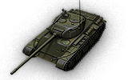<figcaption>T-44 FL</figcaption></figure>
<strong>Penetration (mm)</strong> <b>EU</b>  AP <strong>215</strong> /  APCR <strong>267</strong> /  HE <strong>50</strong> → <b>RU</b>  AP <strong>205</strong> /  APCR <strong>258</strong> /  HE <strong>50</strong>

<em>Firepower</em> 
<strong>DPM (HP/min)</strong> <small>EU</small> 2 300.74  <small>RU</small> <strong>2 086</strong> 
<strong>Rate of fire (rounds/min)</strong> <small>EU</small> 9.20  <small>RU</small> <strong>8.34</strong> 
<strong>Reload time (s)</strong> <small>EU</small> 6.52  <small>RU</small> <strong>7.19</strong> 
<strong>Shell velocity (m/s)</strong> <small>EU</small> 970  <small>RU</small> <strong>880</strong> 

<em>Gun handling</em> 
<strong>Dispersion · moving</strong> <small>EU</small> 0.12  <small>RU</small> <strong>0.14</strong> 
<strong>Dispersion · tank traverse</strong> <small>EU</small> 0.12  <small>RU</small> <strong>0.14</strong> 

<em>Mobility</em> 
<strong>Forward speed (km/h)</strong> <small>EU</small> 56  <small>RU</small> <strong>51</strong> 
<strong>Forward speed on hard terrain (km/h)</strong> <small>EU</small> 56  <small>RU</small> <strong>51</strong> 
<strong>Forward speed on medium terrain (km/h)</strong> <small>EU</small> 56  <small>RU</small> <strong>51</strong> 
<strong>Forward speed on soft terrain (km/h)</strong> <small>EU</small> 40.91  <small>RU</small> <strong>42.59</strong> 
<strong>Engine power (hp)</strong> <small>EU</small> 730  <small>RU</small> <strong>760</strong> 
<strong>Power/weight (hp/t)</strong> <small>EU</small> 21.50  <small>RU</small> <strong>22.38</strong> 
<strong>Tank traverse (°/s)</strong> <small>EU</small> 58.41  <small>RU</small> <strong>45.89</strong> 
<strong>Tank traverse on hard terrain (°/s)</strong> <small>EU</small> 58.41  <small>RU</small> <strong>45.89</strong> 
<strong>Tank traverse on medium terrain (°/s)</strong> <small>EU</small> 48.67  <small>RU</small> <strong>38.24</strong> 
<strong>Tank traverse on soft terrain (°/s)</strong> <small>EU</small> 29.20  <small>RU</small> <strong>22.95</strong> 

<em>Armor &amp; health</em> 
<strong>Hull armor · front (mm)</strong> <small>EU</small> 105  <small>RU</small> <strong>90</strong> 
<strong>Turret armor · front (mm)</strong> <small>EU</small> 200  <small>RU</small> <strong>240</strong> 
<strong>Health</strong> <small>EU</small> 1 450  <small>RU</small> <strong>1 400</strong> 

T-44-100 · Tier VIII

t44100

<a href="https://tanks.gg/v20410/tank/t-44-100">EU stats</a> · <a href="https://tanks.gg/v14600ru/tank/t-44-100">RU stats</a>
<figure style="display:inline-block">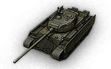<figcaption>T-44-100</figcaption></figure>
<strong>Penetration (mm)</strong> <b>EU</b>  AP <strong>210</strong> /  APCR <strong>253</strong> /  HE <strong>50</strong> → <b>RU</b>  AP <strong>205</strong> /  APCR <strong>258</strong> /  HE <strong>50</strong>

<em>Firepower</em> 
<strong>DPM (HP/min)</strong> <small>EU</small> 2 406.92  <small>RU</small> <strong>2 086</strong> 
<strong>Rate of fire (rounds/min)</strong> <small>EU</small> 9.63  <small>RU</small> <strong>8.34</strong> 
<strong>Reload time (s)</strong> <small>EU</small> 6.23  <small>RU</small> <strong>7.19</strong> 

<em>Gun handling</em> 
<strong>Dispersion · moving</strong> <small>EU</small> 0.10  <small>RU</small> <strong>0.12</strong> 
<strong>Dispersion · tank traverse</strong> <small>EU</small> 0.10  <small>RU</small> <strong>0.12</strong> 
<strong>Dispersion · turret traverse</strong> <small>EU</small> 0.08  <small>RU</small> <strong>0.11</strong> 

<em>Armor &amp; health</em> 
<strong>Turret armor · front (mm)</strong> <small>EU</small> 190  <small>RU</small> <strong>240</strong> 
<strong>Health</strong> <small>EU</small> 1 350  <small>RU</small> <strong>1 400</strong> 

T-44-100 Igrovoy · Tier VIII

t44100igrovoy

<a href="https://tanks.gg/v20410/tank/t-44-100-i">EU stats</a> · <a href="https://tanks.gg/v14600ru/tank/t-44-100-i">RU stats</a>
<figure style="display:inline-block">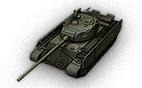<figcaption>T-44-100 Igrovoy</figcaption></figure>
<strong>Penetration (mm)</strong> <b>EU</b>  AP <strong>210</strong> /  APCR <strong>253</strong> /  HE <strong>50</strong> → <b>RU</b>  AP <strong>205</strong> /  APCR <strong>258</strong> /  HE <strong>50</strong>

<em>Firepower</em> 
<strong>DPM (HP/min)</strong> <small>EU</small> 2 406.92  <small>RU</small> <strong>2 086</strong> 
<strong>Rate of fire (rounds/min)</strong> <small>EU</small> 9.63  <small>RU</small> <strong>8.34</strong> 
<strong>Reload time (s)</strong> <small>EU</small> 6.23  <small>RU</small> <strong>7.19</strong> 

<em>Gun handling</em> 
<strong>Dispersion · moving</strong> <small>EU</small> 0.10  <small>RU</small> <strong>0.12</strong> 
<strong>Dispersion · tank traverse</strong> <small>EU</small> 0.10  <small>RU</small> <strong>0.12</strong> 
<strong>Dispersion · turret traverse</strong> <small>EU</small> 0.08  <small>RU</small> <strong>0.11</strong> 

<em>Armor &amp; health</em> 
<strong>Turret armor · front (mm)</strong> <small>EU</small> 190  <small>RU</small> <strong>240</strong> 
<strong>Health</strong> <small>EU</small> 1 350  <small>RU</small> <strong>1 400</strong> 

T-54 first prototype · Tier VIII

t54firstprototype

<a href="https://tanks.gg/v20410/tank/t-54-mod-1">EU stats</a> · <a href="https://tanks.gg/v14600ru/tank/t-54-obr-1">RU stats</a>
<figure style="display:inline-block">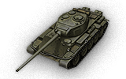<figcaption>T-54 first prototype</figcaption></figure>
<strong>Penetration (mm)</strong> <b>EU</b>  AP <strong>190</strong> /  APCR <strong>247</strong> /  HE <strong>50</strong> → <b>RU</b>  AP <strong>210</strong> /  APCR <strong>260</strong> /  HE <strong>50</strong>

<em>Firepower</em> 
<strong>DPM (HP/min)</strong> <small>EU</small> 1 955.63  <small>RU</small> <strong>2 086</strong> 
<strong>Rate of fire (rounds/min)</strong> <small>EU</small> 7.82  <small>RU</small> <strong>8.34</strong> 
<strong>Reload time (s)</strong> <small>EU</small> 7.67  <small>RU</small> <strong>7.19</strong> 

<em>Gun handling</em> 
<strong>Dispersion · moving</strong> <small>EU</small> 0.20  <small>RU</small> <strong>0.14</strong> 
<strong>Dispersion · tank traverse</strong> <small>EU</small> 0.20  <small>RU</small> <strong>0.14</strong> 
<strong>Dispersion · turret traverse</strong> <small>EU</small> 0.12  <small>RU</small> <strong>0.10</strong> 

T-54 first prototype FL · Tier VIII

t54firstprototypefl

<a href="https://tanks.gg/v20410/tank/t-54-mod-1-fl">EU stats</a> · <a href="https://tanks.gg/v14600ru/tank/t-54-obr-1-lf">RU stats</a>
<figure style="display:inline-block"><figcaption>T-54 first prototype FL</figcaption></figure>
<strong>Penetration (mm)</strong> <b>EU</b>  AP <strong>190</strong> /  APCR <strong>247</strong> /  HE <strong>50</strong> → <b>RU</b>  AP <strong>210</strong> /  APCR <strong>260</strong> /  HE <strong>50</strong>

<em>Firepower</em> 
<strong>DPM (HP/min)</strong> <small>EU</small> 1 955.63  <small>RU</small> <strong>2 086</strong> 
<strong>Rate of fire (rounds/min)</strong> <small>EU</small> 7.82  <small>RU</small> <strong>8.34</strong> 
<strong>Reload time (s)</strong> <small>EU</small> 7.67  <small>RU</small> <strong>7.19</strong> 

<em>Gun handling</em> 
<strong>Dispersion · moving</strong> <small>EU</small> 0.20  <small>RU</small> <strong>0.14</strong> 
<strong>Dispersion · tank traverse</strong> <small>EU</small> 0.20  <small>RU</small> <strong>0.14</strong> 
<strong>Dispersion · turret traverse</strong> <small>EU</small> 0.12  <small>RU</small> <strong>0.10</strong> 

TITT Rozanov · Tier VIII

tittrozanov

<a href="https://tanks.gg/v20410/tank/titt">EU stats</a> · <a href="https://tanks.gg/v14600ru/tank/titt">RU stats</a>
<figure style="display:inline-block">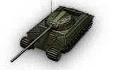<figcaption>EU · TITT Rozanov</figcaption></figure><figure style="display:inline-block">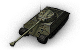<figcaption>RU · ТИТТ Розанова</figcaption></figure>
<strong>Penetration (mm)</strong> <b>EU</b>  AP <strong>212</strong> /  APCR <strong>242</strong> /  HE <strong>50</strong> → <b>RU</b>  AP <strong>222</strong> /  APCR <strong>248</strong> /  HE <strong>50</strong>

<strong>Damage (HP)</strong> <b>EU</b>  AP <strong>200</strong> /  APCR <strong>200</strong> /  HE <strong>280</strong> → <b>RU</b>  AP <strong>300</strong> /  APCR <strong>300</strong> /  HE <strong>400</strong>

<em>Firepower</em> 
<strong>DPM (HP/min)</strong> <small>EU</small> 2 406.92  <small>RU</small> <strong>2 040.65</strong> 
<strong>Module damage</strong> <small>EU</small> 115  <small>RU</small> <strong>135</strong> 
<strong>Rate of fire (rounds/min)</strong> <small>EU</small> 12.03  <small>RU</small> <strong>6.80</strong> 
<strong>Reload time (s)</strong> <small>EU</small> 4.99  <small>RU</small> <strong>8.82</strong> 
<strong>Caliber</strong> <small>EU</small> 85  <small>RU</small> <strong>100</strong> 
<strong>Shell velocity (m/s)</strong> <small>EU</small> 1 100  <small>RU</small> <strong>1 020</strong> 
<strong>Potential damage</strong> <small>EU</small> 12 000  <small>RU</small> <strong>18 000</strong> 

<em>Gun handling</em> 
<strong>Dispersion (m/100 m)</strong> <small>EU</small> 0.33  <small>RU</small> <strong>0.36</strong> 
<strong>Dispersion · damaged</strong> <small>EU</small> 0.65  <small>RU</small> <strong>0.73</strong> 
<strong>Dispersion · moving</strong> <small>EU</small> 0.18  <small>RU</small> <strong>0.16</strong> 
<strong>Dispersion · tank traverse</strong> <small>EU</small> 0.18  <small>RU</small> <strong>0.16</strong> 

<em>Mobility</em> 
<strong>Forward speed (km/h)</strong> <small>EU</small> 42  <small>RU</small> <strong>44</strong> 
<strong>Forward speed on hard terrain (km/h)</strong> <small>EU</small> 38.06  <small>RU</small> <strong>44</strong> 
<strong>Forward speed on medium terrain (km/h)</strong> <small>EU</small> 32.98  <small>RU</small> <strong>39.80</strong> 
<strong>Forward speed on soft terrain (km/h)</strong> <small>EU</small> 24.74  <small>RU</small> <strong>29.85</strong> 
<strong>Engine power (hp)</strong> <small>EU</small> 520  <small>RU</small> <strong>640</strong> 
<strong>Weight (kg)</strong> <small>EU</small> 40 000 → <small>RU</small> <strong>40 800</strong> 
<strong>Power/weight (hp/t)</strong> <small>EU</small> 13  <small>RU</small> <strong>15.69</strong> 

<em>Armor &amp; health</em> 
<strong>Health · engine</strong> <small>EU</small> 190  <small>RU</small> <strong>370</strong> 

<em>Miscellaneous</em> 
<strong>Fire chance (%)</strong> <small>EU</small> 15  <small>RU</small> <strong>12</strong> 
<strong>Shell cost</strong> <small>EU</small> 255  <small>RU</small> <strong>435</strong> 

