# USSR · Tier IX

[All nations and tiers](../buffs_nerfs.md) · EU v20410 → RU v14600ru · 3 November 2026

<label><strong>Find a tank</strong><input type="search" placeholder="Try is7, obj140 or xm57" aria-label="Find a tank" style="display:block;width:100%;padding:.7rem;border:1px solid #888;border-radius:4px;margin:.5rem 0;color:inherit;background:transparent"></label>

212A · Tier IX

212a

<a href="https://tanks.gg/v20410/tank/212a">EU stats</a> · <a href="https://tanks.gg/v14600ru/tank/212a">RU stats</a>
<figure style="display:inline-block">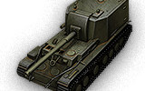<figcaption>212A</figcaption></figure>
<strong>Penetration (mm)</strong> <b>EU</b>  HE <strong>52</strong> /  HE <strong>65</strong> /  AP <strong>258</strong> → <b>RU</b>  HE <strong>51</strong> /  AP <strong>258</strong>

<strong>Damage (HP)</strong> <b>EU</b>  HE <strong>900</strong> /  HE <strong>1200</strong> /  AP <strong>600</strong> → <b>RU</b>  HE <strong>1200</strong> /  AP <strong>650</strong>

<em>Firepower</em> 
<strong>DPM (HP/min)</strong> <small>EU</small> 1 444.15  <small>RU</small> <strong>1 925.54</strong> 
<strong>Explosion radius</strong> <small>EU</small> 10.40  <small>RU</small> <strong>8</strong> 
<strong>Stun duration · maximum (s)</strong> <small>EU</small> 28 → <small>RU</small> <strong>—</strong> 
<strong>Stun duration · minimum (s)</strong> <small>EU</small> 12.60 → <small>RU</small> <strong>—</strong> 
<strong>Shell velocity (m/s)</strong> <small>EU</small> 425  <small>RU</small> <strong>480</strong> 
<strong>Max range (m)</strong> <small>EU</small> 1 263.11  <small>RU</small> <strong>1 467.52</strong> 
<strong>Potential damage</strong> <small>EU</small> 36 000  <small>RU</small> <strong>48 000</strong> 

<em>Mobility</em> 
<strong>Tank traverse on hard terrain (°/s)</strong> <small>EU</small> 21.81  <small>RU</small> <strong>21.80</strong> 

<em>Armor &amp; health</em> 
<strong>Health · ammo rack</strong> <small>EU</small> 230  <small>RU</small> <strong>120</strong> 

<em>Miscellaneous</em> 
<strong>Moving camo</strong> <small>EU</small> 1.77  <small>RU</small> <strong>1.71</strong> 
<strong>Shell cost</strong> <small>EU</small> 1 910  <small>RU</small> <strong>2 270</strong> 

IS-3-II · Tier IX

is3ii

<a href="https://tanks.gg/v20410/tank/is-3-ii">EU stats</a> · <a href="https://tanks.gg/v14600ru/tank/is-3-ii">RU stats</a>
<figure style="display:inline-block">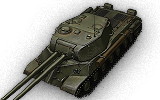<figcaption>IS-3-II</figcaption></figure>
<em>Gun handling</em> 
<strong>Dispersion · firing</strong> <small>EU</small> 4  <small>RU</small> <strong>3</strong> 

<em>Mobility</em> 
<strong>Turret traverse (°/s)</strong> <small>EU</small> 27.12  <small>RU</small> <strong>22.95</strong> 
<strong>Tank traverse (°/s)</strong> <small>EU</small> 37.55  <small>RU</small> <strong>31.29</strong> 
<strong>Tank traverse on hard terrain (°/s)</strong> <small>EU</small> 35.77  <small>RU</small> <strong>30.65</strong> 
<strong>Tank traverse on medium terrain (°/s)</strong> <small>EU</small> 32.52  <small>RU</small> <strong>27.87</strong> 
<strong>Tank traverse on soft terrain (°/s)</strong> <small>EU</small> 18.83  <small>RU</small> <strong>16.13</strong> 

<em>Armor &amp; health</em> 
<strong>Health</strong> <small>EU</small> 1 900  <small>RU</small> <strong>2 000</strong> 

Alternate mode

<a href="https://tanks.gg/v20410/tank/is-3-ii-siege">EU stats</a> · <a href="https://tanks.gg/v14600ru/tank/is-3-ii-siege">RU stats</a>
<em>Gun handling</em> 
<strong>Dispersion · firing</strong> <small>EU</small> 4  <small>RU</small> <strong>3</strong> 

<em>Mobility</em> 
<strong>Turret traverse (°/s)</strong> <small>EU</small> 27.12  <small>RU</small> <strong>22.95</strong> 
<strong>Tank traverse (°/s)</strong> <small>EU</small> 37.55  <small>RU</small> <strong>31.29</strong> 
<strong>Tank traverse on hard terrain (°/s)</strong> <small>EU</small> 35.77  <small>RU</small> <strong>30.65</strong> 
<strong>Tank traverse on medium terrain (°/s)</strong> <small>EU</small> 32.52  <small>RU</small> <strong>27.87</strong> 
<strong>Tank traverse on soft terrain (°/s)</strong> <small>EU</small> 18.83  <small>RU</small> <strong>16.13</strong> 

<em>Armor &amp; health</em> 
<strong>Health</strong> <small>EU</small> 1 900  <small>RU</small> <strong>2 000</strong> 

K-91-PT · Tier IX

k91pt

<a href="https://tanks.gg/v20410/tank/k-91-pt">EU stats</a> · <a href="https://tanks.gg/v14600ru/tank/k-91-pt">RU stats</a>
<figure style="display:inline-block">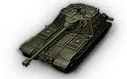<figcaption>K-91-PT</figcaption></figure>
<strong>Damage (HP)</strong> <b>EU</b>  AP <strong>390</strong> /  APCR <strong>390</strong> /  HE <strong>530</strong> → <b>RU</b>  AP <strong>420</strong> /  APCR <strong>420</strong> /  HE <strong>530</strong>

<em>Firepower</em> 
<strong>DPM (HP/min)</strong> <small>EU</small> 2 837.93  <small>RU</small> <strong>3 056.23</strong> 
<strong>Ammo capacity</strong> <small>EU</small> 30  <small>RU</small> <strong>40</strong> 
<strong>Potential damage</strong> <small>EU</small> 11 700  <small>RU</small> <strong>16 800</strong> 

<em>Gun handling</em> 
<strong>Aim time (s)</strong> <small>EU</small> 2.49  <small>RU</small> <strong>2.21</strong> 

Object 257 · Tier IX

object257

<a href="https://tanks.gg/v20410/tank/obj-257">EU stats</a> · <a href="https://tanks.gg/v14600ru/tank/ob-257">RU stats</a>
<figure style="display:inline-block">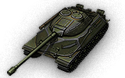<figcaption>Object 257</figcaption></figure>
<em>Mobility</em> 
<strong>Tank traverse on hard terrain (°/s)</strong> <small>EU</small> 44.10  <small>RU</small> <strong>47.27</strong> 
<strong>Tank traverse on medium terrain (°/s)</strong> <small>EU</small> 33.72  <small>RU</small> <strong>36.15</strong> 
<strong>Tank traverse on soft terrain (°/s)</strong> <small>EU</small> 22.93  <small>RU</small> <strong>24.58</strong> 

<em>Armor &amp; health</em> 
<strong>Health</strong> <small>EU</small> 2 000  <small>RU</small> <strong>1 900</strong> 

<em>Miscellaneous</em> 
<strong>Moving camo</strong> <small>EU</small> 3.33  <small>RU</small> <strong>3.27</strong> 
<strong>Moving camo · after firing</strong> <small>EU</small> 0.60  <small>RU</small> <strong>0.59</strong> 

Object 263 · Tier IX

object263

<a href="https://tanks.gg/v20410/tank/obj-263">EU stats</a> · <a href="https://tanks.gg/v14600ru/tank/ob-263">RU stats</a>
<figure style="display:inline-block">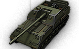<figcaption>Object 263</figcaption></figure>
<em>Mobility</em> 
<strong>Tank traverse on hard terrain (°/s)</strong> <small>EU</small> 27.44  <small>RU</small> <strong>32.32</strong> 
<strong>Tank traverse on medium terrain (°/s)</strong> <small>EU</small> 23.52  <small>RU</small> <strong>27.70</strong> 
<strong>Tank traverse on soft terrain (°/s)</strong> <small>EU</small> 14.32  <small>RU</small> <strong>16.86</strong> 

Object 265T · EU IX → RU VIII

object265t

<a href="https://tanks.gg/v20410/tank/obj-265t">EU stats</a> · <a href="https://tanks.gg/v14600ru/tank/ob-265t">RU stats</a>
<figure style="display:inline-block">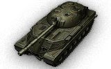<figcaption>EU · Object 265T</figcaption></figure><figure style="display:inline-block">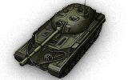<figcaption>RU · Объект 265Т</figcaption></figure>
<strong>Penetration (mm)</strong> <b>EU</b>  AP <strong>242</strong> /  HEAT <strong>300</strong> /  HE <strong>61</strong> → <b>RU</b>  AP <strong>225</strong> /  HEAT <strong>270</strong> /  HE <strong>61</strong>

<em>General</em> 
<strong>Tier</strong> <small>EU</small> 9 → <small>RU</small> <strong>8</strong> 

<em>Firepower</em> 
<strong>DPM (HP/min)</strong> <small>EU</small> 2 218.75  <small>RU</small> <strong>1 937</strong> 
<strong>Rate of fire (rounds/min)</strong> <small>EU</small> 5.69  <small>RU</small> <strong>4.97</strong> 
<strong>Reload time (s)</strong> <small>EU</small> 10.55  <small>RU</small> <strong>12.08</strong> 
<strong>Clip size</strong> <small>EU</small> 3 → <small>RU</small> <strong>—</strong> 
<strong>Clip damage · damage</strong> <small>EU</small> 1 170 → <small>RU</small> <strong>—</strong> 
<strong>Clip damage · time (s)</strong> <small>EU</small> 6 → <small>RU</small> <strong>—</strong> 
<strong>Intra-clip reload</strong> <small>EU</small> 3 → <small>RU</small> <strong>—</strong> 
<strong>Ammo capacity</strong> <small>EU</small> 50  <small>RU</small> <strong>40</strong> 
<strong>Potential damage</strong> <small>EU</small> 19 500  <small>RU</small> <strong>15 600</strong> 

<em>Gun handling</em> 
<strong>Aim time (s)</strong> <small>EU</small> 2.59  <small>RU</small> <strong>2.78</strong> 
<strong>Dispersion · moving</strong> <small>EU</small> 0.24  <small>RU</small> <strong>0.20</strong> 
<strong>Dispersion · tank traverse</strong> <small>EU</small> 0.24  <small>RU</small> <strong>0.20</strong> 
<strong>Dispersion · turret traverse</strong> <small>EU</small> 0.15  <small>RU</small> <strong>0.06</strong> 
<strong>Dispersion · firing</strong> <small>EU</small> 4  <small>RU</small> <strong>3</strong> 
<strong>Depression (°)</strong> <small>EU</small> 6  <small>RU</small> <strong>8</strong> 

<em>Mobility</em> 
<strong>Forward speed (km/h)</strong> <small>EU</small> 40  <small>RU</small> <strong>35</strong> 
<strong>Forward speed on hard terrain (km/h)</strong> <small>EU</small> 40  <small>RU</small> <strong>35</strong> 
<strong>Forward speed on medium terrain (km/h)</strong> <small>EU</small> 35.90  <small>RU</small> <strong>29.42</strong> 
<strong>Forward speed on soft terrain (km/h)</strong> <small>EU</small> 21.54  <small>RU</small> <strong>20</strong> 
<strong>Reverse speed (km/h)</strong> <small>EU</small> 14  <small>RU</small> <strong>15</strong> 
<strong>Engine power (hp)</strong> <small>EU</small> 750  <small>RU</small> <strong>700</strong> 
<strong>Weight (kg)</strong> <small>EU</small> 53 000 → <small>RU</small> <strong>53 275</strong> 
<strong>Power/weight (hp/t)</strong> <small>EU</small> 14.15  <small>RU</small> <strong>13.14</strong> 
<strong>Terrain resist (hard)</strong> <small>EU</small> 1.25  <small>RU</small> <strong>1.05</strong> 
<strong>Terrain resist (med)</strong> <small>EU</small> 1.44  <small>RU</small> <strong>1.63</strong> 
<strong>Turret traverse (°/s)</strong> <small>EU</small> 26.08  <small>RU</small> <strong>33.38</strong> 
<strong>Tank traverse (°/s)</strong> <small>EU</small> 31.29  <small>RU</small> <strong>27.12</strong> 
<strong>Tank traverse on hard terrain (°/s)</strong> <small>EU</small> 31.29  <small>RU</small> <strong>27.12</strong> 
<strong>Tank traverse on medium terrain (°/s)</strong> <small>EU</small> 27.12  <small>RU</small> <strong>17.55</strong> 
<strong>Tank traverse on soft terrain (°/s)</strong> <small>EU</small> 16.27  <small>RU</small> <strong>11.93</strong> 

<em>Armor &amp; health</em> 
<strong>Hull armor · front (mm)</strong> <small>EU</small> 130  <small>RU</small> <strong>170</strong> 
<strong>Hull armor · side (mm)</strong> <small>EU</small> 75  <small>RU</small> <strong>110</strong> 
<strong>Hull armor · rear (mm)</strong> <small>EU</small> 40  <small>RU</small> <strong>60</strong> 
<strong>Turret armor · front (mm)</strong> <small>EU</small> 300  <small>RU</small> <strong>270</strong> 
<strong>Turret armor · side (mm)</strong> <small>EU</small> 120  <small>RU</small> <strong>160</strong> 
<strong>Turret armor · rear (mm)</strong> <small>EU</small> 40  <small>RU</small> <strong>100</strong> 
<strong>Health</strong> <small>EU</small> 1 800  <small>RU</small> <strong>1 500</strong> 
<strong>Health · engine</strong> <small>EU</small> 310  <small>RU</small> <strong>260</strong> 
<strong>Health · track</strong> <small>EU</small> 240  <small>RU</small> <strong>220</strong> 
<strong>Health · ammo rack</strong> <small>EU</small> 230  <small>RU</small> <strong>200</strong> 
<strong>Track repair time (s)</strong> <small>EU</small> 11.70  <small>RU</small> <strong>12.03</strong> 

<em>Miscellaneous</em> 
<strong>Stationary camo · after firing</strong> <small>EU</small> 1.20  <small>RU</small> <strong>0.67</strong> 
<strong>Moving camo · after firing</strong> <small>EU</small> 0.61  <small>RU</small> <strong>0.34</strong> 
<strong>View range (m)</strong> <small>EU</small> 380  <small>RU</small> <strong>350</strong> 
<strong>Radio range (m)</strong> <small>EU</small> 730  <small>RU</small> <strong>625</strong> 
<strong>Fire chance (%)</strong> <small>EU</small> 15  <small>RU</small> <strong>12</strong> 
<strong>Shell cost</strong> <small>EU</small> 870  <small>RU</small> <strong>1 180</strong> 

Object 283 · Tier IX

object283

<a href="https://tanks.gg/v20410/tank/obj-283">EU stats</a> · <a href="https://tanks.gg/v14600ru/tank/ob-283">RU stats</a>
<figure style="display:inline-block">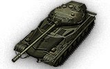<figcaption>Object 283</figcaption></figure>
<strong>Penetration (mm)</strong> <b>EU</b>  AP <strong>226</strong> /  HEAT <strong>300</strong> /  HE <strong>50</strong> → <b>RU</b>  AP <strong>236</strong> /  HEAT <strong>310</strong> /  HE <strong>50</strong>

<em>Firepower</em> 
<strong>DPM (HP/min)</strong> <small>EU</small> 2 399.23  <small>RU</small> <strong>2 531.33</strong> 
<strong>Rate of fire (rounds/min)</strong> <small>EU</small> 6.66  <small>RU</small> <strong>7.03</strong> 
<strong>Reload time (s)</strong> <small>EU</small> 9  <small>RU</small> <strong>8.53</strong> 

<em>Gun handling</em> 
<strong>Aim time (s)</strong> <small>EU</small> 2.40  <small>RU</small> <strong>2.01</strong> 
<strong>Dispersion · turret traverse</strong> <small>EU</small> 0.18  <small>RU</small> <strong>0.10</strong> 
<strong>Depression (°)</strong> <small>EU</small> 6  <small>RU</small> <strong>8</strong> 

<em>Armor &amp; health</em> 
<strong>Health</strong> <small>EU</small> 1 600  <small>RU</small> <strong>1 700</strong> 

Object 430 · Tier IX

object430

<a href="https://tanks.gg/v20410/tank/obj-430">EU stats</a> · <a href="https://tanks.gg/v14600ru/tank/ob-430">RU stats</a>
<figure style="display:inline-block">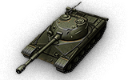<figcaption>Object 430</figcaption></figure>
<em>Gun handling</em> 
<strong>Aim time (s)</strong> <small>EU</small> 2.21  <small>RU</small> <strong>2.40</strong> 
<strong>Dispersion · moving</strong> <small>EU</small> 0.15  <small>RU</small> <strong>0.16</strong> 
<strong>Dispersion · tank traverse</strong> <small>EU</small> 0.15  <small>RU</small> <strong>0.16</strong> 
<strong>Dispersion · turret traverse</strong> <small>EU</small> 0.10  <small>RU</small> <strong>0.12</strong> 

<em>Mobility</em> 
<strong>Forward speed on soft terrain (km/h)</strong> <small>EU</small> 40.67  <small>RU</small> <strong>35.25</strong> 
<strong>Engine power (hp)</strong> <small>EU</small> 600  <small>RU</small> <strong>520</strong> 
<strong>Power/weight (hp/t)</strong> <small>EU</small> 17.10  <small>RU</small> <strong>14.82</strong> 
<strong>Tank traverse (°/s)</strong> <small>EU</small> 62.58  <small>RU</small> <strong>54.24</strong> 
<strong>Tank traverse on hard terrain (°/s)</strong> <small>EU</small> 62.58  <small>RU</small> <strong>55.85</strong> 
<strong>Tank traverse on medium terrain (°/s)</strong> <small>EU</small> 53.64  <small>RU</small> <strong>47.87</strong> 
<strong>Tank traverse on soft terrain (°/s)</strong> <small>EU</small> 23.47  <small>RU</small> <strong>20.94</strong> 

<em>Armor &amp; health</em> 
<strong>Hull armor · front (mm)</strong> <small>EU</small> 140  <small>RU</small> <strong>120</strong> 

<em>Miscellaneous</em> 
<strong>View range (m)</strong> <small>EU</small> 390  <small>RU</small> <strong>380</strong> 

Object 430 Version II · Tier IX

object430versionii

<a href="https://tanks.gg/v20410/tank/obj-430-ii">EU stats</a> · <a href="https://tanks.gg/v14600ru/tank/ob-430-ii">RU stats</a>
<figure style="display:inline-block">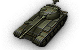<figcaption>Object 430 Version II</figcaption></figure>
<strong>Penetration (mm)</strong> <b>EU</b>  AP <strong>246</strong> /  HEAT <strong>330</strong> /  HE <strong>50</strong> → <b>RU</b>  AP <strong>256</strong> /  HEAT <strong>330</strong> /  HE <strong>50</strong>

<em>Firepower</em> 
<strong>DPM (HP/min)</strong> <small>EU</small> 2 902.26  <small>RU</small> <strong>2 706.16</strong> 
<strong>Rate of fire (rounds/min)</strong> <small>EU</small> 9.07  <small>RU</small> <strong>8.46</strong> 
<strong>Reload time (s)</strong> <small>EU</small> 6.62  <small>RU</small> <strong>7.09</strong> 

<em>Gun handling</em> 
<strong>Dispersion (m/100 m)</strong> <small>EU</small> 0.33  <small>RU</small> <strong>0.31</strong> 
<strong>Dispersion · damaged</strong> <small>EU</small> 0.65  <small>RU</small> <strong>0.61</strong> 
<strong>Dispersion · firing</strong> <small>EU</small> 3  <small>RU</small> <strong>3.50</strong> 
<strong>Depression (°)</strong> <small>EU</small> 4  <small>RU</small> <strong>8</strong> 

<em>Mobility</em> 
<strong>Tank traverse (°/s)</strong> <small>EU</small> 54.24  <small>RU</small> <strong>50.06</strong> 
<strong>Tank traverse on hard terrain (°/s)</strong> <small>EU</small> 55.49  <small>RU</small> <strong>51.32</strong> 
<strong>Tank traverse on medium terrain (°/s)</strong> <small>EU</small> 48.55  <small>RU</small> <strong>44.91</strong> 
<strong>Tank traverse on soft terrain (°/s)</strong> <small>EU</small> 24.28  <small>RU</small> <strong>22.45</strong> 

<em>Armor &amp; health</em> 
<strong>Health</strong> <small>EU</small> 1 800  <small>RU</small> <strong>1 750</strong> 

Object 590 · Tier IX

object590

<a href="https://tanks.gg/v20410/tank/obj-590">EU stats</a> · <a href="https://tanks.gg/v14600ru/tank/ob-590">RU stats</a>
<figure style="display:inline-block">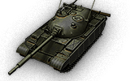<figcaption>Object 590</figcaption></figure>
<strong>Penetration (mm)</strong> <b>EU</b>  APCR <strong>238</strong> /  AP <strong>268</strong> /  HE <strong>50</strong> → <b>RU</b>  AP <strong>225</strong> /  APCR <strong>268</strong> /  HE <strong>50</strong>

<strong>Damage (HP)</strong> <b>EU</b>  APCR <strong>320</strong> /  AP <strong>320</strong> /  HE <strong>420</strong> → <b>RU</b>  AP <strong>320</strong> /  APCR <strong>320</strong> /  HE <strong>420</strong>

<em>Firepower</em> 
<strong>DPM (HP/min)</strong> <small>EU</small> 2 355.95  <small>RU</small> <strong>2 451.60</strong> 
<strong>Rate of fire (rounds/min)</strong> <small>EU</small> 7.36  <small>RU</small> <strong>7.66</strong> 
<strong>Reload time (s)</strong> <small>EU</small> 8.15  <small>RU</small> <strong>7.83</strong> 
<strong>Clip damage · time (s)</strong> <small>EU</small> 6  <small>RU</small> <strong>5</strong> 
<strong>Intra-clip reload</strong> <small>EU</small> 3  <small>RU</small> <strong>2.50</strong> 
<strong>Shell velocity (m/s)</strong> <small>EU</small> 1 480  <small>RU</small> <strong>1 015</strong> 
<strong>Normalization</strong> <small>EU</small> 2  <small>RU</small> <strong>5</strong> 

<em>Gun handling</em> 
<strong>Aim time (s)</strong> <small>EU</small> 2.59  <small>RU</small> <strong>2.68</strong> 
<strong>Dispersion (m/100 m)</strong> <small>EU</small> 0.36  <small>RU</small> <strong>0.35</strong> 
<strong>Dispersion · damaged</strong> <small>EU</small> 0.73  <small>RU</small> <strong>0.71</strong> 
<strong>Dispersion · firing</strong> <small>EU</small> 3.50  <small>RU</small> <strong>4</strong> 
<strong>Depression (°)</strong> <small>EU</small> 6  <small>RU</small> <strong>5</strong> 

<em>Armor &amp; health</em> 
<strong>Hull armor · front (mm)</strong> <small>EU</small> 110  <small>RU</small> <strong>100</strong> 
<strong>Turret armor · front (mm)</strong> <small>EU</small> 245  <small>RU</small> <strong>200</strong> 

Object 704 · Tier IX

object704

<a href="https://tanks.gg/v20410/tank/obj-704">EU stats</a> · <a href="https://tanks.gg/v14600ru/tank/ob-704">RU stats</a>
<figure style="display:inline-block">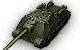<figcaption>EU · Object 704</figcaption></figure><figure style="display:inline-block">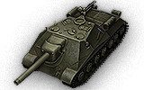<figcaption>RU · Объект 704</figcaption></figure>
<em>Gun handling</em> 
<strong>Aim time (s)</strong> <small>EU</small> 2.59  <small>RU</small> <strong>2.78</strong> 
<strong>Dispersion (m/100 m)</strong> <small>EU</small> 0.35  <small>RU</small> <strong>0.37</strong> 
<strong>Dispersion · damaged</strong> <small>EU</small> 0.69  <small>RU</small> <strong>0.75</strong> 

<em>Mobility</em> 
<strong>Forward speed (km/h)</strong> <small>EU</small> 40  <small>RU</small> <strong>37</strong> 
<strong>Forward speed on hard terrain (km/h)</strong> <small>EU</small> 40  <small>RU</small> <strong>37</strong> 
<strong>Forward speed on medium terrain (km/h)</strong> <small>EU</small> 40  <small>RU</small> <strong>37</strong> 
<strong>Forward speed on soft terrain (km/h)</strong> <small>EU</small> 27.20  <small>RU</small> <strong>25.16</strong> 
<strong>Reverse speed (km/h)</strong> <small>EU</small> 14  <small>RU</small> <strong>13</strong> 
<strong>Engine power (hp)</strong> <small>EU</small> 800  <small>RU</small> <strong>740.10</strong> 
<strong>Power/weight (hp/t)</strong> <small>EU</small> 16.44  <small>RU</small> <strong>15.20</strong> 
<strong>Tank traverse (°/s)</strong> <small>EU</small> 29.20  <small>RU</small> <strong>22.95</strong> 
<strong>Tank traverse on hard terrain (°/s)</strong> <small>EU</small> 29.32  <small>RU</small> <strong>21.58</strong> 
<strong>Tank traverse on medium terrain (°/s)</strong> <small>EU</small> 23.04  <small>RU</small> <strong>16.96</strong> 
<strong>Tank traverse on soft terrain (°/s)</strong> <small>EU</small> 14.02  <small>RU</small> <strong>10.32</strong> 

<em>Armor &amp; health</em> 
<strong>Health · engine</strong> <small>EU</small> 310  <small>RU</small> <strong>370</strong> 
<strong>Health · track</strong> <small>EU</small> 240  <small>RU</small> <strong>230</strong> 
<strong>Track repair time (s)</strong> <small>EU</small> 11.70  <small>RU</small> <strong>12.03</strong> 

Object 705 · Tier IX

object705

<a href="https://tanks.gg/v20410/tank/obj-705">EU stats</a> · <a href="https://tanks.gg/v14600ru/tank/ob-705">RU stats</a>
<figure style="display:inline-block">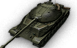<figcaption>Object 705</figcaption></figure>
<em>Armor &amp; health</em> 
<strong>Health</strong> <small>EU</small> 2 100  <small>RU</small> <strong>2 000</strong> 

<em>Miscellaneous</em> 
<strong>Moving camo</strong> <small>EU</small> 3.18  <small>RU</small> <strong>3.12</strong> 
<strong>Moving camo · after firing</strong> <small>EU</small> 0.49  <small>RU</small> <strong>0.48</strong> 

Object 752 · Tier IX

object752

<a href="https://tanks.gg/v20410/tank/obj-752">EU stats</a> · <a href="https://tanks.gg/v14600ru/tank/ob-752">RU stats</a>
<figure style="display:inline-block">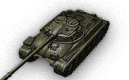<figcaption>EU · Object 752</figcaption></figure><figure style="display:inline-block">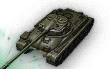<figcaption>RU · Объект 752</figcaption></figure>
<strong>Penetration (mm)</strong> <b>EU</b>  AP <strong>240</strong> /  APCR <strong>310</strong> /  HE <strong>68</strong> → <b>RU</b>  AP <strong>246</strong> /  HEAT <strong>310</strong> /  HE <strong>68</strong>

<strong>Damage (HP)</strong> <b>EU</b>  AP <strong>390</strong> /  APCR <strong>390</strong> /  HE <strong>530</strong> → <b>RU</b>  AP <strong>440</strong> /  HEAT <strong>440</strong> /  HE <strong>530</strong>

<em>Firepower</em> 
<strong>DPM (HP/min)</strong> <small>EU</small> 1 800.08  <small>RU</small> <strong>1 873.14</strong> 
<strong>Rate of fire (rounds/min)</strong> <small>EU</small> 4.62  <small>RU</small> <strong>4.26</strong> 
<strong>Reload time (s)</strong> <small>EU</small> 32.60  <small>RU</small> <strong>14.09</strong> 
<strong>Clip size</strong> <small>EU</small> 3 → <small>RU</small> <strong>—</strong> 
<strong>Clip damage · damage</strong> <small>EU</small> 1 170 → <small>RU</small> <strong>—</strong> 
<strong>Clip damage · time (s)</strong> <small>EU</small> 6.40 → <small>RU</small> <strong>—</strong> 
<strong>Intra-clip reload</strong> <small>EU</small> 3.20 → <small>RU</small> <strong>—</strong> 
<strong>Shell velocity (m/s)</strong> <small>EU</small> 862  <small>RU</small> <strong>980</strong> 
<strong>Ammo capacity</strong> <small>EU</small> 30  <small>RU</small> <strong>42</strong> 
<strong>Potential damage</strong> <small>EU</small> 11 700  <small>RU</small> <strong>18 480</strong> 

<em>Gun handling</em> 
<strong>Aim time (s)</strong> <small>EU</small> 3.26  <small>RU</small> <strong>2.88</strong> 
<strong>Dispersion (m/100 m)</strong> <small>EU</small> 0.40  <small>RU</small> <strong>0.38</strong> 
<strong>Dispersion · damaged</strong> <small>EU</small> 0.81  <small>RU</small> <strong>0.77</strong> 
<strong>Dispersion · moving</strong> <small>EU</small> 0.24  <small>RU</small> <strong>0.22</strong> 
<strong>Dispersion · tank traverse</strong> <small>EU</small> 0.24  <small>RU</small> <strong>0.22</strong> 
<strong>Dispersion · turret traverse</strong> <small>EU</small> 0.11  <small>RU</small> <strong>0.10</strong> 

<em>Mobility</em> 
<strong>Forward speed (km/h)</strong> <small>EU</small> 35  <small>RU</small> <strong>32</strong> 
<strong>Forward speed on hard terrain (km/h)</strong> <small>EU</small> 35  <small>RU</small> <strong>32</strong> 
<strong>Forward speed on medium terrain (km/h)</strong> <small>EU</small> 35  <small>RU</small> <strong>32</strong> 
<strong>Forward speed on soft terrain (km/h)</strong> <small>EU</small> 25.59  <small>RU</small> <strong>30</strong> 
<strong>Reverse speed (km/h)</strong> <small>EU</small> 12  <small>RU</small> <strong>14</strong> 
<strong>Engine power (hp)</strong> <small>EU</small> 580  <small>RU</small> <strong>680</strong> 
<strong>Power/weight (hp/t)</strong> <small>EU</small> 12.78  <small>RU</small> <strong>14.98</strong> 

<em>Armor &amp; health</em> 
<strong>Hull armor · front (mm)</strong> <small>EU</small> 195  <small>RU</small> <strong>205</strong> 

ST-I · Tier IX

sti

<a href="https://tanks.gg/v20410/tank/st-i">EU stats</a> · <a href="https://tanks.gg/v14600ru/tank/st-i">RU stats</a>
<figure style="display:inline-block">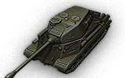<figcaption>ST-I</figcaption></figure>
<em>Gun handling</em> 
<strong>Aim time (s)</strong> <small>EU</small> 2.88  <small>RU</small> <strong>3.26</strong> 
<strong>Dispersion (m/100 m)</strong> <small>EU</small> 0.40  <small>RU</small> <strong>0.38</strong> 
<strong>Dispersion · damaged</strong> <small>EU</small> 0.81  <small>RU</small> <strong>0.77</strong> 
<strong>Dispersion · moving</strong> <small>EU</small> 0.20  <small>RU</small> <strong>0.22</strong> 
<strong>Dispersion · tank traverse</strong> <small>EU</small> 0.20  <small>RU</small> <strong>0.22</strong> 
<strong>Dispersion · turret traverse</strong> <small>EU</small> 0.12  <small>RU</small> <strong>0.20</strong> 

<em>Mobility</em> 
<strong>Forward speed on hard terrain (km/h)</strong> <small>EU</small> 40  <small>RU</small> <strong>38.48</strong> 
<strong>Forward speed on medium terrain (km/h)</strong> <small>EU</small> 30.81  <small>RU</small> <strong>28.86</strong> 
<strong>Forward speed on soft terrain (km/h)</strong> <small>EU</small> 16.43  <small>RU</small> <strong>15.39</strong> 
<strong>Engine power (hp)</strong> <small>EU</small> 790  <small>RU</small> <strong>740.10</strong> 
<strong>Power/weight (hp/t)</strong> <small>EU</small> 12.95  <small>RU</small> <strong>12.13</strong> 
<strong>Turret traverse (°/s)</strong> <small>EU</small> 25.03  <small>RU</small> <strong>18.77</strong> 
<strong>Tank traverse (°/s)</strong> <small>EU</small> 31.29  <small>RU</small> <strong>27.12</strong> 
<strong>Tank traverse on hard terrain (°/s)</strong> <small>EU</small> 32.60  <small>RU</small> <strong>27.64</strong> 
<strong>Tank traverse on medium terrain (°/s)</strong> <small>EU</small> 24.45  <small>RU</small> <strong>20.73</strong> 
<strong>Tank traverse on soft terrain (°/s)</strong> <small>EU</small> 13.04  <small>RU</small> <strong>11.06</strong> 

<em>Armor &amp; health</em> 
<strong>Health</strong> <small>EU</small> 2 000  <small>RU</small> <strong>1 900</strong> 

SU-122V · EU IX → RU X

su122v

<a href="https://tanks.gg/v20410/tank/su-122v">EU stats</a> · <a href="https://tanks.gg/v14600ru/tank/su-122v">RU stats</a>
<figure style="display:inline-block">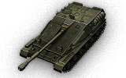<figcaption>SU-122V</figcaption></figure>
<strong>Penetration (mm)</strong> <b>EU</b>  AP <strong>270</strong> /  APCR <strong>315</strong> /  HE <strong>68</strong> → <b>RU</b>  AP <strong>286</strong> /  HEAT <strong>340</strong> /  HE <strong>68</strong>

<strong>Damage (HP)</strong> <b>EU</b>  AP <strong>440</strong> /  APCR <strong>440</strong> /  HE <strong>530</strong> → <b>RU</b>  AP <strong>440</strong> /  HEAT <strong>440</strong> /  HE <strong>530</strong>

<em>General</em> 
<strong>Tier</strong> <small>EU</small> 9 → <small>RU</small> <strong>10</strong> 

<em>Firepower</em> 
<strong>DPM (HP/min)</strong> <small>EU</small> 3 025.85  <small>RU</small> <strong>2 107.64</strong> 
<strong>Rate of fire (rounds/min)</strong> <small>EU</small> 6.88  <small>RU</small> <strong>4.79</strong> 
<strong>Reload time (s)</strong> <small>EU</small> 8.72  <small>RU</small> <strong>44.10</strong> 
<strong>Shell velocity (m/s)</strong> <small>EU</small> 940  <small>RU</small> <strong>1 040</strong> 
<strong>Ammo capacity</strong> <small>EU</small> 40  <small>RU</small> <strong>52</strong> 
<strong>Potential damage</strong> <small>EU</small> 17 600  <small>RU</small> <strong>22 880</strong> 
<strong>Clip size</strong> <small>EU</small> — → <small>RU</small> <strong>4</strong> 
<strong>Clip damage · damage</strong> <small>EU</small> — → <small>RU</small> <strong>1 760</strong> 
<strong>Clip damage · time (s)</strong> <small>EU</small> — → <small>RU</small> <strong>6</strong> 
<strong>Intra-clip reload</strong> <small>EU</small> — → <small>RU</small> <strong>2</strong> 

<em>Gun handling</em> 
<strong>Aim time (s)</strong> <small>EU</small> 1.92  <small>RU</small> <strong>2.40</strong> 
<strong>Dispersion (m/100 m)</strong> <small>EU</small> 0.38  <small>RU</small> <strong>0.35</strong> 
<strong>Dispersion · damaged</strong> <small>EU</small> 0.77  <small>RU</small> <strong>0.69</strong> 
<strong>Dispersion · tank traverse</strong> <small>EU</small> 0.20  <small>RU</small> <strong>0.16</strong> 
<strong>Dispersion · firing</strong> <small>EU</small> 4  <small>RU</small> <strong>3.50</strong> 

<em>Mobility</em> 
<strong>Forward speed (km/h)</strong> <small>EU</small> 50  <small>RU</small> <strong>44</strong> 
<strong>Forward speed on hard terrain (km/h)</strong> <small>EU</small> 50  <small>RU</small> <strong>44</strong> 
<strong>Forward speed on medium terrain (km/h)</strong> <small>EU</small> 50  <small>RU</small> <strong>44</strong> 
<strong>Forward speed on soft terrain (km/h)</strong> <small>EU</small> 36.29  <small>RU</small> <strong>35.44</strong> 
<strong>Engine power (hp)</strong> <small>EU</small> 820  <small>RU</small> <strong>850</strong> 
<strong>Weight (kg)</strong> <small>EU</small> 43 000 → <small>RU</small> <strong>32 602</strong> 
<strong>Power/weight (hp/t)</strong> <small>EU</small> 19.07  <small>RU</small> <strong>26.07</strong> 
<strong>Terrain resist (hard)</strong> <small>EU</small> 0.96  <small>RU</small> <strong>1.44</strong> 
<strong>Terrain resist (med)</strong> <small>EU</small> 1.15  <small>RU</small> <strong>1.63</strong> 
<strong>Terrain resist (soft)</strong> <small>EU</small> 1.92  <small>RU</small> <strong>2.68</strong> 
<strong>Turret traverse (°/s)</strong> <small>EU</small> 16.69  <small>RU</small> <strong>27.12</strong> 
<strong>Tank traverse (°/s)</strong> <small>EU</small> 46.93  <small>RU</small> <strong>29.20</strong> 
<strong>Tank traverse on hard terrain (°/s)</strong> <small>EU</small> 44.59  <small>RU</small> <strong>27.74</strong> 
<strong>Tank traverse on medium terrain (°/s)</strong> <small>EU</small> 37.16  <small>RU</small> <strong>24.48</strong> 
<strong>Tank traverse on soft terrain (°/s)</strong> <small>EU</small> 22.29  <small>RU</small> <strong>14.86</strong> 

<em>Armor &amp; health</em> 
<strong>Hull armor · front (mm)</strong> <small>EU</small> 100  <small>RU</small> <strong>80</strong> 
<strong>Hull armor · side (mm)</strong> <small>EU</small> 40  <small>RU</small> <strong>60</strong> 
<strong>Hull armor · rear (mm)</strong> <small>EU</small> 30  <small>RU</small> <strong>60</strong> 
<strong>Health</strong> <small>EU</small> 1 600  <small>RU</small> <strong>1 850</strong> 
<strong>Health · engine</strong> <small>EU</small> 310  <small>RU</small> <strong>400</strong> 
<strong>Health · track</strong> <small>EU</small> 240  <small>RU</small> <strong>220</strong> 
<strong>Health · ammo rack</strong> <small>EU</small> 230  <small>RU</small> <strong>260</strong> 
<strong>Health · fuel tank</strong> <small>EU</small> 200  <small>RU</small> <strong>175</strong> 
<strong>Track repair time (s)</strong> <small>EU</small> 11.70  <small>RU</small> <strong>11.40</strong> 

<em>Miscellaneous</em> 
<strong>View range (m)</strong> <small>EU</small> 350  <small>RU</small> <strong>360</strong> 
<strong>Radio range (m)</strong> <small>EU</small> 670  <small>RU</small> <strong>850</strong> 
<strong>Fire chance (%)</strong> <small>EU</small> 15  <small>RU</small> <strong>10</strong> 
<strong>Shell cost</strong> <small>EU</small> 1 095  <small>RU</small> <strong>1 080</strong> 

Alternate mode

<a href="https://tanks.gg/v20410/tank/su-122v-siege">EU stats</a> · <a href="https://tanks.gg/v14600ru/tank/su-122v-siege">RU stats</a>
<em>General</em> 
<strong>Tier</strong> <small>EU</small> 9 → <small>RU</small> <strong>10</strong> 

<em>Firepower</em> 
<strong>DPM (HP/min)</strong> <small>EU</small> 3 025.85  <small>RU</small> <strong>2 107.64</strong> 
<strong>Rate of fire (rounds/min)</strong> <small>EU</small> 6.88  <small>RU</small> <strong>4.79</strong> 
<strong>Reload time (s)</strong> <small>EU</small> 8.72  <small>RU</small> <strong>44.10</strong> 
<strong>Shell velocity (m/s)</strong> <small>EU</small> 940  <small>RU</small> <strong>1 040</strong> 
<strong>Ammo capacity</strong> <small>EU</small> 40  <small>RU</small> <strong>52</strong> 
<strong>Potential damage</strong> <small>EU</small> 17 600  <small>RU</small> <strong>22 880</strong> 
<strong>Clip size</strong> <small>EU</small> — → <small>RU</small> <strong>4</strong> 
<strong>Clip damage · damage</strong> <small>EU</small> — → <small>RU</small> <strong>1 760</strong> 
<strong>Clip damage · time (s)</strong> <small>EU</small> — → <small>RU</small> <strong>6</strong> 
<strong>Intra-clip reload</strong> <small>EU</small> — → <small>RU</small> <strong>2</strong> 

<em>Gun handling</em> 
<strong>Aim time (s)</strong> <small>EU</small> 1.92  <small>RU</small> <strong>1.25</strong> 
<strong>Dispersion (m/100 m)</strong> <small>EU</small> 0.38  <small>RU</small> <strong>0.25</strong> 
<strong>Dispersion · damaged</strong> <small>EU</small> 0.77  <small>RU</small> <strong>0.50</strong> 
<strong>Dispersion · moving</strong> <small>EU</small> 0.10  <small>RU</small> <strong>0.18</strong> 
<strong>Dispersion · tank traverse</strong> <small>EU</small> 0.10  <small>RU</small> <strong>0.16</strong> 
<strong>Dispersion · turret traverse</strong> <small>EU</small> 0.10  <small>RU</small> <strong>0.06</strong> 
<strong>Dispersion · firing</strong> <small>EU</small> 4  <small>RU</small> <strong>16</strong> 

<em>Mobility</em> 
<strong>Forward speed (km/h)</strong> <small>EU</small> 20  <small>RU</small> <strong>12</strong> 
<strong>Forward speed on hard terrain (km/h)</strong> <small>EU</small> 20  <small>RU</small> <strong>12</strong> 
<strong>Forward speed on medium terrain (km/h)</strong> <small>EU</small> 20  <small>RU</small> <strong>12</strong> 
<strong>Forward speed on soft terrain (km/h)</strong> <small>EU</small> 20  <small>RU</small> <strong>12</strong> 
<strong>Reverse speed (km/h)</strong> <small>EU</small> 20  <small>RU</small> <strong>12</strong> 
<strong>Engine power (hp)</strong> <small>EU</small> 820  <small>RU</small> <strong>850</strong> 
<strong>Weight (kg)</strong> <small>EU</small> 43 000 → <small>RU</small> <strong>32 602</strong> 
<strong>Power/weight (hp/t)</strong> <small>EU</small> 19.07  <small>RU</small> <strong>26.07</strong> 
<strong>Terrain resist (hard)</strong> <small>EU</small> 0.96  <small>RU</small> <strong>1.44</strong> 
<strong>Terrain resist (med)</strong> <small>EU</small> 1.15  <small>RU</small> <strong>1.63</strong> 
<strong>Terrain resist (soft)</strong> <small>EU</small> 1.92  <small>RU</small> <strong>2.68</strong> 
<strong>Turret traverse (°/s)</strong> <small>EU</small> 16.69  <small>RU</small> <strong>27.12</strong> 
<strong>Tank traverse (°/s)</strong> <small>EU</small> 46.93  <small>RU</small> <strong>29.20</strong> 
<strong>Tank traverse on hard terrain (°/s)</strong> <small>EU</small> 44.59  <small>RU</small> <strong>27.74</strong> 
<strong>Tank traverse on medium terrain (°/s)</strong> <small>EU</small> 37.16  <small>RU</small> <strong>24.48</strong> 
<strong>Tank traverse on soft terrain (°/s)</strong> <small>EU</small> 22.29  <small>RU</small> <strong>14.86</strong> 

<em>Armor &amp; health</em> 
<strong>Hull armor · front (mm)</strong> <small>EU</small> 100  <small>RU</small> <strong>80</strong> 
<strong>Hull armor · side (mm)</strong> <small>EU</small> 40  <small>RU</small> <strong>60</strong> 
<strong>Hull armor · rear (mm)</strong> <small>EU</small> 30  <small>RU</small> <strong>60</strong> 
<strong>Health</strong> <small>EU</small> 1 600  <small>RU</small> <strong>1 850</strong> 
<strong>Health · engine</strong> <small>EU</small> 310  <small>RU</small> <strong>400</strong> 
<strong>Health · track</strong> <small>EU</small> 240  <small>RU</small> <strong>220</strong> 
<strong>Health · ammo rack</strong> <small>EU</small> 230  <small>RU</small> <strong>260</strong> 
<strong>Health · fuel tank</strong> <small>EU</small> 200  <small>RU</small> <strong>175</strong> 
<strong>Track repair time (s)</strong> <small>EU</small> 11.70  <small>RU</small> <strong>11.40</strong> 

<em>Miscellaneous</em> 
<strong>View range (m)</strong> <small>EU</small> 350  <small>RU</small> <strong>360</strong> 
<strong>Radio range (m)</strong> <small>EU</small> 670  <small>RU</small> <strong>850</strong> 
<strong>Fire chance (%)</strong> <small>EU</small> 15  <small>RU</small> <strong>10</strong> 
<strong>Shell cost</strong> <small>EU</small> 1 095  <small>RU</small> <strong>1 080</strong> 

T-10 · Tier IX

t10

<a href="https://tanks.gg/v20410/tank/t-10">EU stats</a> · <a href="https://tanks.gg/v14600ru/tank/t-10">RU stats</a>
<figure style="display:inline-block">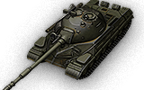<figcaption>T-10</figcaption></figure>
<em>Firepower</em> 
<strong>DPM (HP/min)</strong> <small>EU</small> 2 294.60  <small>RU</small> <strong>2 238.63</strong> 
<strong>Rate of fire (rounds/min)</strong> <small>EU</small> 5.21  <small>RU</small> <strong>5.09</strong> 
<strong>Reload time (s)</strong> <small>EU</small> 11.51  <small>RU</small> <strong>11.79</strong> 
<strong>Shell velocity (m/s)</strong> <small>EU</small> 1 010  <small>RU</small> <strong>940</strong> 
<strong>Ammo capacity</strong> <small>EU</small> 35  <small>RU</small> <strong>30</strong> 
<strong>Potential damage</strong> <small>EU</small> 15 400  <small>RU</small> <strong>13 200</strong> 

<em>Gun handling</em> 
<strong>Aim time (s)</strong> <small>EU</small> 2.59  <small>RU</small> <strong>2.68</strong> 
<strong>Dispersion · firing</strong> <small>EU</small> 4  <small>RU</small> <strong>3.50</strong> 

<em>Mobility</em> 
<strong>Forward speed on soft terrain (km/h)</strong> <small>EU</small> 33.88  <small>RU</small> <strong>31.24</strong> 
<strong>Engine power (hp)</strong> <small>EU</small> 860  <small>RU</small> <strong>792.96</strong> 
<strong>Power/weight (hp/t)</strong> <small>EU</small> 16.91  <small>RU</small> <strong>15.59</strong> 
<strong>Tank traverse (°/s)</strong> <small>EU</small> 37.55  <small>RU</small> <strong>33.38</strong> 
<strong>Tank traverse on hard terrain (°/s)</strong> <small>EU</small> 39.72  <small>RU</small> <strong>35.21</strong> 
<strong>Tank traverse on medium terrain (°/s)</strong> <small>EU</small> 36.11  <small>RU</small> <strong>32.01</strong> 
<strong>Tank traverse on soft terrain (°/s)</strong> <small>EU</small> 20.91  <small>RU</small> <strong>18.53</strong> 

<em>Armor &amp; health</em> 
<strong>Hull armor · front (mm)</strong> <small>EU</small> 120  <small>RU</small> <strong>130</strong> 
<strong>Health</strong> <small>EU</small> 1 900  <small>RU</small> <strong>1 800</strong> 

T-54 · Tier IX

t54

<a href="https://tanks.gg/v20410/tank/t-54">EU stats</a> · <a href="https://tanks.gg/v14600ru/tank/t-54">RU stats</a>
<figure style="display:inline-block">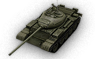<figcaption>T-54</figcaption></figure>
<strong>Penetration (mm)</strong> <b>EU</b>  AP <strong>236</strong> /  HEAT <strong>330</strong> /  HE <strong>50</strong> → <b>RU</b>  AP <strong>241</strong> /  HEAT <strong>330</strong> /  HE <strong>50</strong>

<em>Firepower</em> 
<strong>DPM (HP/min)</strong> <small>EU</small> 2 902.26  <small>RU</small> <strong>2 706.16</strong> 
<strong>Rate of fire (rounds/min)</strong> <small>EU</small> 9.07  <small>RU</small> <strong>8.46</strong> 
<strong>Reload time (s)</strong> <small>EU</small> 6.62  <small>RU</small> <strong>7.09</strong> 
<strong>Shell velocity (m/s)</strong> <small>EU</small> 1 120  <small>RU</small> <strong>895</strong> 

<em>Gun handling</em> 
<strong>Dispersion · moving</strong> <small>EU</small> 0.11  <small>RU</small> <strong>0.14</strong> 
<strong>Dispersion · tank traverse</strong> <small>EU</small> 0.11  <small>RU</small> <strong>0.14</strong> 
<strong>Depression (°)</strong> <small>EU</small> 6  <small>RU</small> <strong>7</strong> 

<em>Mobility</em> 
<strong>Forward speed on soft terrain (km/h)</strong> <small>EU</small> 37.09  <small>RU</small> <strong>56</strong> 
<strong>Engine power (hp)</strong> <small>EU</small> 750  <small>RU</small> <strong>740.10</strong> 
<strong>Power/weight (hp/t)</strong> <small>EU</small> 21.44  <small>RU</small> <strong>21.16</strong> 
<strong>Terrain resist (hard)</strong> <small>EU</small> 0.96  <small>RU</small> <strong>0.24</strong> 
<strong>Terrain resist (med)</strong> <small>EU</small> 1.05  <small>RU</small> <strong>0.58</strong> 
<strong>Terrain resist (soft)</strong> <small>EU</small> 2.11  <small>RU</small> <strong>1.04</strong> 
<strong>Tank traverse (°/s)</strong> <small>EU</small> 58.41  <small>RU</small> <strong>54.24</strong> 
<strong>Tank traverse on hard terrain (°/s)</strong> <small>EU</small> 62.58  <small>RU</small> <strong>59.52</strong> 
<strong>Tank traverse on medium terrain (°/s)</strong> <small>EU</small> 56.89  <small>RU</small> <strong>25.13</strong> 
<strong>Tank traverse on soft terrain (°/s)</strong> <small>EU</small> 28.44  <small>RU</small> <strong>14.01</strong> 

<em>Armor &amp; health</em> 
<strong>Health</strong> <small>EU</small> 1 800  <small>RU</small> <strong>1 750</strong> 

T-54 FL · Tier IX

t54fl

<a href="https://tanks.gg/v20410/tank/t-54-fl">EU stats</a> · <a href="https://tanks.gg/v14600ru/tank/t-54-lf">RU stats</a>
<figure style="display:inline-block"><figcaption>T-54 FL</figcaption></figure>
<strong>Penetration (mm)</strong> <b>EU</b>  AP <strong>236</strong> /  HEAT <strong>330</strong> /  HE <strong>50</strong> → <b>RU</b>  AP <strong>241</strong> /  HEAT <strong>330</strong> /  HE <strong>50</strong>

<em>Firepower</em> 
<strong>DPM (HP/min)</strong> <small>EU</small> 2 902.26  <small>RU</small> <strong>2 706.16</strong> 
<strong>Rate of fire (rounds/min)</strong> <small>EU</small> 9.07  <small>RU</small> <strong>8.46</strong> 
<strong>Reload time (s)</strong> <small>EU</small> 6.62  <small>RU</small> <strong>7.09</strong> 
<strong>Shell velocity (m/s)</strong> <small>EU</small> 1 120  <small>RU</small> <strong>895</strong> 

<em>Gun handling</em> 
<strong>Dispersion · moving</strong> <small>EU</small> 0.11  <small>RU</small> <strong>0.14</strong> 
<strong>Dispersion · tank traverse</strong> <small>EU</small> 0.11  <small>RU</small> <strong>0.14</strong> 
<strong>Depression (°)</strong> <small>EU</small> 6  <small>RU</small> <strong>7</strong> 

<em>Mobility</em> 
<strong>Forward speed on soft terrain (km/h)</strong> <small>EU</small> 37.09  <small>RU</small> <strong>56</strong> 
<strong>Engine power (hp)</strong> <small>EU</small> 750  <small>RU</small> <strong>740.10</strong> 
<strong>Power/weight (hp/t)</strong> <small>EU</small> 21.44  <small>RU</small> <strong>21.16</strong> 
<strong>Terrain resist (hard)</strong> <small>EU</small> 0.96  <small>RU</small> <strong>0.24</strong> 
<strong>Terrain resist (med)</strong> <small>EU</small> 1.05  <small>RU</small> <strong>0.58</strong> 
<strong>Terrain resist (soft)</strong> <small>EU</small> 2.11  <small>RU</small> <strong>1.04</strong> 
<strong>Tank traverse (°/s)</strong> <small>EU</small> 58.41  <small>RU</small> <strong>54.24</strong> 
<strong>Tank traverse on hard terrain (°/s)</strong> <small>EU</small> 58.41  <small>RU</small> <strong>54.24</strong> 
<strong>Tank traverse on medium terrain (°/s)</strong> <small>EU</small> 53.10  <small>RU</small> <strong>22.90</strong> 
<strong>Tank traverse on soft terrain (°/s)</strong> <small>EU</small> 26.55  <small>RU</small> <strong>12.77</strong> 

<em>Armor &amp; health</em> 
<strong>Health</strong> <small>EU</small> 1 800  <small>RU</small> <strong>1 750</strong> 

T-54 ltwt. · Tier IX

t54ltwt

<a href="https://tanks.gg/v20410/tank/t-54-ltwt">EU stats</a> · <a href="https://tanks.gg/v14600ru/tank/t-54-obl">RU stats</a>
<figure style="display:inline-block">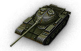<figcaption>T-54 ltwt.</figcaption></figure>
<em>Gun handling</em> 
<strong>Dispersion (m/100 m)</strong> <small>EU</small> 0.39  <small>RU</small> <strong>0.40</strong> 
<strong>Dispersion · damaged</strong> <small>EU</small> 0.79  <small>RU</small> <strong>0.81</strong> 
<strong>Dispersion · firing</strong> <small>EU</small> 3  <small>RU</small> <strong>4</strong> 

<em>Mobility</em> 
<strong>Forward speed (km/h)</strong> <small>EU</small> 75  <small>RU</small> <strong>69</strong> 
<strong>Forward speed on hard terrain (km/h)</strong> <small>EU</small> 75  <small>RU</small> <strong>69</strong> 
<strong>Forward speed on medium terrain (km/h)</strong> <small>EU</small> 75  <small>RU</small> <strong>69</strong> 
<strong>Forward speed on soft terrain (km/h)</strong> <small>EU</small> 75  <small>RU</small> <strong>69</strong> 
<strong>Reverse speed (km/h)</strong> <small>EU</small> 27  <small>RU</small> <strong>23</strong> 
<strong>Engine power (hp)</strong> <small>EU</small> 1 300  <small>RU</small> <strong>1 000</strong> 
<strong>Power/weight (hp/t)</strong> <small>EU</small> 42.43  <small>RU</small> <strong>32.64</strong> 
<strong>Tank traverse (°/s)</strong> <small>EU</small> 50.06  <small>RU</small> <strong>52.15</strong> 
<strong>Tank traverse on hard terrain (°/s)</strong> <small>EU</small> 54.51  <small>RU</small> <strong>65.62</strong> 
<strong>Tank traverse on medium terrain (°/s)</strong> <small>EU</small> 47.69  <small>RU</small> <strong>57.42</strong> 
<strong>Tank traverse on soft terrain (°/s)</strong> <small>EU</small> 31.79  <small>RU</small> <strong>38.28</strong> 

<em>Armor &amp; health</em> 
<strong>Health</strong> <small>EU</small> 1 500  <small>RU</small> <strong>1 300</strong> 

<em>Miscellaneous</em> 
<strong>Stationary camo</strong> <small>EU</small> 17.21  <small>RU</small> <strong>16.30</strong> 
<strong>Stationary camo · after firing</strong> <small>EU</small> 3.79  <small>RU</small> <strong>3.59</strong> 
<strong>Moving camo</strong> <small>EU</small> 17.21  <small>RU</small> <strong>16.30</strong> 
<strong>Moving camo · after firing</strong> <small>EU</small> 3.79  <small>RU</small> <strong>3.59</strong> 
<strong>View range (m)</strong> <small>EU</small> 400  <small>RU</small> <strong>390</strong> 

